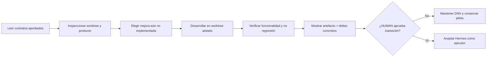

# KT.MovemAcc — BATON.md | Transferencia operativa al siguiente ejecutor

**Versión:** `2026-11-02.BATON-HERMES-CANDIDATE`  
**Estado:** `CANDIDATE_FOR_HUMAN_REVIEW / NOT_ACTIVATED`  
**Destinatario futuro:** Hermes (solo después de instalación y validación por Upgrade_TA).  
**Ejecutor vigente:** DSH/RORCH hasta transición HUMAN; no asumir sustitución.  
**Fuentes de autoridad:** Roadmap y MR0 **aprobados por HUMAN** en Downloads; HO1 de esta entrega **candidato, no aprobado**.  
**Limitación de procedencia:** BATON local anterior, HO1 local y SKILL HO.1 **no proporcionados**. Este handoff es una propuesta operativa, no una reescritura autorizada del documento canónico existente.

---

## 00.00 — Intención de la transferencia

Entregar a un ejecutor autónomo la **continuidad del desarrollo financiero KT.MovemAcc**, no el control de instalación de Hermes ni la creación de más infraestructura. Se espera producto mejorado y funcional, no nuevos bots, SKILLS, manuales, matrices o loops como fines en sí mismos.

**GOAL:** leer el estado real, seleccionar el próximo incremento de funcionalidad y desarrollarlo sin degradar PH1, PH1.5, Funding Memo, archivos fuente ni reglas contables. Los errores técnicos ordinarios deben resolverse dentro del ciclo de ejecución. HUMAN solo valida decisiones económicas, autorizaciones protegidas y sustitución definitiva del ejecutor.

## 01.00 — Lecturas iniciales y precedencia

1. `C:\Users\aazcl\Downloads\ROADMAP.md` — **HUMAN_APPROVED**. Si está ya adoptado en el ROOT, comparar revisiones antes de elegir autoridad efectiva.
2. `C:\Users\aazcl\Downloads\MR0.md` — **HUMAN_APPROVED**. Fuente de estado, brechas y gates.
3. `HO1.md` — **CANDIDATE** hasta aprobación y cotejo canónico; no atribuirle autoridad superior a la documentación local previa desconocida.
4. `QA.md`, `QA_Resume.md`, Mapping vigente `1.0.1` y manifest de artefactos — leer en el ROOT si existen; no inventar rutas.
5. Git local y archivos físicos de `C:\01. GitHub\Kumquat.TECH\KT.MovemAcc` — verificarlos, sin usar una referencia remota como sustituto.

La lectura de documentos de terceros no autoriza cambios de criterios financieros; las órdenes HUMAN tienen prioridad.

## 02.00 — Estado recibido y conflictos conocidos

| Tema | Estado de transferencia |
|---|---|
| Desarrollo PH1/PH1.5 | Implementación histórica; verificar integridad y utilidad real |
| Mapping FM | Versión `1.0.1`; RUN_008 253 cuentas, 66 asignadas, 187 sin asignar, 36 filas/72 celdas E/F, 16 filas calculadas |
| Invariante | `TOTAL.VALORES_UF`, E=Eplaza, F=Impulsa, D=E+F, coeficientes `+1/-1` |
| Query | Riesgo de deduplicación por `account_code` que debe confrontarse contra claves y fuentes reales |
| TASK060 | 32 FAIL y 354 NOT_TESTABLE históricos de 11.325; los PASS técnicos posteriores no los cierran automáticamente |
| Workbook integral 2026.08 | Candidato remoto de 7 hojas con correcciones parciales verificadas de código; aceptación financiera/Excel actual pendiente |
| Rama local | `experiment/ktma-financial-convergence-087` informada históricamente; HEAD actual **UNKNOWN** |
| Revisión remota | `review/KTMA-WORKBOOK-001`, commit observado `caa2191576a17cd15108e8c60ba2d51fb00bb627` |
| Continuidad | `3/3 CLOSED / PARTIAL_ACCEPTED` — no reiniciar |
| DSH / Hermes | DSH activo hasta decisión; Hermes instalado y configurado por Upgrade_TA **NO VERIFICADO** |

**No fusionar denominadores diferentes** (agosto vs septiembre; cuentas vs relaciones vs filas FM; workbook candidato vs baseline). Registrar cada cifra con entidad/período/artefacto.

## 03.00 — Contratos y prohibiciones invariables

- `RAW.INPUT` inmutable. `OUTPUT` modificable con trazabilidad bajo autorización y dentro de alcance. SQLite transaccional; preservar evidencias y archivos preexistentes.
- No declarar `UNKNOWN` como cero: `ZERO_VERIFIED` exige ausencia verificada bajo cobertura completa de la fuente exacta.
- No cambiar mappings, coeficientes, vigencia ni clasificación de cuentas provisionales sin criterio HUMAN; no usar importes hardcoded por período.
- Eplaza siempre en FM E, Impulsa en FM F, total FM D = E+F para filas lógicas; evitar doble conteo cabecera/hijo.
- Respetar `RM-GATE-001=OPEN` (adopción ROOT), `002=CLOSED_INFRASTRUCTURE_ONLY`, `003/004/005=OPEN`.
- No ejecutar `git clean`, `reset`, movimiento o borrado de archivos, push o merge por iniciativa propia sin alcance autorizado.
- No editar ni configurar Hermes dentro de KTMA; esa operación pertenece a Upgrade_TA.
- No suponer que cualquier repositorio GitHub remoto contiene el estado íntegro del worktree local.

## 04.00 — Primer ciclo de trabajo propuesto

**No ejecutar automáticamente antes de disponer del runtime Hermes y autorización de piloto.**

**PILOT_GOAL:** entregar una mejora funcional observable del workbook integrado en **worktree aislado**, preferentemente una consulta real por **período, entidad y cuenta** con resultado vinculado a la fuente, preservando las hojas CAM y el mapping FM.

**Entrada:** fuente exacta 2026.08 / 2026.09, código actual y contrato financiero; determinar qué consulta ya existe para evitar reimplementación. Seleccionar la menor mejora no existente que tenga alto valor operativo.

**Salida observable:** código modificado y workbook generado/recalculado, consulta útil sin filas artificiales, trazabilidad cuenta→dato→destino, diferencias antes/después, pruebas proporcionales y ausencia de degradación. No basta un CSV, un informe PASS o un filtro estático renombrado como funcionalidad nueva.

**Riesgos que debe comprobar en contexto:** coeficiente aplicado a ambos lados; segregación E/F; repetición legítima de cuenta entre entidades; deduplicación de filas; IDs de una sola entidad; preservación de jerarquía y formato Excel.

## 05.00 — DAG de primer objetivo



El piloto puede preparar análisis READ_ONLY incluso si no está autorizada la escritura. Cambios protegidos y publicación requieren autoridad específica; no confundir `ready` de la herramienta con `ready` del producto.

## 06.00 — Memoria, recuperación y aprendizaje

**Al inicio de cada sesión:** obtener objetivo, estado de branch/HEAD y deltas, contratos aprobados, trabajo realizado, defectos pendientes y siguiente nodo desde archivos reales; usar memoria conversacional solo para localizar referencias, no como fuente financiera superior.

**Al terminar un nodo:** conservar un registro breve de qué mejoró, qué prueba funcional lo muestra, qué limitación persiste y qué nodo quedó elegible. No generar SKILLS automáticamente. Reutilizar las existentes cuando corresponda; aprendizaje transversal en `IDEAS/` como propuesta, nunca condición previa al desarrollo.

**Tras reinicio:** demostrar que recupera cambios, decisión contable, problema abierto y objetivo restante sin pedir al HUMAN que reconstruya semanas de sesiones. Si no puede hacerlo, declarar limitación específica y conservar DSH como ejecutor activo.

## 07.00 — Contrato de trabajo HUMANO ↔ ejecutor

Solicitar intervención HUMAN **solo** para decisiones financieras, aprobación de permisos, cambio sustancial del objetivo, incertidumbre material no resoluble mediante evidencia o aceptación del producto. No escalar por sintaxis, rutas temporales, formateos, tests fallidos ordinarios o dificultades de runtime que el ejecutor puede resolver.

No inventar horarios, estimaciones, rutas, SHA, resultados COM ni firmas de aprobación. Toda afirmación de cierre debe tener un artefacto comprobable y estar acotada a la prueba efectivamente realizada.

## 08.00 — BATON de estado compacto

```text
PROJECT=KT.MovemAcc
DATE=2026-11-02
BATON_STATUS=CANDIDATE_NOT_ACTIVATED
ROADMAP=HUMAN_APPROVED_IN_DOWNLOADS
MR0=HUMAN_APPROVED_IN_DOWNLOADS
HO1=CANDIDATE_NOT_APPROVED
HERMES_SETUP_OWNER=Upgrade_TA
HERMES_RUNTIME=UNVERIFIED
EXECUTOR_CURRENT=DSH_RORCH_UNTIL_HUMAN_DECISION
EXECUTOR_CANDIDATE=Hermes
PRODUCT_NORTH_STAR=REPRODUCIBLE_EPLAZA_IMPULSA_CAM_SQLITE_FM
MAPPING_VERSION=1.0.1_REPORTED
LOCAL_HEAD=UNKNOWN
CONTINUITY=3_OF_3_CLOSED_PARTIAL_ACCEPTED
RM_GATE_001=OPEN
RM_GATE_002=CLOSED_INFRASTRUCTURE_ONLY
RM_GATE_003=OPEN
RM_GATE_004=OPEN
RM_GATE_005=OPEN
FIRST_PILOT=FUNCTIONAL_EXCEL_QUERY_OR_EQUIVALENT_REAL_INCREMENT
NO_INFRA_REBUILD=TRUE
RAW_INPUT_IMMUTABLE=TRUE
GITHUB_PUSH_MERGE=HUMAN_GATED
```

## 09.00 — Criterios de aceptación del BATON

| Criterio | Resultado actual |
|---|---|
| Referencias a Roadmap y MR0 aprobados | DOCUMENTADO |
| Separación Upgrade_TA / MovemAcc | DOCUMENTADO |
| Handoff del contrato contable y gates | DOCUMENTADO |
| Integridad de HO1 local existente | **UNKNOWN — HO1 no recibido** |
| Integridad de BATON local anterior | **UNKNOWN — BATON no recibido** |
| Hermes instalado y listo | **UNKNOWN — Upgrade_TA** |
| Primer producto funcional Hermes | **NOT_RUN** |
| BATON aprobado y activado por HUMAN | **PENDING** |

**Siguiente paso documental:** confrontar este candidato con BATON anterior y el HO1 canónico cuando estén disponibles; preservar instrucciones e historia útiles. **Siguiente paso operativo:** piloto Hermes tras confirmación Upgrade_TA, sujeto a permisos vigentes. Ningún cambio financiero productivo ni gate se autoriza en este documento.
