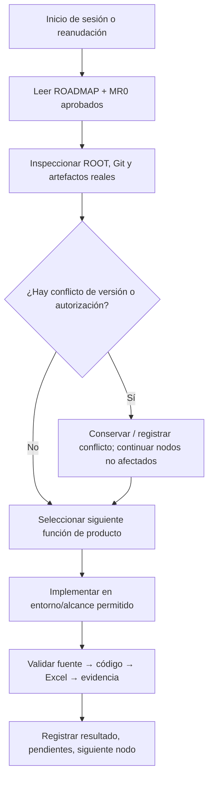

# KT.MovemAcc — HO1.md | Hoja operativa de continuidad, recuperación y handoff

**Revisión:** `2026-11-02.HO1-HERMES-TRANSITION-CANDIDATE`  
**Estado:** `CANDIDATE_FOR_HUMAN_REVIEW / BASELINE_LOCAL_HO1_NOT_READ`  
**Proyecto:** `KT.MovemAcc` · ROOT declarado `C:\01. GitHub\Kumquat.TECH\KT.MovemAcc`  
**Autoridad:** HUMAN → MORCH → ejecutor autorizado (RORCH/DSH vigente; Hermes candidato) → especialistas.  
**Fuentes rectoras:** `ROADMAP.md` y `MR0.md` aprobados por HUMAN, ambos declarados guardados en `C:\Users\aazcl\Downloads`.  
**Restricción de alcance:** Instalación, autenticación, proveedores y runtime Hermes **exclusivamente bajo Upgrade_TA**.  
**Nota de procedencia:** No se recibió la versión local de HO1 ni `HO.1_Skiils.md`; este documento define un *contrato de continuidad candidato*. No sustituye, deroga ni certifica el contenido canónico no consultado. La integración exige `semantic diff` con HO1 real.

---

## 00.00 — Resultado ejecutivo y regla rectora

**Propósito:** preservar el progreso de desarrollo y permitir que el próximo ejecutor retome de manera segura la siguiente funcionalidad concreta, sin reinstalar infraestructura, reabrir continuidad cerrada, reinterrogar al HUMAN sobre decisiones ya tomadas o aceptar informes técnicos como certificación financiera.

**North Star:** sistema operativo de integración contable Eplaza/Impulsa con CAM (PH1), datos trazables SQLite (PH1.5), reglas de mapeo al Funding Memo (PH2), consulta funcional y reportes mensuales comparables. `QUALITY_OF_PRODUCT > REPORT_ACTIVITY` y desarrollo funcional > proliferación de SKILLS, bots, loops o governance.

**Estado de aprobación documental:** HUMAN aprobó Roadmap y MR0 para conservar en Downloads; **no se observó** su incorporación/identidad en ROOT. Este HO1 está **pendiente** de aprobación.

## 01.00 — Inventario de fuentes de autoridad y precedencia

| Orden | Fuente | Alcance | Verificación |
|---|---|---|---|
| 1 | Decisiones HUMAN y contratos contables vigentes | Reglas y autorización | Aceptado por declaración HUMAN |
| 2 | `C:\Users\aazcl\Downloads\ROADMAP.md` | Dirección, Waves y dependencias | Aprobado por HUMAN; bytes físicos locales no verificados aquí |
| 3 | `C:\Users\aazcl\Downloads\MR0.md` | Estado, discrepancias, próximo DAG, gates | Aprobado por HUMAN; bytes físicos locales no verificados aquí |
| 4 | HO1 local vigente, cuando se suministre | Continuidad, procedimientos y memoria | **NO LEÍDO / NO SUSTITUIR** |
| 5 | Código, RAW y manifest de RUN en ROOT real | Verdad material de ejecución | Requiere inspección local |
| 6 | Informes RORCH, GitHub remoto y conversaciones | Evidencia contextual; no autoridad productiva automática | Distinguir observación de relato |

**Regla de conflictos:** evidencia más fuerte prevalece solo sobre hechos observables; no sustituye criterio financiero HUMAN. Registrar conflicto y su materialidad, no resolverlo mediante adivinación.

## 02.00 — Estado estable del producto por módulos

| Módulo | Baseline reconocido | Qué recuperar / siguiente función | Límite |
|---|---|---|---|
| `RM-FIN-001` PH1 | CAM Eplaza + Impulsa, formato/hierarquía y auditoría histórica | Reproducir CAM de cada período preservando esquema y contenido relevante | No copiar hojas como sustituto de ingeniería |
| `RM-DAT-001` PH1.5 | SQLite y linaje por período | Consultas útiles por entidad/período/cuenta, comparación multiperíodo | Transacciones; no mutar RAW |
| `RM-PH2-001` FM | RUN_008: 253 cuentas, 66 asignadas, 187 sin asignar, 36 filas/72 celdas E/F, 16 filas calculadas; mapping 1.0.1 | Comprobar entidad, coeficiente, unicidad y uso financiero del workbook | No extrapolar denominadores entre períodos o candidatos |
| `RM-REC-001` | TASK060 11.325 casos históricos: 10.939 PASS, 32 FAIL, 354 NOT_TESTABLE | Matriz de casos y autoridad financiera separadas | `32 resueltos técnicamente` no equivale a aceptación |
| `RM-AUD-001` | 29 WARN reportados, 11 vinculados / 18 abiertos en baseline | Estado por AUDIT_ID | No promover advertencias a PASS sin evidencia |
| `RM-QA-001` | Suites y comparaciones técnicas históricas | Validar cambios del producto con pruebas enfocadas | Reporte PASS ≠ Excel funcional aceptado |
| `RM-ROOT-001` | NTV/CIRL y worktree potencialmente dirty | Control de deltas y rutas, sin limpieza destructiva | No reubicar ni borrar sin autorización |

## 03.00 — Contratos financieros que no se pueden olvidar

1. Única base para mapping: `TOTAL.VALORES_UF` por cuenta/entidad/período; origen **acumulado hasta 23:59 de fin de período**, no movimiento del mes por defecto.
2. Funding Memo: **E = Eplaza**, **F = Impulsa**, **D = E + F** por partida lógica; coeficientes `+1`/`-1` aplicados antes de agregar.
3. Una cuenta/identidad contable no aporta más de una vez a un mismo esquema de destino autorizado; un destino puede agregar N cuentas. Examinar identidad compuesta, duplicados y aparición legítima en ambas entidades.
4. Una ausencia `ZERO_VERIFIED` demanda RAW/período completo; `UNKNOWN` no puede convertirse en cero; `SIN_ASIGNACION_FM` debe permanecer visible.
5. Mapping versionado, cambio gerencial/Directorio con fecha de comunicación **distinta de** vigencia contable, reversibilidad y registro histórico.
6. IVA construcción `120971`, `120973`: consultar contador, sin multiplicar automáticamente por 1,19; `120972` conserva provisionalmente signo negativo; `121031` y `410457` conservan clasificación provisional hasta decisión HUMANA.
7. RAW.INPUT inmutable; OUTPUT regenerable controlado; SQLite con writes transaccionales y rollback según permisos.

## 04.00 — Entornos, rutas, evidencia e integridad

**Entorno declarado:** Windows 11, PowerShell y WSL2. ROOT `C:\01. GitHub\Kumquat.TECH\KT.MovemAcc`; descargas `C:\Users\aazcl\Downloads` y en WSL `/mnt/c/Users/aazcl/Downloads` sujeto a existencia.

**Incidente histórico:** conversiones Unicode del `:` y `\`, rutas aparentes `C/Users/...` creadas dentro del ROOT o en virtualización. Todo archivo ofrecido como entrega debe comprobarse físicamente en el destino solicitado; *escritura reportada* no demuestra persistencia correcta.

**Controles mínimos de read-back (sin ejecutar en esta elaboración):**

```powershell
$Root = 'C:\01. GitHub\Kumquat.TECH\KT.MovemAcc'
$Downloads = 'C:\Users\aazcl\Downloads'
Test-Path -LiteralPath $Root
Test-Path -LiteralPath (Join-Path $Downloads 'ROADMAP.md')
Test-Path -LiteralPath (Join-Path $Downloads 'MR0.md')
Get-Item -LiteralPath (Join-Path $Downloads 'ROADMAP.md')
Get-Item -LiteralPath (Join-Path $Downloads 'MR0.md')
git -C $Root status --porcelain=v1
git -C $Root branch --show-current
git -C $Root rev-parse HEAD
```

No hacer `git reset`, `clean`, `checkout`, push, merge ni borrar archivos para obtener un árbol limpio. Registrar tracked/untracked/ignored y residuos sin alterar material protegido.

## 05.00 — Estado Git y autorización

- Rama experimental local informada: `experiment/ktma-financial-convergence-087`, con HEADs cambiantes en RUNs; **HEAD ACTUAL = UNKNOWN** hasta lectura local.
- Rama remota de revisión autorizada históricamente: `review/KTMA-WORKBOOK-001`; no inferir permiso de publicar otras ramas.
- Commit remoto observado en revisión: `caa2191576a17cd15108e8c60ba2d51fb00bb627`. El commit mismo no demuestra validación funcional del binario en Excel Desktop.
- `CONTINUITY_ITERATION = 3/3 CLOSED; PARTIAL_ACCEPTED`; **NO REOPEN**.
- `RM-GATE-001 = OPEN` para adopción canónica, pese a aprobación de descargas; `002 = CLOSED_INFRASTRUCTURE_ONLY`; `003/004/005 = OPEN`.

## 06.00 — Recuperación de sesión por ejecutor



**Recuperación mínima:** objetivo vigente, módulos terminados y abiertos, worktree/HEAD real, qué archivo/hoja/celda prueba la función, permisos, discrepancias y siguiente TASK ejecutable. No transcribir todas las conversaciones ni resetear contexto sin necesidad.

**Reanudación después de interrupción:** buscar checkpoint real, detectar efectos parciales y escritores pendientes; reanudar nodo idempotente si es seguro. Si no lo es, detener solo ese nodo, preservar RAW/outputs y escalar hechos concretos. La continuidad documental no concede autorizaciones nuevas.

## 07.00 — Gestión de ejecución y paralelismo

Conservar método NTV/CIRL existente de modo proporcional: `GOAL → DAG/LOOP → ejecución → CROSS_CHECK → cierre del nodo`. Un solo agente puede desarrollar si basta. Especialistas/bots solo cuando aporten capacidad específica, sin fabricar una nueva estructura para cada fallo.

- Paralelizar solo frentes independientes y sin escrituras concurrentes sobre workbook/SQLite/archivo protegido.
- Diagnosticar y autocorregir defectos ordinarios; HUMAN decide únicamente finanzas, dirección y excepciones materiales.
- Preservar trabajo útil y no aceptar regresión de funcionalidades.
- No volver a iniciar la reconstrucción de continuidad cerrada 3/3.

## 08.00 — Dependencia Upgrade_TA / Hermes

Upgrade_TA instala/configura Hermes, proveedores multimodelo, herramientas, aislamiento y memoria. **Ningún instalador ni configuración de runtime entra en el DAG de construcción financiera KT.MovemAcc.**

Cuando Upgrade_TA informe `READY`, MovemAcc solo debe validar un piloto acotado:

1. Abrir el repositorio/worktree aislado y recuperar correctamente Roadmap, MR0, HO1 y BATON.
2. Explicar qué se debe construir y qué está bloqueado sin requerir una nueva narración humana.
3. Implementar una mejora funcional real de workbook/consulta, usando fuentes verificadas.
4. Reiniciar sesión y recuperar decisiones, cambios, issues y siguiente nodo sin perder ni alterar RAW.
5. Mostrar comparación antes/después, limitaciones reales y resultado operativo.

**Criterio de sustitución:** solo HUMAN decide abandonar DSH como ejecutor principal tras observar mejor producto y continuidad. No instalar DSH Superagent ni replicar infra por esta vía.

## 09.00 — Próximo DAG de producto

| Orden | Nodo existente | Entregable observable | Dependencia |
|---|---|---|---|
| P0-A | `RM-FIN-001` | Workbook CAM/PH1 íntegro y comprobable en Excel | Baseline y fuentes del período |
| P0-B | `RM-PH2-001` | FM E/F/D conciliado con signos, coeficientes y mapping autorizado | PH1 + contrato financiero |
| P0-C | `RM-DAT-001` | Consulta por cuenta, período y entidad; sin duplicación artificial | Datos consolidados / SQLite |
| P0-D | `RM-REC-001` | Estado caso a caso TASK060 y excepciones independientes | Evidencia histórica |
| P1-A | `RM-AUD-001` | 29 WARN con estatus veraz | Fuentes y decisiones HUMAN para criterios |
| P1-B | `RM-FIN-001` + `RM-DAT-001` | Operación mensual 2026.08/09 reproducible y diferencias explicadas | Dos datasets identificados |
| Externo | Upgrade_TA | Hermes instalado y validado para piloto | Fuera de implementación KTMA |

## 10.00 — Stop conditions y retorno a HUMAN

**Detener solo la operación involucrada cuando:** se pretende escribir RAW, modificar un criterio financiero no aprobado, publicar/mergear sin gate, borrar material protegido, sobrescribir artefactos aceptados sin respaldo o no se puede establecer identidad correcta de fuente/binario tras intentos técnicos razonables.

**Solicitar a HUMAN:** decisión financiera puntual (archivo, hoja, celda, alternativas e impacto), permiso protegido o sustitución definitiva del ejecutor. No trasladar al HUMAN errores cotidianos de programación.

## 11.00 — Matriz de continuidad y salud

| Indicador | Estado al elaborar HO1 | Evidencia necesaria |
|---|---|---|
| Roadmap | HUMAN_APPROVED_IN_DOWNLOADS | Read-back local / adopción posterior |
| MR0 | HUMAN_APPROVED_IN_DOWNLOADS | Read-back local / adopción posterior |
| HO1 | CANDIDATE | Revisión HUMAN + cotejo HO1 local |
| BATON | CANDIDATE por separado | Revisión HUMAN + cotejo BATON previo |
| PH1 / FM productivos | NOT_ACCEPTED | Contratos financieros y Excel real |
| Local HEAD | UNKNOWN | git local read-only |
| Hermes | EXTERNAL_NOT_VERIFIED | Upgrade_TA |
| NTV/CIRL | REQUIRED | Observación en próximo trabajo |
| Gate 001/003/004/005 | OPEN | HUMAN / acto específico |

## 12.00 — Protocolo de reconciliación documental y actualización

1. Identificar archivo HO1 canónico local y SKILL `HO.1_Skiils.md` si existen.
2. Leerlos integralmente; comparar contra este candidato sección/ID/decisión, sin pérdida de contenido útil.
3. Conservar baseline anterior íntegro como historial o anexo cuando corresponda y registrar conflictos.
4. Aplicar únicamente cambios que completen o actualicen información; no reemplazar el documento local completo por defecto.
5. Verificar existencia física y contenido del HO1 finalmente integrado y documentar versión/decisión de adopción.
6. Solo después actualizar BATON para señalar **el HO1 efectivamente aprobado**, no un supuesto.

**Terminal:** `HO1_DOCUMENT_CANDIDATE_READY; CANONICAL_MERGE_UNVERIFIED; HERMES_READY_UNKNOWN; FINANCIAL_GATES_UNCHANGED`.

---

## ANEXO H — BASELINE HO1 HISTÓRICO (RECONCILED-TASK060)

> **ARCHIVAL / BASELINE HISTÓRICO.** El contenido siguiente corresponde íntegramente a la versión `RECONCILED-TASK060` (2026-10-19) que existía en Git HEAD antes de la integración 2026-11-02. Se preserva como evidencia de continuidad y para referencia de hashes financieros específicos.

### Identity histórico
```text
PROJECT=KT.MovemAcc
TASK_OR_THREAD=KTMA_TASK060_CONTINUITY_RECONCILIATION_AND_FINANCIAL_PROOF
DATE=2026-10-19
OWNER=HUMAN
HANDOFF_FROM=MORCH (Meta-Orchestrator)
HANDOFF_TO=Próximo MORCH/RORCH autorizado o nueva sesión
ROOT=C:\01. GitHub\Kumquat.TECH\KT.MovemAcc
BRANCH=main
HEAD=e948336cd790d998e4af6243d00246989404897e
COMMIT_STATUS=HEAD_e948336_UNCHANGED; BOOTSTRAP_AND_GOVERNANCE_CANONICAL_LOCAL_NOT_GIT_PUBLISHED
```

### Evidence pins históricos (hashes financieros específicos)
```text
LATEST_VERIFIED_EVIDENCE=GitHub/local/remote HEAD e948336cd790d998e4af6243d00246989404897e verificado en TASK052; SQLite DATA/KTMA.sqlite hash b5f6... e integrity=ok verificados read-only en TASK052; TASK048 runtime Python/imports histórico
PH1_ACCEPTED_WORKBOOK_SHA256=38a3ffe730a2d1faa1da63fdd085d4ef4d1330ff73fa25622a73fa50fbbfcfd3
PH15_DATABASE_SHA256_REPORTED=b5f6b6eae6dcb2f1273f8e5d1706b6db30e52d9250ad148b68e88881ffac60d0
EVIDENCE_PATHS=03_DOCS/MANAGEMENT/MR0_DECISION_REGISTER.md; MR0_RISK_REGISTER.md; HO1_ROADMAP_INPUTS.md; ROADMAP_DAG.md; ROADMAP_DECISIONS.md; 04_CONFIG/CRITERIA/PH1_CRITERIA_REGISTER.json; 03_DOCS/MACHINE/PH15_TO_PH2_READ_CONTRACT.md
PROMPT_FILES=No se ha verificado la existencia de prompts físicos del proyecto. TASK047/048/049/050/051 instrucciones constan en conversación; no inventar rutas.
SOURCE_PATHS=01_CONTINUITY/MORCH/; 02_SKILLS/TRANSVERSAL/; 02_SKILLS/INTERNAL/ (vacía según inventario); 03_DOCS/MANAGEMENT/MR0_INTEGRATED_REVIEW.md; ROADMAP_INTEGRAL.md; HO1_RUNBOOK.md
```

### READ_PLAN canónico MORCH (histórico)
```text
READ_PLAN_STATUS=CANONICALLY_ADOPTED_LOCAL
1. Leer 01_CONTINUITY/MORCH/MORCH_START.md.
2. Leer 01_CONTINUITY/MORCH/MORCH_INDEX.json.
3. Recuperar estado y autoridad desde 01_CONTINUITY/MORCH/MORCH.md y 01_CONTINUITY/MORCH/MORCH.json.
4. Validar 01_CONTINUITY/MORCH/MORCH_MANIFEST.json.
5. Recuperar MR.0, Roadmap y HO.1 vigentes según índice.
6. Contrastar HEAD y evidencia local/remota.
7. Aplicar gates y STOP_IF.
8. Continuar únicamente con nodos autorizados.
```

### Terminal convergence histórico
```text
TARGET=HO1_HANDOFF
PROJECT=KT.MovemAcc
STATUS=NOT_READY_FINANCIAL_DIFFERENCES
AUTHORITY=HUMAN
CURRENT_STATE=PH1_PH15_ACCEPTED_PUBLISHED; BOOTSTRAP_CANONICAL_LOCAL; RM_GATE_002_CLOSED_INFRASTRUCTURE_ONLY
LATEST_EVIDENCE=TASK060 continuidad reconciliada; matriz determinista 10.939 PASS, 32 FAIL, 354 NOT_TESTABLE; hashes financieros preservados
OPEN_GATES=RM-GATE-001;RM-GATE-003;RM-GATE-004;RM-GATE-005
CLOSED_GATES=PH1;PH1.5;controlled publication;RM-GATE-002 infrastructure only
NEXT_DAG=resolve or explicitly adjudicate TASK060 Excel-SQLite differences -> re-evaluate RM-GATE-003; keep PH2 blocked pending RM-GATE-003 and RM-GATE-004
NEXT_ACTION=HUMAN financial acceptance decision
DO_NOT=Unapproved mutation / publication / upgrade / PH2
RISKS=Privacy, RAW versioning, HUMAN financial acceptance pending
STOP_IF=Authorization/evidence/state conflict
HANDOFF_QUALITY=PASS
TERMINAL_CONVERGENCE=CONTINUITY_RECONCILED_HUMAN_GATE_PENDING
```
