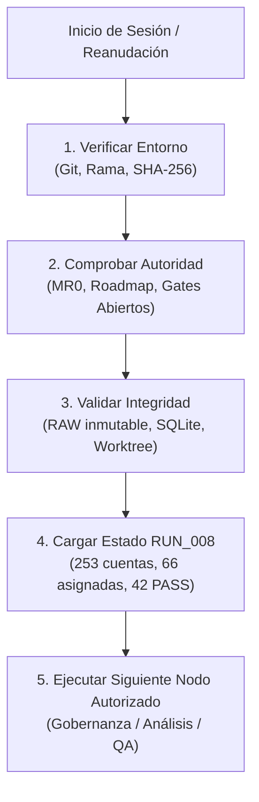

# KT.MovemAcc — HO.1 | Continuidad operativa y reanudación segura

**Autor:** Pablo San Martín (Baseline) / RORCH (Reconciliación y Perfeccionamiento)  
**Fecha de actualización:** 30 de octubre de 2026  
**Versión:** `2026-10-30.RUN_008_RECONCILED`  
**Estado:** `CANÓNICO OPERATIVO / RUN_008`  
**Documentos rectores:** `KTMA_HOJA_DE_RUTA_20261021_PABLO_SAN_MARTIN.md`, `KT_MovemAcc_ROADMAP_20261030.md`, `KTMA_MR0_20261021_PABLO_SAN_MARTIN.md`  
**Rama experimental:** `experiment/ktma-financial-convergence-087`

---

## 1. Propósito y alcance de HO.1

HO.1 responde a una necesidad práctica: **que una persona o un agente pueda retomar KT.MovemAcc sin reconstruir el contexto completo ni poner en riesgo los archivos financieros**. Contiene identidad del proyecto, qué está aprobado, situación real reportada, dónde buscar información, comprobaciones previas, secuencia para continuar y qué hacer ante un bloqueo.

No es la hoja de ruta ni un nuevo registro de criterios financieros. El estado detallado de frentes corresponde a MR0 y las respuestas aprobadas corresponden a QA.

---

## 2. Identificación inmediata y entorno

| Campo | Referencia |
|---|---|
| Responsable de las decisiones | Pablo San Martín (HUMAN) |
| Proyecto | KT.MovemAcc |
| Raíz de Windows esperada | `C:\01. GitHub\Kumquat.TECH\KT.MovemAcc` |
| Raíz de WSL esperada | `/mnt/c/01. GitHub/Kumquat.TECH/KT.MovemAcc` |
| Rama de experimentación | `experiment/ktma-financial-convergence-087` |
| HEAD Git actual | `b70186b8bd5ad25a4ccaa4c0716e012d8d8dcbf9` (MR0 canónico perfeccionado) |
| Fase contable | Fase 1: consolidación CAM; Fase 1.5: normalización / SQLite |
| Informe financiero | Funding Memo (PH2) — Prototipo de validación |
| Autorización de Fase 1 | `RM-GATE-003=ABIERTO` (Revisión técnica aceptada, sin aprobación productiva) |
| Autorización de Funding Memo | `RM-GATE-004=ABIERTO` (Prototipo de validación sin mapeo definitivo) |
| Contrato NTV / CIRL | Activo y permanente en cada ciclo |

**Regla de seguridad:** Las rutas son las *esperadas*. Antes de operar, comprobar el directorio físico, la rama y los archivos; no crear carpetas nuevas para compensar una ruta inexistente. `RAW.INPUT` se mantiene estrictamente inmutable.

---

## 3. Resumen de continuidad en cinco minutos

1. **Primer minuto — Identidad:** Comprobar la raíz física real, el estado de Git (`experiment/ktma-financial-convergence-087`) y que el worktree respeta la inmutabilidad de `RAW.INPUT`.
2. **Segundo minuto — Autoridad:** Leer la hoja de ruta aprobada, MR0 actualizado (RUN_008), `QA_Resume.md` y las normas NTV vigentes. Confirmar que los puntos de aprobación financiera siguen abiertos.
3. **Third minuto — Integridad:** Validar hashes SHA-256 de entradas protegidas (`RAW.INPUT`, bases SQLite y outputs canónicos).
4. **Cuarto minuto — Situación:** Consultar las métricas RUN_008: 253 cuentas contables, 66 asignadas, 187 sin asignar, 72 destinos FM (36 filas lógicas), 16 partidas calculadas (16/16), 42 regresiones PASS.
5. **Quinto minuto — Próxima acción:** Continuar con frentes analíticos de solo lectura, gobernanza de mapeo o preparación de decisiones financieras para HUMAN.

---

## 4. Dónde está cada recurso clave

| Recurso | Ruta canónica |
|---|---|
| Hoja de ruta | `03_DOCS/MANAGEMENT/KTMA_HOJA_DE_RUTA_20261021_PABLO_SAN_MARTIN.md` |
| Registro Maestro (MR0) | `03_DOCS/MANAGEMENT/KTMA_MR0_20261021_PABLO_SAN_MARTIN.md` |
| Continuidad (HO.1) | `03_DOCS/MANAGEMENT/KTMA_HO1_20261021_PABLO_SAN_MARTIN.md` |
| Runbook operativo | `03_DOCS/MANAGEMENT/HO1_RUNBOOK.md` |
| Base de datos SQLite (PH1.5) | `DATA/KTMA.sqlite` |
| Modelos de alineación CAM | `OUTPUT/2026.08/CAM2026.08_CONSOL.ALIGN.xlsx` |
| Validación Funding Memo | `OUTPUT/2026.08/FM2026.08_VALIDATION.xlsx` |

---

## 5. Secuencia obligatoria de reanudación y STOP_IF

* **STOP_IF:**
  - Desviación en el hash de `RAW.INPUT` o de archivos protegidos.
  - Modificación no autorizada de celdas financieras en `OUTPUT`.
  - Intento de declarar aceptación financiera productiva sin validación explícita de HUMAN (`RM-GATE-003` / `RM-GATE-004`).
  - Pérdida de trazabilidad en los scripts de prueba.

---

## 6. Diagrama de flujo de continuidad (Mermaid)

---

## 7. Control de cambios y custodia

* Versión unificada y reconciliada sin pérdida, incorporando las directrices del Roadmap 2026-10-30 y el estado funcional RUN_008, manteniendo intacta la estructura de seguridad y continuidad de Pablo San Martín.
