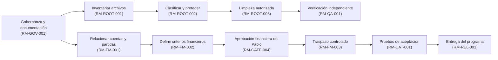
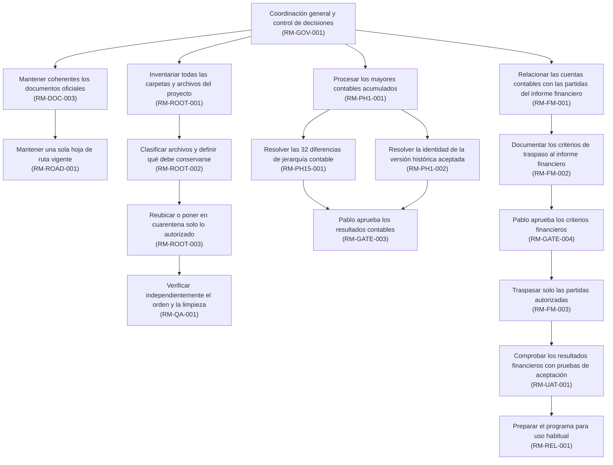
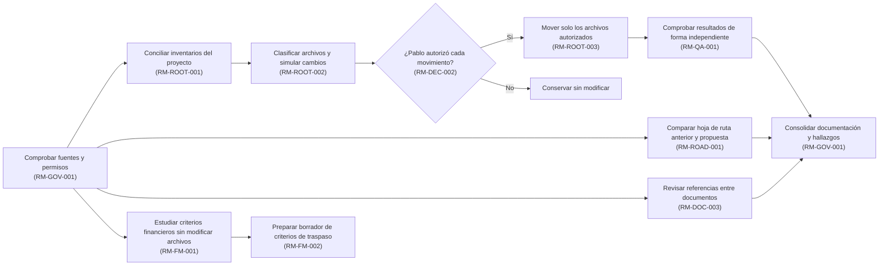
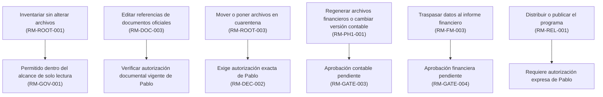

# KT.MovemAcc — Hoja de ruta integral actualizada

**Autor:** Pablo San Martín  
**Versión:** `2026-10-21 / MORCH-BORRADOR-v2`  
**Estado:** `PROPUESTO_PARA_REVISION_HUMANA` — documento descargable; **no instalado ni declarado oficial en la raíz del proyecto**.  
**Ámbito:** gobernanza, documentación, orden y limpieza de la raíz del proyecto, fase 1/fase 1.5, sincronización contabilidad → informe financiero denominado Funding Memo (fase 2), producto final.  
**Raíz del proyecto esperada:** `C:\01. GitHub\Kumquat.TECH\KT.MovemAcc`  
**Rama esperada:** `experiment/ktma-qa-harness-004`; HEAD reportado `e948336cd790d998e4af6243d00246989404897e`.  
**Fuentes del estado:** declaraciones HUMAN, reporte `KTMA_NTV_011` de RORCH y `KTMA_SPECIALIST_001–003` de Codex Desktop + NTV. Estos últimos son **reportes de ejecutores**, no auditoría independiente de la raíz del proyecto realizada en esta sesión. Diseño conforme a la estructura de `ROADMAP_Skills2.md` y a los controles de `SKILLS.QA.TRANSVERSAL.md` compartidos.

## 1. Objetivo principal

Entregar una solución autónoma y reproducible que procese mayores contables acumulados por entidad (fase 1), preserve semántica financiera y evidencia de procedencia (fase 1.5), y rellene **solo partidas autorizadas** de un informe financiero denominado Funding Memo (fase 2), con conciliación independiente, trazabilidad celda–cuenta y operación final sencilla (interfaz de comandos en Windows y posteriormente `.exe`/Docker). Mantener raíz del proyecto ordenado, documentación oficial inequívoca, controles NTV efectivos y decisiones financieras HUMAN.

**Principio rector:** `APROBADO_POR_HUMAN ≠ VERIFICADO_TÉCNICAMENTE ≠ APROBACIÓN_INFORMADA`. Ningún resultado de ejecución cierra por sí solo una autorización de negocio.

## 2. Estado actual — 21-10-2026

| ID | Estado reportado | Evidencia / reserva |
|---|---|---|
| RM-DOC-001 | `VERIFICACIÓN_INFORMADA` NTV011 | `QA.md` → `03_DOCS/HUMAN/QA.md`; SHA256 `aaeaa517…a0f0617` |
| RM-DOC-002 | `VERIFICACIÓN_INFORMADA` NTV011 | `QA_Resume.md` → `03_DOCS/HUMAN/QA_Resume.md`; SHA256 `01a0d470…37dfe8` |
| RM-SKL-001 | `VERIFICACIÓN_INFORMADA` NTV011 | `QA_SKILLS.MovemACC_QA.md` → `02_SKILLS/INTERNAL/QA_SKILLS.MovemACC_QA.md`; SHA256 `d550e2b5…1334d79b`; descubrimiento/carga/prueba funcional reportados |
| RM-fase 1-001 | `PARCIAL` | Motor fase 1 autónomo reportado en interfaz de comandos; validación Windows nativa con insumos reales de octubre todavía pendiente; hash del fase 1 histórico aceptado (`38a3f…`) no recuperado |
| RM-PH15-001 | `FALLOS_ABIERTOS` | 32 discrepancias fase 1–fase 1.5 clasificadas `DIFERENCIA_DE_SEMÁNTICA_DE_ORIGEN`, asociadas a Impulsa; no convertir en PASS sin cambio autorizado y reverificación |
| RM-FM-001 | `CORRESPONDENCIAS_PARCIALES` | SPECIALIST_003: 72 destinos; 15 técnicamente verificados, 18 ambiguos, 37 sin correspondencia, 2 propuestos; **0 mapeos HUMAN aprobados** |
| RM-FM-002 | `PLANIFICADO` | `ACC_FM_Sync.md`: contrato financiero futuro, **no creado ni aprobado** |
| RM-ROOT-001 | `INFORMES_CONTRADICTORIOS` | SPECIALIST_003: 32 archivos con rutas malformadas + 6 pruebas en `BACKUPS`; RORCH NTV011: 0 rutas malformadas/raíz verificada, **sin movimientos de limpieza reportados**. Requiere inventario de misma raíz del proyecto/alcance antes de declarar limpio |
| RM-GATE-003 | `ABIERTO` | Aceptación fase 1/fase 1.5 y prueba piloto, de titularidad HUMAN |
| RM-GATE-004 | `ABIERTO` | Aprobación de criterios/mapeos informe financiero (Funding Memo) y salida fase 2, de titularidad HUMAN |

**Decisión temporal HUMAN vigente:** cada mayor entregado contiene **movimientos acumulados desde el día 0 del proyecto hasta el cierre del último día del período, 23:59**. Para agosto 2026: hasta 31-08-2026 23:59. Esta definición de alcance temporal no resuelve por sí sola las reglas de reconocimiento, signos, moneda, activación y agregación de cada partida.

**Restricción de custodia:** `C:\Users\aazcl\Downloads` es temporal (limpieza potencial tras ~24 horas); no es repositorio ni archivo canónico. No concatenar rutas Windows a raíz del proyecto en WSL.

## 3. Estado objetivo

1. Documentación y instrucciones especializadas HUMAN aprobadas instaladas con fuente/destino SHA256 idénticos, rutas e índices correctos, descubrimiento funcional probado.
2. Un único hoja de ruta vigente identificado; histórico preservado sin dobles autoridades; QA y `ACC_FM_Sync.md` con responsabilidades distintas.
3. raíz del proyecto inventariado hasta alcance verificable, sin rutas malformadas activas ni resultados de pruebas colocados impropiamente; cada artefacto clasificado, migrado o retenido por política y autorización.
4. fase 1/fase 1.5 conciliados, con 32 casos resueltos mediante regla semántica autorizada, evidencia numérica y pruebas independientes; versión de referencia histórica y cambio de huella digital documentados.
5. `ACC_FM_Sync.md` aprobado por HUMAN, 72 destinos con identidad de origen y tratamiento explícito, sin dobles conteos ni fórmulas sobreescritas.
6. informe financiero Funding Memo completado **solo después de aprobación explícita**, en copia controlada y con verificación independiente, preservando V0 histórica.
7. Producto operable mensualmente, probado en Windows nativo; posterior empaquetado `.exe`/Docker sujeto a la madurez de fase 1/fase 2.

## 4. Estrategia

**Primero verdad documental y sistema de archivos; después limpieza reversible; en paralelo análisis financiero de solo lectura; finalmente mutaciones financieras y versión distribuible bajo autorizaciones.** No bloquear análisis financiero inicial por limpieza que no afecte sus entradas. La hoja de ruta no sustituye backlog, MR.0, HO.1, QA, contrato fase 1 o el futuro `ACC_FM_Sync.md`.

Higiene: **inventariar → clasificar → comprobar huellas digitales y dependencias → simular → solicitar autorización de Pablo → mover a cuarentena → verificar independientemente → cerrar**. Sin borrado automático. Los archivos desconocidos son `RETENIDO_HASTA_CLASIFICAR`.

## 5. Catálogo de componentes

| ID | Nombre / tipo | Responsable | Estado | Salida verificable y dependencia |
|---|---|---|---|---|
| RM-GOV-001 | Gobernanza NTV / frente de trabajo | MORCH + RORCH | ACTIVO | Contratos de aceptación, autoridad HUMAN, matriz de autorizaciones |
| RM-DOC-001 | Historial de preguntas y respuestas / hito | RORCH | APROBACIÓN_INFORMADA | Hash origen=destino; registro oficial y referencias |
| RM-DOC-002 | Resumen de preguntas y respuestas / hito | RORCH | APROBACIÓN_INFORMADA | Hash origen=destino; consistencia con Historial de preguntas y respuestas |
| RM-SKL-001 | instrucción especializada interna de control de calidad / hito | RORCH | APROBACIÓN_INFORMADA | Descubrimiento + carga + prueba de comportamiento |
| RM-ROAD-001 | Unicidad hoja de ruta / frente de trabajo | RORCH | PENDIENTE | Identificar hoja de ruta canónica, comparación/delta, conservar versión histórica, promover solo con autoridad |
| RM-DOC-003 | Integridad documental / frente de trabajo | RORCH | PENDIENTE | Índices, enlaces, HO.1, archivo de presentación (README), caso de uso (UseCase) y hoja de ruta alineados sin reescribir contenido HUMAN |
| RM-ROOT-001 | Inventario raíz del proyecto contradictorio / frente de trabajo | RORCH + verificador | PENDIENTE_CRÍTICO | Inventario recursivo exacto, ruta física real, hashes, diferencias entre reportes NTV011 y SPECIALIST_003 |
| RM-ROOT-002 | Clasificación y retención / frente de trabajo | RORCH | BLOQUEADO_POR_RM-ROOT-001 | Cada archivo objetivo: `CANÓNICO`, `EVIDENCIA_INMUTABLE`, `DERIVADO_REPRODUCIBLE`, `DESCARTABLE`, `RETENIDO_HASTA_CLASIFICAR` |
| RM-ROOT-003 | Cuarentena y reubicación / frente de trabajo | RORCH | REQUIERE_AUTORIZACIÓN_HUMANA | Lista exacta autorizada, simulación sin cambios, reversión, preservación de hashes, sin borrado forzoso |
| RM-QA-001 | verificación independiente documentación/raíz del proyecto / frente de trabajo | verificador distinto | PENDIENTE | Comparación de inventarios registrados antes/después, pruebas de rutas malformadas y de no mutación |
| RM-fase 1-001 | fase 1 acumulado / frente de trabajo | RORCH | PARTIAL | Reproducción en Windows nativo, entrada XLSB y salida aislada, mismos invariantes |
| RM-PH15-001 | 32 fallos de jerarquía / frente de trabajo | SPECIALIST | FALLOS_ABIERTOS | Diagnóstico contable + regla HUMAN + reverificación comparadores |
| RM-fase 1-002 | Versión de referencia aceptada / frente de trabajo | RORCH + HUMAN | BLOCKED | Recuperar bytes/hash aceptados o decisión HUMAN explícita sobre drift |
| RM-FM-001 | Matriz 72 destinos / frente de trabajo | SPECIALIST | PARTIAL | 15 técnico, 18 ambiguo, 37 sin correspondencia, 2 propuesto, ninguna aprobación HUMAN |
| RM-FM-002 | `ACC_FM_Sync.md` / frente de trabajo | SPECIALIST redacta, HUMAN aprueba | PLANIFICADO | Reglas por celda/cuenta, versiones, fuentes, aprobación y QA; no crear como oficial anticipadamente |
| RM-FM-003 | Poblamiento fase 2 / frente de trabajo | RORCH | BLOQUEADO_POR_APROBACIÓN | Salida FM controlada; no modificar V0 ni fórmulas no autorizadas |
| RM-UAT-001 | pruebas de aceptación financiero y prueba piloto / frente de trabajo | revisión independiente + HUMAN | PENDIENTE | Conciliación, controles negativos, evidencia de operación |
| RM-REL-001 | Paquete Windows / Docker / frente de trabajo | RORCH | FUTURE | Distribución reproducible, reversión y guía usuario |
| RM-GATE-003 | Aceptación fase 1 / punto de aprobación | HUMAN | ABIERTO | Decisión explícita tras prueba piloto / versión de referencia y QA |
| RM-GATE-004 | Aceptación FM / punto de aprobación | HUMAN | ABIERTO | Decisión explícita tras criterios y reconciliación |
| RM-DEC-001 | Corte temporal acumulado / decisión | HUMAN | APPROVED | Desde día 0 hasta último día 23:59, período 2026.08 conforme definición |
| RM-DEC-002 | Limpieza exacta / decisión | HUMAN | PENDIENTE | Autorizar por ruta y operación, con inventario, destino, hash y reversión |
| RM-DEC-003 | Principios económicos D01–D08 / decisión | HUMAN | PENDIENTE | Resolver en `ACC_FM_Sync.md` con evidencia y trazabilidad |

## 6. Diagramas

### 6.1 Secuencia de fases (orden relativo, sin fechas inventadas)

### 6.2 Mapa de componentes y relaciones

Este diagrama muestra **qué hace cada componente y cómo se conecta con los demás**. Los nombres completos aparecen dentro de las cajas; los identificadores técnicos se conservan entre paréntesis únicamente para encontrar cada elemento en el catálogo de la sección 5.

**Lectura:** hay tres líneas principales: documentación; orden y limpieza; procesamiento y traspaso financiero. Las aprobaciones de Pablo son puntos de control, no actividades que puedan cerrar automáticamente los ejecutores.

### 6.3 Dependencias de la próxima ejecución y trabajo simultáneo

### 6.4 Mapa de autorizaciones y decisiones

## 7. Fases

| ID | Fase | Prioridad | Criterio de salida |
|---|---|---|---|
| RM-P0-001 | Versión de referencia y autoridad | P0 | Comparar reportes contradictorios, registrar revisión de Git y huella SHA-256 y límites; mapa de autoridad |
| RM-P1-001 | Documentación, orden, limpieza | P0 | Documentos oficiales indexados, árbol clasificado, cuarentena autorizada y verificación independiente |
| RM-P2-001 | Correctitud fase 1/fase 1.5 | P0 | Resolver 32 FAIL, versión de referencia, validación Windows, HUMAN RM-GATE-003 |
| RM-P3-001 | Contrato y fase 2 | P0 | D01–D08, `ACC_FM_Sync.md` aprobado, mapeo 72/72, HUMAN RM-GATE-004 |
| RM-P4-001 | Producto y entrega | P1 | Motor fase 2 reproducible y empaquetado, pruebas de aceptación y documentación operativa |

## 8. Hitos

| ID | Hito | Estado / aceptación |
|---|---|---|
| RM-MIL-001 | NTV011 promueve tres archivos HUMAN | `VERIFICACIÓN_INFORMADA`; hashes coincidentes; sin verificación de sistema de archivos directa MORCH |
| RM-MIL-002 | Inventario raíz del proyecto único y reproducible | PENDIENTE; debe explicar el conflicto 32 vs 0 |
| RM-MIL-003 | Limpieza con retención trazable | PENDIENTE; requiere autorización distinta por operación |
| RM-MIL-004 | Hoja de ruta única promovida | PENDIENTE; comparación con hoja de ruta raíz del proyecto anterior obligatoria |
| RM-MIL-005 | 32 anomalías fase 1.5 reconciliadas | PENDIENTE |
| RM-MIL-006 | `ACC_FM_Sync.md` aprobado | PENDIENTE |
| RM-MIL-007 | Prueba piloto de la fase 2 aceptada financieramente | PENDIENTE |

## 9. Dependencias

**OBLIGATORIA:** inventario → clasificación → limpieza; clasificación y reglas financieras → correspondencias aprobado → poblamiento fase 2 → pruebas de aceptación. **AUTORIZACIÓN:** la autorización HUMAN por rutas es obligatoria para cuarentena; `RM-GATE-003` para cierre fase 1; `RM-GATE-004` para salida FM. **EXCLUSIÓN DE RECURSOS:** Excel lock activo, escrituras sobre mismo índice, workbook/SQLite financieros, dos ejecutores sobre idéntico manifiesto. **FLEXIBLE:** armonización archivo de presentación (README)/Hoja de ruta puede coexistir con diagnóstico financiero solo lectura.

## 10. Puntos de aprobación y autorizaciones

- **RM-GATE-003:** `ABIERTO`, no aceptar versión de referencia actual por analogía ni por 15 mapeos verificados de Eplaza.
- **RM-GATE-004:** `ABIERTO`, no poblar FM, ni promover `PROPUESTA_FINANCIERA` a `APROBADO_POR_HUMAN`.
- **RM-DEC-002:** nuevas operaciones `MOVE/QUARANTINE/DELETE` sobre artefactos preexistentes exigen **lista exacta autorizada HUMAN específica**; este hoja de ruta es **propuesta**, no permiso de ejecución.
- Ediciones de documentos aprobados: no reescribir su contenido sin nueva autorización; sí se puede **proponer** modificación de referencias externas bajo contrato y ámbito documentado.
- `git commit/push/merge/reset/clean/branch switch`, despliegues y mutación financiera: no autorizados en este hoja de ruta.

## 11. Riesgos y supuestos

| ID | Riesgo | Mitigación |
|---|---|---|
| RM-RSK-001 | Falso raíz limpia: `0` de RORCH vs `32+6` SPECIALIST | Recontar bajo misma ruta física, Unicode, ruta física real, recursión y exclusiones; incluir falsos positivos |
| RM-RSK-002 | Directorio Unicode `C` y falso Downloads dentro de raíz del proyecto | Comparar codepoints, hash y traducción Windows↔WSL; sin concatenar rutas |
| RM-RSK-003 | Eliminación de evidencia irremplazable por limpieza | `RETENIDO_HASTA_CLASIFICAR`, manifiesto y cuarentena reversible; 0 borrados por defecto |
| RM-RSK-004 | Hash drift fase 1 histórico | Distinguir aceptado `38a3f…` del actual `5acba7…`, investigar sin restauración unilateral |
| RM-RSK-005 | QA `PASS` convertido en aceptación de negocio | Ejes evidencia/madurez/veredicto y gates HUMAN separados |
| RM-RSK-006 | Documento hoja de ruta duplicado o autoridad paralela | Inspeccionar `ROADMAP_INTEGRAL.md`/índices reales; producir delta antes de reemplazar |
| RM-RSK-007 | Impulsa bloqueado por Excel lock | No borrar `~$`; esperar cierre por usuario, rehash reproducible |
| RM-RSK-008 | Semántica contable acumulada confundida con saldos de cierre | Aplicar decisión de alcance temporal sin asumir automáticamente medida, signos y reconocimiento |

## 12. Plan de trabajo paralelo y dependencias

**Etapa 0 (controles):** RORCH verifica root, branch, SHA256, estado actual, instrucciones especializadas y autoridad. **Etapa 1 simultánea:** inventario exacto `RM-ROOT-001`; auditoría documental `RM-DOC-003` + unicidad `RM-ROAD-001`; SPECIALIST prepara `RM-FM-002` en modo solo lectura, sin crear autoridad oficial. **Etapa 2:** `RM-ROOT-002` clasificación de 32 malformados/6 BACKUPS/bytecode/locks; registro propuesta con hash y dest. **Etapa 3 autorizada:** `RM-ROOT-003` movimientos exactos y `RM-QA-001`; no hacer hasta recibir la lista exacta autorizada. **Wave financiera separada:** fase 1/fase 1.5 y FM hacia gates.

## 13. Indicadores y evidencias

| ID | Métrica / evidencia | Criterio |
|---|---|---|
| RM-MET-001 | Cobertura de inventario | Numerador/denominador explícitos y exclusiones (symlinks, ocultos, bloqueados, sin seguimiento en Git, BACKUPS) |
| RM-MET-002 | Mutaciones inesperadas | 0 sobre rutas protegidas; SHA256 antes/después, trabajo diferencias y archivos sin seguimiento en Git |
| RM-MET-003 | Duplicidad canónica | 0 fuentes oficiales incompatibles; versión anterior conservada como histórico |
| RM-MET-004 | Ruta malformada | 0 nuevos; existentes clasificados y retenidos o movidos por autorización específica |
| RM-MET-005 | Independencia QA | I2 mínimo para comprobación numérica/FS relevante; no reclamar auditor externo sin I3/I4 |
| RM-MET-006 | Mapeos financieros | Estados por denominador 72, separación `VERIFICADO_TÉCNICAMENTE` / `APROBADO_POR_HUMAN` |
| RM-MET-007 | Fallos fase 1.5 | 32 FAIL conservados hasta nueva prueba autorizada; desglose de criterio de comprobación y evidencia |

**Evidencia mínima por tarea:** `TASK_ID`, run, responsable, entrada+hash, path real, prueba positiva/negativa, verificador, artefactos+hash, exclusiones, cambios, reversión, gate y siguiente grafo de dependencias. No almacenar única evidencia en Downloads.

## 14. Frecuencia de revisión

Actualizar ante una decisión HUMAN, modificación aprobada de reglas, cambio de fase/gate, entrega significativa bajo NTV, mutación de raíz del proyecto o descubrimiento de contradicción material. MORCH revisa convergencia; RORCH mantiene infraestructura/documentación; SPECIALIST valida semántica/correspondencias; HUMAN conserva decisión financiera y permisos destructivos. No asignar fechas arbitrarias.

## 15. Reglas de modificación

- Promoción de este borrador: comparar contra hoja de ruta actual existente y conservar identificadores oficiales; **los `RM-*` nuevos aquí son identificadores propuestos, no sustituyen identificadores existentes hasta conciliación**.
- No instalar automáticamente este archivo como nuevo hoja de ruta canónica. Verificar política de nombre y raíz del proyecto, presentar delta y solicitar autorización HUMAN si modifica un artefacto protegido.
- Preservar revisiones previas, hash, enlace de sucesión, decisiones y reversión.
- `QA.md` registra historia; `QA_Resume.md` estado vigente; `QA_SKILLS.MovemACC_QA.md` gobierna QA; `ACC_FM_Sync.md` será **futura** fuente normativa de criterios de vaciado, sin suplantar las anteriores.
- No permitir el cierre de un módulo sin evidencia observada y contrato de aceptación.

## 16. Próximas acciones — Secuencia ejecutable

| Orden | ID | Acción acotada | Salida | Autorización |
|---|---|---|---|---|
| 1 | RM-GOV-001 | Comprobaciones previas solo lectura de la raíz del proyecto y cotejo NTV011 vs SPECIALIST_003, sin borrar | Manifiesto de contradicciones | Análisis solo lectura |
| 2A | RM-ROOT-001 | Recuento recursivo preciso: `C` malformado, TASK062, BACKUPS (6 test), bytecode, locks, huérfanos, duplicados | Inventario exacto por ruta/hash/estado | Análisis solo lectura |
| 2B | RM-ROAD-001 | Localizar hoja de ruta oficial anterior, preservar IDs y elaborar delta de actualización | Propuesta única de hoja de ruta | Análisis solo lectura |
| 2C | RM-DOC-003 | Comprobar vínculos archivo de presentación (README)/HO.1/caso de uso (UseCase)/QA/instrucciones especializadas y pruebas de descubrimiento | Lista de ajustes seguros | Análisis solo lectura |
| 2D | RM-FM-002 | Preparar estructura borrador ACC_FM_Sync a partir de SPECIALIST_003 y QA HUMAN | Especificación propuesta, no oficial | Sólo diseño solo lectura |
| 3 | RM-ROOT-002 | Clasificar cada objetivo, definir dependencia, retención, operación propuesta y reversión | Manifiesto de cambios exactos | Sin movimientos |
| 4 | RM-DEC-002 | HUMAN revisa lista exacta autorizada de movimientos/cuarentenas | Permiso por ruta y operación | **HUMAN** |
| 5 | RM-ROOT-003 | Ejecutar únicamente operaciones aprobadas | Hash post-move + log + reversión | **Tras paso 4** |
| 6 | RM-QA-001 | Verificación independiente de la raíz del proyecto, referencias y cero mutaciones indebidas | Veredicto con cobertura y restricciones | Verificación solo lectura |
| 7 | RM-GOV-001 | Converger, registrar cambios y proponer formalización final del hoja de ruta | Informe a HUMAN; gates continúan ABIERTO | MORCH/HUMAN |

**CONDICIONES DE DETENCIÓN:** ausencia de fuente o hash, desajuste de ruta real, pérdida de autorización, recurso bloqueado Excel, colisión de nombres, referencia a artefacto protegido, cualquier efecto secundario fuera de lista exacta autorizada o resultados QA falsamente declarados PASS.

## 17. Registro de decisiones

| ID | Decisión | Autoridad | Estado |
|---|---|---|---|
| RM-DEC-001 | Movimientos contables acumulados desde origen hasta 23:59 del último día del período | HUMAN | APPROVED |
| RM-DEC-002 | Permisos de cuarentena/movimiento para hallazgos de raíz del proyecto | HUMAN | PENDIENTE |
| RM-DEC-003 | Ocho reglas financieras D01–D08, aprobaciones correspondencias | HUMAN | PENDIENTE |
| RM-DEC-004 | QA.md, QA_Resume.md, instrucción especializada interna aprobados; NTV011 reporta instalación con hashes iguales | HUMAN/RORCH | APPROVED_SOURCE / INSTALACIÓN_INFORMADA |
| RM-DEC-005 | Rol futuro ACC_FM_Sync.md, sin creación oficial aún | HUMAN (intención) | PLANIFICADO |
| RM-DEC-006 | Promoción del hoja de ruta actualizado a reemplazo/sucesor canónico | HUMAN | PENDIENTE |

## 18. Anexo: identificadores históricos

**IDs a reconciliar:** estos identificadores `RM-*` son propuestos conforme a instrucción especializada (Skill) `ROADMAP_Skills2.md`. Antes de actualizar en la raíz del proyecto, RORCH debe cotejarlos con el hoja de ruta canónica anterior, preservando cualquier ID ya oficial y evitando renumeración accidental. No se declara ningún ID histórico obsoleto sin lectura de su referencia.  
**Evidencia histórica reportada:** `KTMA_SPECIALIST_001`, `_002`, `_003`, `KTMA_NTV_011`, TASK060/TASK062 y antecedentes contables de agosto de 2026.  
**Fuera de alcance:** limpiar en esta sesión el raíz del proyecto en Windows, validar en vivo detección de la instrucción especializada (Skill), recuperar por cuenta propia versión de referencia aceptado, autorizar mapeos contables o aprobar cierres de gates.

---

**Conclusión MORCH:** la prioridad inmediata es resolver la contradicción de inventario y promover un **único hoja de ruta mediante comparación con el existente**, preparando una limpieza **reversible y autorizada**, mientras avanza el borrador de `ACC_FM_Sync.md` sin escrituras financieras.
