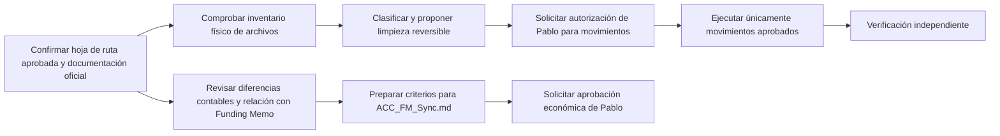

# KT.MovemAcc — MR0 | Registro maestro de ejecución y control

**Autor:** Pablo San Martín  
**Fecha de actualización:** 21 de octubre de 2026  
**Versión:** 2026-10-21 — propuesta para aprobación humana  
**Estado:** BORRADOR PARA REVISIÓN; no instalado en el repositorio  
**Documento rector:** `KTMA_HOJA_DE_RUTA_20261021_PABLO_SAN_MARTIN.md` — aprobado por Pablo San Martín el 21-10-2026.  
**Raíz esperada:** `C:\01. GitHub\Kumquat.TECH\KT.MovemAcc`

## 1. Propósito y límites

MR0 es el **registro operativo maestro** del trabajo: identifica responsables, estado real, dependencias, impedimentos, evidencias y siguiente acción. No sustituye la hoja de ruta (dirección estratégica), `HO.1` (continuidad y recuperación), `QA.md` (preguntas/respuestas), `QA_Resume.md` (acuerdos vigentes) ni el futuro `ACC_FM_Sync.md` (criterios de traspaso contable al Funding Memo).

Los hechos atribuidos a RORCH o SPECIALIST son **resultados informados**, no constataciones directas de este documento. Está prohibido elevar una declaración `SUCCESS` a cumplimiento global sin evidencia suficiente.

## 2. Reglas de autoridad

**HUMAN (Pablo San Martín):** aprueba criterios económicos, modificaciones protegidas, limpieza con efectos sobre archivos y cierre de hitos financieros.  
**MORCH:** integra decisiones, ordena dependencias y propone el siguiente trabajo.  
**RORCH (DSH):** orquesta la ejecución técnica y la formalización documental autorizada.  
**SPECIALIST (Codex Desktop + NTV):** investiga correspondencias financieras con evidencia reproducible; no representa al asistente de esta conversación.  
**Verificador independiente:** contrasta resultados con un mecanismo suficientemente separado y documenta limitaciones.

**Puntos de aprobación:** `RM-GATE-003=ABIERTO` (fase 1 y fase 1.5), `RM-GATE-004=ABIERTO` (Funding Memo, fase 2).

## 3. Estado ejecutivo

| Elemento | Situación al corte | Calidad de evidencia | Próximo paso |
|---|---|---|---|
| Hoja de ruta | Aprobada por HUMAN en esta conversación | Aprobación HUMAN; instalación no comprobada | Confrontar con hoja de ruta canónica y promover conservando histórico |
| `QA.md` | Instalación oficial declarada por RORCH (NTV011) | Informada; hashes declarados iguales | Verificar referencias y custodia |
| `QA_Resume.md` | Instalación oficial declarada por RORCH (NTV011) | Informada; hashes declarados iguales | Verificar consistencia |
| `QA_SKILLS.MovemACC_QA.md` | Descubrimiento y prueba de carga informados por RORCH | Informada | Confirmar vigencia de las normas y compatibilidad |
| Raíz del proyecto | **Discrepancia entre reportes** | No reconciliada | Inventario independiente de rutas reales y rutas malformadas |
| Fase 1 | Motor autónomo informado; prueba nativa Windows/octubre pendiente | Parcial | Ensayo sin sobrescribir salidas aceptadas |
| Fase 1.5 | 32 fallos de comparación abiertos | Causa semántica informada, fallos siguen vigentes | Resolver criterio y repetir controles |
| Correspondencia al Funding Memo | 72 destinos: 15 verificados técnicamente, 18 ambiguos, 37 sin asignación, 2 propuestos | SPECIALIST_003; ninguna aprobación económica | Consolidar decisiones D01–D08 |
| `ACC_FM_Sync.md` | Previsto; no creado ni aprobado | Planeado | Diseñar borrador trazable |
| Versión distribuible | Pendiente | Planeado | Ejecutar después de aceptación financiera y pruebas nativas |

## 4. Registro maestro de frentes y tareas

Los códigos entre paréntesis mantienen la trazabilidad de la hoja de ruta; el nombre legible es la referencia principal.

| Prioridad | Frente / código | Responsable | Estado | Requisito para completar | Siguiente acción |
|---|---|---|---|---|---|
| 0 | Hoja de ruta única (`RM-ROAD-001`) | RORCH | Pendiente de instalación comprobada | Versión aprobada identificada; histórico intacto; referencias correctas | Comparar versiones; preparar promoción autorizada |
| 0 | Integridad documental (`RM-DOC-003`) | RORCH | Parcial | Índices, presentación del proyecto, QA, hoja de ruta y continuidad compatibles | Auditar referencias sin reescribir decisiones |
| 0 | Inventario físico (`RM-ROOT-001`) | RORCH + verificador | Crítico, pendiente | Lista recursiva con rutas reales, cantidades, hashes y alcance | Conciliar afirmaciones contradictorias |
| 0 | Clasificación y conservación (`RM-ROOT-002`) | RORCH | Depende de inventario | Cada artefacto clasificado con dueño y plazo de conservación | Separar evidencia, herramientas, pruebas y desconocidos |
| 0 | Cuarentena reversible (`RM-ROOT-003`) | RORCH + HUMAN | Sin autorización específica | Lista de rutas, hashes, destino y reversión aprobados | Proponer plan; **no mover ni borrar todavía** |
| 0 | Verificación de limpieza (`RM-QA-001`) | Verificador | Pendiente | Contraste independiente antes/después | Validar ausencia de pérdidas, escapes y rutas inválidas |
| 0 | Base histórica de fase 1 (`RM-PH1-002`) | RORCH + HUMAN | Bloqueada | Disposición explícita del hash histórico aceptado | Determinar si los bytes originales pueden recuperarse |
| 0 | Diferencias fase 1/1.5 (`RM-PH15-001`) | SPECIALIST + HUMAN | 32 fallos abiertos | Regla semántica autorizada + nuevos resultados reproducibles | Resolver padres y subtotales de Impulsa |
| 0 | Relación cuenta–partida (`RM-FM-001`) | SPECIALIST | Parcial | Evidencia contable por celda, signos, medidas, no duplicación | Resolver ambigüedades y excepciones |
| 0 | Criterios de traspaso (`RM-FM-002`) | SPECIALIST redacta; HUMAN aprueba | Planeado | `ACC_FM_Sync.md` aprobado con matriz versionada | Preparar borrador, sin declararlo oficial |
| 1 | Ensayo nativo Windows (`RM-PH1-001`) | RORCH | Pendiente | Entradas reales y salidas aisladas, misma conciliación | Planear ejecución autorizada |
| 1 | Poblamiento de Funding Memo (`RM-FM-003`) | RORCH | Bloqueado por aprobación | Mapeos HUMAN aprobados y copia controlada | No escribir |
| 1 | Pruebas de aceptación (`RM-UAT-001`) | Verificador + HUMAN | Pendiente | Comparadores positivos/negativos y evidencia financiera | Diseñar oráculos |
| 2 | Programa distribuible (`RM-REL-001`) | RORCH | Futuro | Operación autónoma validada | No anticipar empaquetado |

## 5. Decisiones y cuestiones abiertas

**Aprobadas por HUMAN:** la hoja de ruta vigente; los tres documentos QA; el corte temporal contable. Cada mayor refleja movimientos acumulados desde el día 0 del proyecto hasta las 23:59 del último día del período; para agosto 2026, hasta el 31-08-2026 23:59.

**Sin aprobación financiera:** 15 relaciones técnico-contables no equivalen a autorizaciones de uso; 18 ambiguas, 37 no asignadas, 2 propuestos; quedan ocho principios económicos por resolver: reconocimiento temporal, distribución entre entidades, partición de construcción, partición de financiamiento, cuatro casos originales Eplaza, supuestos comerciales, IVA/comisiones/capital preferente, y capital/rentabilidad.

**Pendientes de autorización de archivos:** cuarentena de rutas malformadas y traslado de pruebas que hoy constan en informes como ubicadas en `BACKUPS`. Un candado de Excel activo no debe eliminarse.

## 6. Riesgos y condiciones de detención

| Riesgo | Consecuencia | Respuesta exigida |
|---|---|---|
| RORCH declaró cero rutas malformadas; SPECIALIST reportó 32 | Limpieza falsamente certificada | Inventario con el mismo alcance y comparación de rutas físicas |
| Pruebas dentro de `BACKUPS` | Confusión entre respaldo y derivado | Clasificar antes de trasladar |
| Falta de archivo histórico aceptado de fase 1 | Comparación no concluyente | Preservar divergencia y solicitar resolución HUMAN |
| 32 fallos semánticos | Agregación contable potencialmente incorrecta | No convertirlos en aprobaciones |
| Diferencia entre suma acumulada y saldo contable neto | Error de interpretación del Funding Memo | Conservar definición temporal y especificar medida por partida |
| Mapeos sin aprobación | Traspaso económico incorrecto | Bloquear escritura de fase 2 |
| Descargas temporales | Pérdida de evidencia única | Copiar al depósito durable antes de su vencimiento |
| Cambios no autorizados a Git o datos | Pérdida de integridad | Detener frente afectado y registrar diferencia |

## 7. Próximo ciclo de trabajo: secuencia y simultaneidad

Los análisis de solo lectura del frente financiero pueden realizarse paralelamente con el inventario documental. Las operaciones sobre archivos y finanzas requieren autorizaciones específicas.

## 8. Contrato de cierre del ciclo

La actualización de MR0 exige: identificación del responsable, archivos de entrada y huellas, pruebas ejecutadas y omitidas, evidencia duradera, cambios realizados, excepciones, decisión HUMAN si corresponde y siguiente acción segura.

**No declarar la raíz limpia por el solo resultado de NTV011. No cerrar `RM-GATE-003` ni `RM-GATE-004`. No comprometer cambios a Git sin autorización.**

## 9. Relaciones documentales

- **Hoja de ruta:** dirección, componentes, dependencias y etapas.
- **MR0 (este archivo):** situación operativa de cada frente, impedimentos y próximas acciones.
- **HO.1:** instrucciones para retomar el trabajo de manera segura.
- **QA.md:** historial de preguntas y respuestas aprobadas.
- **QA_Resume.md:** decisiones vigentes y asuntos pendientes.
- **Skill interna QA:** gobernanza del historial y su resumen.
- **ACC_FM_Sync.md:** documento futuro de criterios contables para poblar el Funding Memo; no creado.
- **Registros de SPECIALIST:** evidencia técnica de correspondencias y discrepancias; no sustituyen aprobaciones.

## 10. Control de versión

Documento redactado a partir de la hoja de ruta aprobada y de mensajes de resultados de RORCH/SPECIALIST. **Pendiente confrontarlo con el MR0 canónico que exista en la raíz local** antes de sustituir archivos; no se verificó el inventario local desde esta sesión. La aprobación de la hoja de ruta no implica por sí sola aprobación de este MR0.
