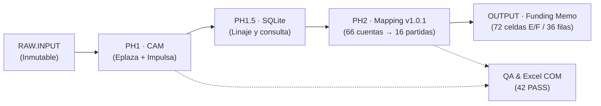
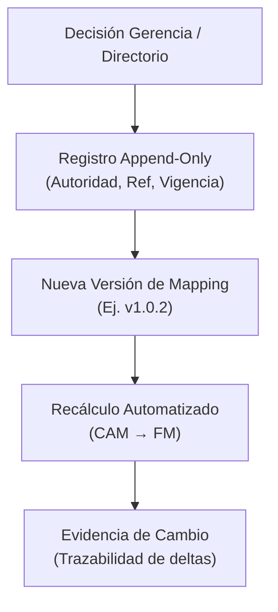

# KT.MovemAcc — MR0 | Registro maestro de ejecución y control

**Autor:** Pablo San Martín (Baseline) / RORCH (Reconciliación y Perfeccionamiento)  
**Fecha de actualización:** 30 de octubre de 2026  
**Versión:** `2026-10-30.RUN_008_RECONCILED`  
**Estado:** `ACTUALIZACIÓN CANÓNICA INTEGRADA / RUN_008`  
**Documentos rectores:** `KTMA_HOJA_DE_RUTA_20261021_PABLO_SAN_MARTIN.md`, `KT_MovemAcc_ROADMAP_20261030.md`  
**Raíz:** `C:\01. GitHub\Kumquat.TECH\KT.MovemAcc`

---

## 1. Propósito, límites y conservación histórica

MR0 es el **registro operativo maestro** del trabajo: identifica responsables, estado real, dependencias, impedimentos, evidencias y siguiente acción. No sustituye la hoja de ruta (dirección estratégica), `HO.1` (continuidad y recuperación), `QA.md` (preguntas/respuestas), `QA_Resume.md` (acuerdos vigentes) ni el contrato contable de traspaso al Funding Memo.

**Regla de conservación:** Esta versión perfeccionada integra el baseline histórico de Pablo San Martín (21-10-2026) con el Roadmap actualizado (30-10-2026) y las métricas del estado funcional RUN_008, **sin eliminar ni desnaturalizar** el contenido histórico útil.

---

## 2. Reglas de autoridad y gobernanza de decisores

* **HUMAN (Pablo San Martín):** aprueba criterios económicos, modificaciones protegidas, limpieza con efectos sobre archivos y cierre de hitos financieros (`RM-GATE-003`, `RM-GATE-004`).
* **MORCH:** integra decisiones, ordena dependencias y propone el siguiente trabajo.
* **RORCH (DSH):** orquesta la ejecución técnica, la formalización documental autorizada y la aplicación constante del contrato NTV/CIRL.
* **SPECIALIST / Ejecutores:** investigan correspondencias financieras con evidencia reproducible.
* **Puntos de aprobación vigentes:** `RM-GATE-003=ABIERTO` (Fase 1 y 1.5), `RM-GATE-004=ABIERTO` (Funding Memo, Fase 2). Sin aprobación financiera productiva automática.

---

## 3. Estado funcional y métricas de convergencia (RUN_008)

Con base en la convergencia técnica reportada hasta RUN_008 (`experiment/ktma-financial-convergence-087`, HEAD `bb9c19f9b36b74df3b4f4f00a1579a9aee5fa58e`):

| Métrica / Elemento | Valor / Estado | Significado y alcance |
|---|---|---|
| Cuentas contables consolidadas | 253 | Universo de ID de cuentas en CAM (Eplaza + Impulsa). |
| Cuentas asignadas al Funding Memo | 66 | Vínculos definidos hacia partidas del FM (versión de mapping 1.0.1). |
| Cuentas sin asignar (`SIN_ASIGNACION_FM`) | 187 | Cuentas visibles, pendientes de clasificación y materialidad. |
| Destinos FM (Celdas E/F) | 72 | 36 filas lógicas × 2 entidades (Eplaza y Impulsa). |
| Filas lógicas FM | 36 | Estructura total de filas del Funding Memo. |
| Filas FM mapeadas con cálculo | 16 | Partidas FM con totales D calculados (16/16 totales calculados en RUN_008). |
| Contribuciones de valor / Ceros verificados | 64 valores / 68 ceros | `ZERO_VERIFIED` bajo oráculo de cobertura y ausencia exacta de ID. |
| Pruebas de regresión / QA de artefacto | 42 PASS / 19 PASS | Pruebas unitarias/regresión y artefactos validados (Excel COM CalculateFullRebuild PASS). |

---

## 4. Contrato financiero y reglas de negocio MR0

1. **Origen numérico exclusivo:** `TOTAL.VALORES_UF` por ID contable, conservando el signo original.
2. **Dimensión de entidad:** FM columna **E = Eplaza**, columna **F = Impulsa**, columna **D = total horizontal E + F** para las partidas correspondientes.
3. **Cardinalidad y coeficientes:** Cada ID contable alimenta como máximo una partida FM (`1:1` o `N:1`), aplicando coeficiente `s(a) ∈ {+1, −1}`.
4. **Corte temporal:** Los reportes mensuales acumulados consideran el origen del proyecto hasta las 23:59 del cierre correspondiente.
5. **Gobernanza de modificaciones (Mapping):** Las asignaciones de cuentas no deben contener montos históricos fijos. Cada cambio futuro instruido por Gerencia o Directorio se registra en un historial append-only con:
   `ACCOUNT_ID`, `ACCOUNT_NAME`, `FM_TARGET_ID`, `FM_TARGET_NAME`, `COEFFICIENT`, `ENTITY_CONTRIBUTIONS`, `MAPPING_VERSION`, `APPROVAL_STATUS`, `DECISION_AUTHORITY`, `DECISION_REFERENCE`, `VALID_FROM`, `VALID_TO`, `CHANGE_HISTORY`.

---

## 5. Excepciones financieras vigentes

* **IVA construcción:** Cuentas `120971` y `120973`; tratamiento pendiente de confirmación con el contador (no multiplicar automáticamente por 1.19).
* **Cuenta 121031:** Alcance comercial pendiente de perfeccionamiento.
* **Cuenta 410457:** Software con asignación provisional.
* **Crédito especial IVA (`120972`):** Signo negativo conservado provisionalmente.
* **Casos TASK060:** 32 discrepancias semánticas resueltas técnicamente, pendientes de aceptación contable final por HUMAN.
* **Gates RM-GATE-003 / RM-GATE-004:** Abiertos hasta formalización ejecutiva.

---

## 6. Registro maestro de frentes, WBS y tareas (DAG)

| Prioridad / Módulo | Frente / WBS | Responsable | Estado | Siguiente oráculo / acción |
|---|---|---|---|---|
| P0 | Reconciliación MR0 (`RM-DOC-001`) | RORCH | **Completado (RUN_008)** | Integración canónica con Roadmap y HO.1 |
| P0 | Higiene Root / CIRL (`RM-ROOT-001`) | RORCH | Activo (NTV/CIRL) | Mantener delta limpio, RAW inmutable, OUTPUT controlado |
| P1 | WARN / Auditoría (`RM-AUD-001`) | RORCH + HUMAN | 11 vinculados, 18 pendientes | Adjudicación de los 18 WARN restantes |
| P1 | Reconciliación TASK060 (`RM-REC-001`) | SPECIALIST + Finanzas | Confligido / Técnico resuelto | Matriz caso a caso con oráculo independiente |
| P2 | Contrato Funding Memo (`RM-PH2-001`) | HUMAN + Finanzas | Diseño / Gated (RM-GATE-004) | Aprobación de reglas NTV010 y mapeo definitivo |
| P2 | QA y Regresión (`RM-QA-001`) | Verificador | 42/42 PASS | Pruebas de integración mensual |

---

## 7. Diagramas de arquitectura y flujo (Mermaid)

### 7.1 Flujo de datos y transformación

### 7.2 Gobernanza y versionado de asignaciones

---

## 8. Relaciones documentales y control de versiones

* **Hoja de Ruta / Roadmap:** Dirección estratégica, fases y dependencias.
* **MR0 (Este documento):** Estado operativo maestro, frentes, métricas RUN_008 y gobernanza.
* **HO.1:** Continuidad, recuperación y recuperación de worktree.
* **QA.md / QA_Resume.md:** Preguntas, respuestas y acuerdos vigentes.
* **Control de versión:** Perfeccionado y unificado para reflejar fielmente RUN_008 y las directivas de autonomía de RORCH.
