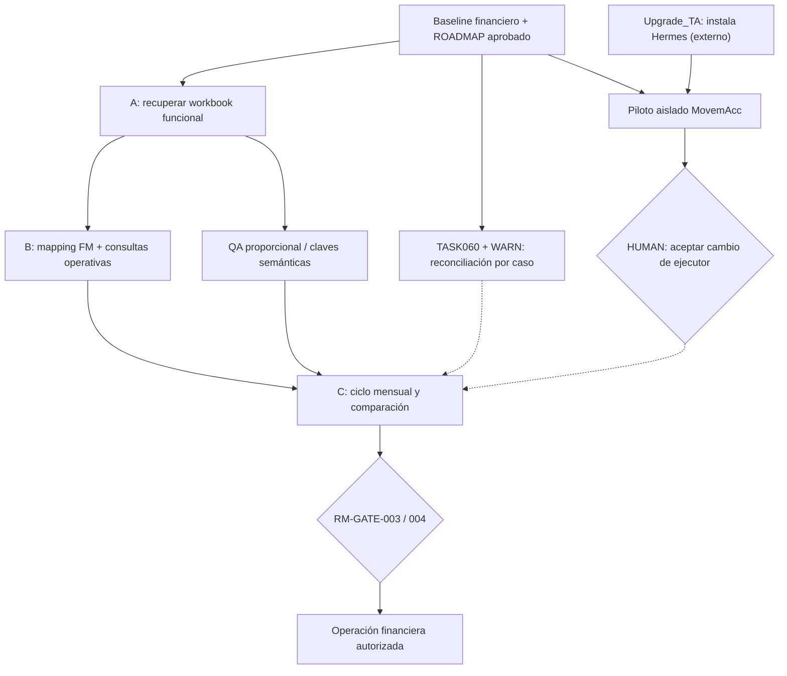
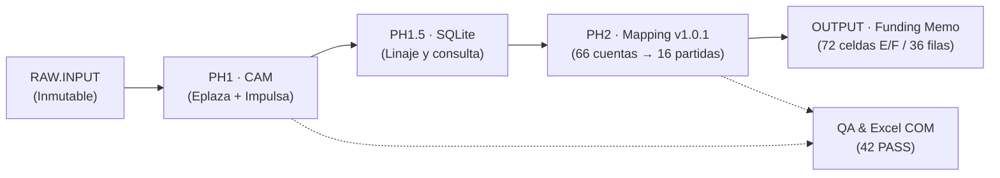
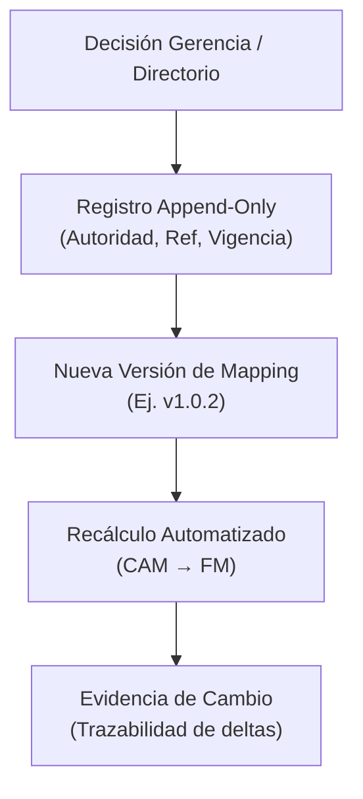

# KT.MovemAcc — MR.0 | Integrated Management Review y registro maestro de ejecución

**Versión de revisión:** `2026-11-02.MR0-ROADMAP-APPROVED-CANDIDATE`  
**Estado de este archivo:** `CANDIDATE_FOR_HUMAN_REVIEW` — no integrado ni escrito en el repositorio local.  
**Documento rector:** `ROADMAP.md`, revisión `2026-11-02.REVIEW-PRODUCT-HERMES-01`, **aprobada expresamente por HUMAN** el 02-11-2026 y guardada, según HUMAN, en `C:\Users\aazcl\Downloads\ROADMAP.md`. La aprobación documental **no verifica** la adopción o identidad de bytes de `03_DOCS/MANAGEMENT/ROADMAP_INTEGRAL.md`.  
**Baseline MR0 conservado:** `KTMA_MR0_20261021_PABLO_SAN_MARTIN(1).md`, encabezado interno `2026-10-30.RUN_008_RECONCILED`, preservado literalmente en Anexo A.  
**Método:** `MR0_Skiils.md` suministrada por HUMAN; 15 secciones de revisión integrada.  
**Ámbito:** KT.MovemAcc; `C:\01. GitHub\Kumquat.TECH\KT.MovemAcc`.  
**Autoridad:** HUMAN → MORCH → RORCH / ejecutor designado → especialistas autorizados.  
**Corte:** 02-11-2026. **Evidencia local:** no se ejecutó validación física sobre Windows ni la rama experimental.  
**Regla editorial:** revisión aditiva; el anexo original no se corrige, elimina ni desnaturaliza. Los cambios de estado posteriores constan en el cuerpo nuevo.

---

## 1. Executive status — Estado ejecutivo

**STATUS = PARTIAL_READY_FOR_PRODUCT_DEVELOPMENT / NOT_FINANCIALLY_ACCEPTED / HERMES_NOT_YET_VALIDATED.**

El North Star autorizado sigue siendo un sistema financiero de **Eplaza + Impulsa** que transforme mayores acumulados en CAM, persistencia/consulta, asignación al Funding Memo y workbook Excel trazable por período. Se priorizan funcionalidades útiles, operación mensual y ausencia de degradación sobre nuevos frameworks, bots o SKILLS.

**Hechos que cambian respecto al MR0 baseline RUN_008:**

1. HUMAN **aprobó** el Roadmap revisado, guardándolo con nombre `ROADMAP.md` en Downloads. Esto modifica el estado de **aprobación de ese documento**, no supone incorporación automática al ROOT ni cierra `RM-GATE-001`.
2. Se publicaron candidatos de workbook integral 2026.08 en una rama GitHub de revisión. RORCH informó correcciones sucesivas del generador y del mapeo. MORCH inspeccionó cambios concretos del código remoto, pero **no certificó la última salida Excel usando Excel Desktop**, ni la aceptó HUMAN.
3. Se detectaron errores repetitivos en la trayectoria DSH: coeficientes omitidos, asignaciones a columnas de entidad erróneas, tratamiento de claves contables potencialmente insuficiente, reportes de aceptación adelantada y rutas Windows/WSL malinterpretadas. Algunas correcciones fueron observadas en el código remoto posterior; sus propiedades funcionales completas siguen pendientes de aceptación.
4. HUMAN decidió que **Upgrade_TA** asume exclusivamente la **instalación y configuración de Hermes**. En MovemAcc solo se define el piloto funcional, el contrato de continuidad y el eventual reemplazo del ejecutor. No incorporar instalación ni despliegue de Hermes como trabajo de desarrollo de este proyecto.
5. La revisión de `dsh-superagent-prototype` **no cambia** la recomendación de piloto Hermes: es un prototipo de investigación que depende de DSH, no una sustitución independiente. No activar Superagent en MovemAcc.

**Criterio de progreso:** nueva capacidad financiera funcional o mejora verificable sin regresión; jamás cantidad de PASS, reportes, agentes, SKILLS o loops.

## 2. Scope and authority — Alcance y autoridad

**Dentro de KT.MovemAcc:** mantener y desarrollar PH1, PH1.5, mapping/FM, consultas útiles, auditoría, análisis multiperíodo, workbook de operación mensual, trazabilidad, pruebas proporcionales y documentación de entrega. Preservar decisiones financieras HUMAN y capacidades existentes.

**Fuera de KT.MovemAcc:** instalar/configurar Hermes o gateways (responsabilidad `Upgrade_TA`); desarrollar otro harness general; replicar funciones nativas en bots; migrar o depurar masivamente el ROOT sin autorización; efectuar publicación/merge sin gate.

| Rol | Decisión o función | Límite |
|---|---|---|
| HUMAN | Objetivo económico, reglas contables, aceptación financiera, autorizaciones y adopción de documentos | No debe resolver errores ordinarios de código, rutas o ejecución |
| MORCH | Reconciliación de estado, prioridades, dependencias, reporte de discrepancias y preparación de handoff | No declarar evidencia no observada ni cerrar gates |
| RORCH / ejecutor activo | Implementar funciones dentro del alcance y recursos autorizados; validar y autocorregir | No autoaprobar producto financiero ni editar contratos HUMAN |
| Upgrade_TA | Instalar, configurar, validar runtime, proveedores y memoria de Hermes | No asumir la propiedad funcional de MovemAcc |
| Hermes candidato | Ejecutar piloto funcional con aislamiento y recuperación de contexto | No reemplazo definitivo hasta demostrar capacidad |
| Verificador / especialista | Contrastar código, artefacto, fuentes y criterios; interpretar discrepancias | PASS de test ≠ decisión de negocio |

## 3. Current state — Estado actual

| Frente | Baseline histórico o estado reciente | Estado reconciliado / brecha |
|---|---|---|
| PH1 / CAM | Implementado y aceptado históricamente en alcance acotado; agosto 2026 | Preservar hojas, jerarquías, fórmulas, formatos y reconciliación física. No equiparar Excel integrado reciente con baseline HUMAN |
| PH1.5 | SQLite, consultas, linaje y base mensual reportados | Mantener trazabilidad y transacciones; prueba de reconstrucción e identidad por período |
| RUN_008 FM | **253 cuentas**; **66 asignadas**; **187 sin asignación**; **36 filas FM / 72 celdas E/F**; **16 partidas calculadas**; mapping `1.0.1` | Baseline válido **para su universo y período**; no comparar mecánicamente con métricas de workbook agosto u otras versiones |
| RUN_009–010 | Pipeline agosto PH1→SQLite→FM y reportes de ejecución según continuidad previa | No reconstruido físicamente en esta revisión; confirmar reproducibilidad antes de unificar estado |
| Workbook integral agosto | Candidato publicado en `review/KTMA-WORKBOOK-001`, 7 hojas según reportes | Correcciones del generador observadas parcialmente; producto **sin aceptación HUMAN**, Excel COM actual `UNVERIFIED` |
| Coeficientes y E/F | Reporte final RORCH: acumulación con coeficientes y segregación por entidad corregidas | Código remoto inspeccionado reflejó multiplicación y segregación; sin cierre integral del producto |
| Claves semánticas | `consol_map` y query han utilizado `account_code` como clave | Riesgo de colapsar registros legítimos por entidad/período/ocurrencia; no afirmar pérdida real sin comparar universo |
| Conciliación TASK060 | 11.325 comparaciones históricas: 10.939 PASS, 32 FAIL, 354 NOT_TESTABLE | Dictámenes posteriores de resolución técnica no sustituyen matriz original ni aceptación financiera |
| Auditoría WARN | 29 WARN históricos, 11 vinculados y 18 pendientes según baseline | Reconciliar estados por AUDIT_ID antes de afirmar cierre |
| Continuidad | 3/3 consumido y `PARTIAL_ACCEPTED` | **CLOSED**; no reiniciar el contador ni usar reconstrucción sin evidencia |
| Infraestructura Hermes | Instalación delegada a Upgrade_TA | `EXTERNAL_DEPENDENCY / NOT_VERIFIED`, no frente de instalación de KTMA |

**Discrepancias que no se resuelven por inferencia:** 66 reglas vs 66 cuentas; 72 celdas E/F vs otras menciones de 72 reglas; 15/15 reglas vs 16 partidas; 106 filas de query vs 253 cuentas del CAM; denominadores y períodos distintos; GitHub remoto vs HEAD local experimental; código corregido vs workbook recalculado. Cada reconciliación requiere entidad, período, identidad semántica, origen y unidad de conteo.

## 4. Evidence reviewed — Evidencia y jerarquía

| ID | Fuente examinada / disponible | Qué acredita | Qué NO acredita |
|---|---|---|---|
| EV-01 | Archivo local aportado `KTMA_MR0_20261021_PABLO_SAN_MARTIN(1).md` | Estructura y contenido completo del baseline MR0 (RUN_008) | Ejecución actual ni vigencia de cada PASS |
| EV-02 | `MR0_Skiils.md` aportado | Método oficial suministrado para revisar MR0, 15 secciones, evidencia y gates | Que la SKILL esté instalada o ejecutándose en el ROOT |
| EV-03 | `ROADMAP.md` generado en esta conversación y aprobado por HUMAN | Dirección aceptada y prioridades de producto | Integración en el repositorio local |
| EV-04 | Consulta GitHub previa, commit `caa2191576a17cd15108e8c60ba2d51fb00bb627`, fuente `src/kt_movemacc/canonical_workbook.py` | Código remoto observado de acumulación con coeficiente y columnas E/F; commit existente | Integridad binaria actual de XLSX ni Excel COM |
| EV-05 | Reporte de RORCH sobre último workbook (`SHA256 9fc6b91f…`) | Declaración del ejecutor, candidata a validación | Verificación física independiente de ese SHA |
| EV-06 | Decisión HUMAN actual sobre Upgrade_TA | Separación de responsabilidades de instalación/ejecución | Que Hermes esté instalado o apto |
| EV-07 | Memoria de ejecución RUN_009/010 y comparativos 2026.08–09 | Continuidad del estado reportado | Relectura en el entorno local de Windows |

**Criterio:** evidencia física observada > reportes de agentes; UNKNOWN ≠ PASS; cifra del reporte conserva su denominador y alcance.

## 5. Decisions accepted — Decisiones vigentes

**Aceptadas por HUMAN (sin reinterpretación):**

- Roadmap nuevo aprobado como `C:\Users\aazcl\Downloads\ROADMAP.md` según declaración HUMAN; no confundir aprobación del documento con adopción Git.
- Instalar/configurar Hermes **solo en Upgrade_TA**; preparar en MovemAcc un piloto de ejecución y transferencia documental posterior.
- Priorizar **calidad funcional y continuidad**, no rapidez aparente ni construcción de otro ecosistema de supervisores.
- Datos FM desde `TOTAL.VALORES_UF` acumulado al cierre de período, preservando signo original.
- FM **E = Eplaza**, **F = Impulsa**, **D = E + F**.
- Cuenta/ID → a lo sumo un destino lógico FM; destino puede consolidar N cuentas con coeficientes `+1`/`-1`.
- `ZERO_VERIFIED` requiere cobertura de fuente; `UNKNOWN` no se interpreta como cero; sin asignación debe permanecer visible.
- RAW inmutable; OUTPUT regenerable de forma controlada; mapping versionado con autoridad/fecha/vigencia y rastreo histórico.
- Mantener casos provisionales: IVA construcción `120971`/`120973` sin multiplicación automática por 1,19; `121031`, `410457` y signo contable de `120972`.
- NTV/CIRL se mantienen como mecanismo transversal ya existente, proporcional al trabajo; no introducir sistemas nuevos por defecto.

## 6. Open decisions — Decisiones no adoptadas

| ID | Decisión abierta | Autoridad | ¿Bloquea todo? |
|---|---|---|---|
| OD-01 | Resolver criterio y origen IVA construcción `120971`/`120973` | HUMAN + contador | No; solo celdas afectadas |
| OD-02 | Afinar clasificación `121031`, `410457`, cuentas `220516/220517` y subtotales | HUMAN / Finanzas | No; mantener regla provisional |
| OD-03 | Aceptación financiera de PH1/PH1.5, excepciones TASK060 | HUMAN / RM-GATE-003 | Bloquea declaración productiva, no mejoras de laboratorio autorizadas |
| OD-04 | Aprobar criterios FM de aplicación productiva y cobertura residual | HUMAN / RM-GATE-004 | Bloquea aprobación productiva, no análisis/corrección acotados |
| OD-05 | Adoptar el Roadmap en canónico local y aceptar este MR0 | HUMAN / gate documental aplicable | No bloquea preparación del piloto aislado |
| OD-06 | Sustitución definitiva del ejecutor DSH por Hermes | HUMAN tras piloto | No; instalación en Upgrade_TA en paralelo |
| OD-07 | Publicación/merge de repositorio/outputs | HUMAN / RM-GATE-005 | Sí, para acciones restringidas |

No duplicar preguntas respondidas históricamente; elevar solo asuntos de criterio financiero y autoridad.

## 7. Risks, blockers and unknowns — Riesgos y bloqueos

| ID | Riesgo o conflicto | Impacto | Tratamiento |
|---|---|---|---|
| R-01 | Falsos positivos `PASS` y aceptación de ejecutor | Retrabajo/errores financieros | Evidencia sobre candidato exacto; aceptación HUMAN separada |
| R-02 | Pérdida de identidad por deduplicación `account_code` | Omisión / doble conteo | Demostrar clave semántica y comparaciones con RAW y CAM |
| R-03 | Cambios no sincronizados entre código, workbook y reporte | Falso cierre | Identificar commit, artefacto y período al evaluar |
| R-04 | Rutas falsas `C:` bajo WSL | Artefactos no entregados | Verificar existencia física real en Downloads Windows |
| R-05 | MR0 local y documento publicado con estados divergentes | Confusión de autoridad | Preservar baseline y anotar modificaciones por fuente/fecha |
| R-06 | Hermes sin memoria o herramienta suficiente | Migración fallida | Piloto con reinicio real y recuperación, sin abandonar DSH antes de evaluación |
| R-07 | Nuevos bots/harnesses desplazan producto | Estancamiento | No abrir workstreams infra sin bloqueo real, medible y aprobado |
| R-08 | 20 filas FM sin fuente apropiada | Cifras inventadas | Clasificar cobertura, estado y datos legítimos, sin extrapolar |
| R-09 | RAMA / HEAD local experimental no observable | Estado de ejecución incierto | Lectura local por ejecutor con evidencia, no inferir GitHub equivalente |
| R-10 | Estado de instalación y permisos de las SKILLS | Reglas inconsistentes | Conservar las normas HUMAN sin atribuir instalación no demostrada |

## 8. Readiness matrix — Preparación real

| Dimensión | Resultado | Evidencia | Brecha / siguiente acción |
|---|---|---|---|
| Claridad de objetivo | PASS | Roadmap HUMAN aprobado | Aplicar frentes funcionales definidos |
| Evidencia suficiente para aceptación productiva | PARTIAL | Baseline + reportes + lectura parcial remota | Excel Desktop y auditoría completa del candidato |
| Contracto financiero | PARTIAL | Reglas HUMAN conocidas | Decisiones provisionales y cobertura FM pendientes |
| Preparación técnica PH1/1.5 | PARTIAL | Implementaciones históricas | Contrastar con rama/artefacto exactos |
| Preparación workbook FM | PARTIAL | Código y candidato remoto | Prueba end-to-end con períodos y claves correctas |
| Runtime Hermes | UNKNOWN | Instalación delegada a Upgrade_TA | Confirmación de instalación y piloto |
| Reversibilidad | PARTIAL | Git y RAW protegido según contrato | Snapshot real, worktree aislado, no tocar producción |
| Autoridad | PASS_DOCUMENTAL | HUMAN / gates preservados | Ejecución de permisos requiere verificación local |
| Coste/plazo | UNKNOWN | No se fijó presupuesto ni fecha | No inventar plazos |
| Aceptación HUMAN del Roadmap | PASS | Declaración explícita HUMAN | Adopción canónica separada |
| Aceptación HUMAN de MR0 y workbook | PENDING | Este archivo es candidato | Revisión y acto explícito HUMAN |

## 9. Roadmap impact — Relación con dirección aprobada

| Wave del Roadmap | Objetivo | Trabajo MR0 | Criterio de resultado |
|---|---|---|---|
| A · Estabilizar lo útil | No degradar workbook/PH1 | `RM-FIN-001`, `RM-REC-001`, `RM-QA-001` | Excel íntegro, celdas/identidad reconciliadas |
| B · Operación financiera | FM, consultas y auditoría | `RM-PH2-001`, `RM-DAT-001`, `RM-AUD-001` | Consultas útiles y cálculo por entidad/coefs trazable |
| C · Mensualizar y comparar | Ciclo multiperíodo | `RM-FIN-001`, `RM-DAT-001`, `RM-PH2-001` | Dos períodos ejecutados sin hardnumbers y con deltas explicados |
| D · Adopción y evolución | Piloto ejecutor y handoff | `RM-GOV-001`, `RM-ROOT-001` + Upgrade_TA externo | Hermes demuestra recuperación y entrega funcional; HUMAN decide |

**No convertir instalación Hermes en módulo de software financiero.** Upgrade_TA es dependencia externa; no cambiar Roadmap automáticamente al variar el ejecutor.

## 10. Active DAG / next work graph — Trabajo ejecutable



El DAG distingue trabajo en paralelo de obligaciones productivas. No debe bloquearse la mejora funcional por terminar la instalación Hermes o por resolver incidencias independientes.

## 11. Authorization matrix — Operaciones y autoridad

| Acción | Estado | Autoridad | Condición |
|---|---|---|---|
| Analizar proyecto, comparar evidencia, diseñar mejoras | ELEGIBLE | Ejecutor dentro de permisos existentes | Sin mutar RAW ni material protegido |
| Modificar código y generar candidatos en rama/worktree autorizado | CONDICIONAL | Permisos de laboratorio existentes | No introducir publicación por implicación |
| Reescribir reglas contables o aprobar cifras | GATED | HUMAN / Finanzas | Decisión explícita con vigencia e impacto |
| Instalar/configurar Hermes | EN UPGRADE_TA | HUMAN / Upgrade_TA | No ejecutar desde MovemAcc |
| Ejecutar piloto de Hermes sobre KTMA | PENDIENTE DISPONIBILIDAD | HUMAN define alcance; ejecutor en aislamiento | No afectar baseline ni autorizar productivo |
| Commit / push / merge / release | SEGÚN GATE Y RAMA | HUMAN | No generalizar autorización de rama review a main |
| Mover/borrar ROOT o escribir RAW | GATED / RAW INMUTABLE | HUMAN según contrato | No concedido aquí |
| Cerrar RM-GATE | GATED | HUMAN | No cerrar por PASS técnico o por archivo aprobado |

## 12. Closed gates — Estados de gates

| Gate | Estado | Alcance |
|---|---|---|
| `RM-GATE-001` | OPEN / ADOPTION_UNVERIFIED | Roadmap aprobado en Downloads; no verificada integración canónica |
| `RM-GATE-002` | CLOSED_INFRASTRUCTURE_ONLY (histórico) | No equivale a aceptación del producto |
| `RM-GATE-003` | OPEN | Aceptación financiera/operación PH1/PH1.5 |
| `RM-GATE-004` | OPEN | Aceptación de criterios/FM productivo |
| `RM-GATE-005` | OPEN | Publicación, privacidad y acciones protegidas |
| `CONTINUITY 3/3` | CLOSED / PARTIAL_ACCEPTED | No reabrir reconstrucción |

**Ningún gate se modifica mediante este MR0.**

## 13. Next eligible nodes — Próximos nodos con dueño y salida

| Orden | ID existente | Owner | Trabajo | Entrega comprobable | Gate |
|---|---|---|---|---|---|
| 1 | `RM-FIN-001` | Ejecutor designado | Fijar baseline de producto funcional y reconciliar candidato | Comparación de workbook y fuentes, sin perder hojas ni detalles | Sin aceptación productiva implícita |
| 2 | `RM-PH2-001` | Ejecutor + Finanzas | Mostrar/consultar contribuciones FM correctas por período/entidad | Mapeo y conciliación de importes/signos y no asignados | RM-GATE-004 para aprobación financiera |
| 3 | `RM-DAT-001` | Ejecutor designado | Completar consultas utilizables (no solo autofiltrado) | Búsqueda reproducible por entidad, período y cuenta | Protección SQLite/RAW |
| 4 | `RM-REC-001` | Revisión financiera | Distinguir 32 históricos de defectos actuales | Matriz caso→estatus, sin equivalencias inventadas | RM-GATE-003 |
| 5 | `RM-AUD-001` | Especialista + HUMAN solo criterios | Conservar/revisar WARN y evidencia de celda | Estado individual auditado | Decisiones humanas cuando proceda |
| 6 | `RM-FIN-001` + `RM-PH2-001` | Ejecutor designado | Repetir pipeline 2026.08/2026.09 y conciliar | Workbook por período + diferencias justificadas | Sin publicación automática |
| Paralelo externo | `RM-GOV-001` | Upgrade_TA para instalación; MORCH para contrato funcional | Habilitar piloto Hermes y definir entrada/salida | Runtime externo listo + prueba aislada con una tarea real | HUMAN acepta cambio de ejecutor |

**Disciplina de ejecución:** la herramienta designada debe resolver problemas ordinarios de runtime y código dentro del trabajo actual; escalar a HUMAN solo criterio financiero, conflicto material de autoridad o permiso no concedido. No crear un nuevo sistema de automatización como respuesta inicial.

## 14. Handoff requirements — Preparación HO.1 y BATON

El handoff debe transferir **solo el estado necesario** y apuntar a fuentes documentales verificables.

| Elemento | Fuente que se debe entregar | Regla |
|---|---|---|
| Dirección | ROADMAP aprobado en Downloads y su versión adoptada en ROOT cuando exista | No depender de chat como autoridad única |
| Estado de trabajo | Este MR0 una vez aprobado | Conservar UNKNOWN, gates, restricciones y próximos nodos |
| Continuidad | HO.1 vigente, a revisar en etapa siguiente | No reabrir contador de reconstrucción |
| BATON | Contrato de transferencia operativo existente | No redactarlo antes de confrontar baseline |
| Herramienta | Hermes validado por Upgrade_TA | Si no está listo, preservar acceso a DSH sin más desarrollo infra |
| Producto | Ruta real repo, branches, último workbook y fuentes por período | Leer estado físico, no asumir commits remotos = locales |
| Decisiones financieras | QA / QA_Resume / mapping 1.0.1 y criterios HUMAN | Proteger vigencia y no inventar aprobaciones |

**Criterio de handoff:** una nueva sesión debe poder identificar su objetivo, el próximo nodo habilitado, qué artefactos modificar, qué no modificar, cómo demostrar que funciona y qué requiere HUMAN, sin pedir reconstruir semanas de conversaciones.

## 15. Terminal convergence statement — Declaración final de MR.0

```text
TARGET=MR0_REVIEW
PROJECT=KT.MovemAcc
DATE=2026-11-02
STATUS=PARTIAL_READY_CANDIDATE
CURRENT_STATE=RUN_008_BASELINE_PLUS_LATER_REPORTED_FINANCIAL_WORKBOOK_CHANGES
PROVEN=HUMAN_ROADMAP_APPROVAL; BASELINE_MR0_READ; SKILL_READ; LIMITED_GITHUB_CODE_OBSERVATION
PARTIAL=WORKBOOK_PRODUCT; TASK060; FM_36_ROW_COVERAGE; WINDOWS_EXCEL_VALIDATION
UNKNOWN=LOCAL_EXPERIMENTAL_HEAD; HERMES_RUNTIME; BINARY_ARTIFACT_ACCEPTANCE
CONFLICTS=COUNT_DENOMINATORS; LOCAL_VS_REMOTE; QUERY_DEDUPLICATION; TECHNICAL_PASS_VS_PRODUCT
DECISIONS_ACCEPTED=ROADMAP_APPROVED_IN_DOWNLOADS; HERMES_INSTALLATION_ONLY_UPGRADE_TA
DECISIONS_OPEN=FINANCIAL_CRITERIA; MR0_APPROVAL; HERMES_EXECUTOR_ADOPTION; PUBLISHING
RISKS=PRODUCT_REGRESSION; MEMORY_LOSS; ROUTE_INTEGRITY; SELF_REPORTED_PASS
BLOCKERS=HUMAN_GATES_FOR_PRODUCTIVE_USE; NOT_FOR_LAB_DEVELOPMENT
READINESS_MATRIX=SECTION_8
ROADMAP_IMPACT=SECTION_9
NEXT_DAG=SECTION_10
AUTHORIZATIONS_REQUIRED=SECTION_11
CLOSED_GATES=RM-GATE-002_INFRA_ONLY; CONTINUITY_CLOSED_3_OF_3
NEXT_ELIGIBLE_NODES=SECTION_13
HANDOFF_REQUIRED=HO1_THEN_BATON
TERMINAL_CONVERGENCE=DOCUMENT_REVIEW_COMPLETE; PRODUCT_AND_RUNTIME_NOT_ACCEPTED
```

**Dictamen:** MR.0 queda documentado como candidato de reconciliación, no como certificación de operación. El siguiente paso documental después de aceptación HUMAN es **HO.1** y luego **BATON**; el siguiente paso de producto no depende de esos documentos ni de la instalación de Hermes en Upgrade_TA.

---

# ANEXO A — MR0 LOCAL RECIBIDO, PRESERVADO LITERALMENTE

> **ARCHIVAL / BASELINE HISTÓRICO.** El contenido siguiente corresponde íntegramente al archivo local recibido. Sus estados RUN_008 y asignación de RORCH/DSH representan el corte histórico y no prevalecen sobre decisiones posteriores de HUMAN del 02-11-2026. No se ha reescrito su texto.

# KT.MovemAcc — MR0 | Registro maestro de ejecución y control

**Autor:** Pablo San Martín (Baseline) / RORCH (Reconciliación y Perfeccionamiento)  
**Fecha de actualización:** 30 de octubre de 2026  
**Versión:** `2026-10-30.RUN_008_RECONCILED`  
**Estado:** `ACTUALIZACIÓN CANÓNICA INTEGRADA / RUN_008`  
**Documentos rectores:** `KTMA_HOJA_DE_RUTA_20261021_PABLO_SAN_MARTIN.md`, `KT_MovemAcc_ROADMAP_20261030.md`  
**Raíz:** `C:\01. GitHub\Kumquat.TECH\KT.MovemAcc`

---

## 1. Propósito, límites y conservación histórica

MR0 es el **registro operativo maestro** del trabajo: identifica responsables, estado real, dependencias, impedimentos, evidencias y siguiente acción. No sustituye la hoja de ruta (dirección estratégica), `HO.1` (continuidad y recuperación), `QA.md` (preguntas/respuestas), `QA_Resume.md` (acuerdos vigentes) ni el contrato contable de traspaso al Funding Memo.

**Regla de conservación:** Esta versión perfeccionada integra el baseline histórico de Pablo San Martín (21-10-2026) con el Roadmap actualizado (30-10-2026) y las métricas del estado funcional RUN_008, **sin eliminar ni desnaturalizar** el contenido histórico útil.

---

## 2. Reglas de autoridad y gobernanza de decisores

* **HUMAN (Pablo San Martín):** aprueba criterios económicos, modificaciones protegidas, limpieza con efectos sobre archivos y cierre de hitos financieros (`RM-GATE-003`, `RM-GATE-004`).
* **MORCH:** integra decisiones, ordena dependencias y propone el siguiente trabajo.
* **RORCH (DSH):** orquesta la ejecución técnica, la formalización documental autorizada y la aplicación constante del contrato NTV/CIRL.
* **SPECIALIST / Ejecutores:** investigan correspondencias financieras con evidencia reproducible.
* **Puntos de aprobación vigentes:** `RM-GATE-003=ABIERTO` (Fase 1 y 1.5), `RM-GATE-004=ABIERTO` (Funding Memo, Fase 2). Sin aprobación financiera productiva automática.

---

## 3. Estado funcional y métricas de convergencia (RUN_008)

Con base en la convergencia técnica reportada hasta RUN_008 (`experiment/ktma-financial-convergence-087`, HEAD `bb9c19f9b36b74df3b4f4f00a1579a9aee5fa58e`):

| Métrica / Elemento | Valor / Estado | Significado y alcance |
|---|---|---|
| Cuentas contables consolidadas | 253 | Universo de ID de cuentas en CAM (Eplaza + Impulsa). |
| Cuentas asignadas al Funding Memo | 66 | Vínculos definidos hacia partidas del FM (versión de mapping 1.0.1). |
| Cuentas sin asignar (`SIN_ASIGNACION_FM`) | 187 | Cuentas visibles, pendientes de clasificación y materialidad. |
| Destinos FM (Celdas E/F) | 72 | 36 filas lógicas × 2 entidades (Eplaza y Impulsa). |
| Filas lógicas FM | 36 | Estructura total de filas del Funding Memo. |
| Filas FM mapeadas con cálculo | 16 | Partidas FM con totales D calculados (16/16 totales calculados en RUN_008). |
| Contribuciones de valor / Ceros verificados | 64 valores / 68 ceros | `ZERO_VERIFIED` bajo oráculo de cobertura y ausencia exacta de ID. |
| Pruebas de regresión / QA de artefacto | 42 PASS / 19 PASS | Pruebas unitarias/regresión y artefactos validados (Excel COM CalculateFullRebuild PASS). |

---

## 4. Contrato financiero y reglas de negocio MR0

1. **Origen numérico exclusivo:** `TOTAL.VALORES_UF` por ID contable, conservando el signo original.
2. **Dimensión de entidad:** FM columna **E = Eplaza**, columna **F = Impulsa**, columna **D = total horizontal E + F** para las partidas correspondientes.
3. **Cardinalidad y coeficientes:** Cada ID contable alimenta como máximo una partida FM (`1:1` o `N:1`), aplicando coeficiente `s(a) ∈ {+1, −1}`.
4. **Corte temporal:** Los reportes mensuales acumulados consideran el origen del proyecto hasta las 23:59 del cierre correspondiente.
5. **Gobernanza de modificaciones (Mapping):** Las asignaciones de cuentas no deben contener montos históricos fijos. Cada cambio futuro instruido por Gerencia o Directorio se registra en un historial append-only con:
   `ACCOUNT_ID`, `ACCOUNT_NAME`, `FM_TARGET_ID`, `FM_TARGET_NAME`, `COEFFICIENT`, `ENTITY_CONTRIBUTIONS`, `MAPPING_VERSION`, `APPROVAL_STATUS`, `DECISION_AUTHORITY`, `DECISION_REFERENCE`, `VALID_FROM`, `VALID_TO`, `CHANGE_HISTORY`.

---

## 5. Excepciones financieras vigentes

* **IVA construcción:** Cuentas `120971` y `120973`; tratamiento pendiente de confirmación con el contador (no multiplicar automáticamente por 1.19).
* **Cuenta 121031:** Alcance comercial pendiente de perfeccionamiento.
* **Cuenta 410457:** Software con asignación provisional.
* **Crédito especial IVA (`120972`):** Signo negativo conservado provisionalmente.
* **Casos TASK060:** 32 discrepancias semánticas resueltas técnicamente, pendientes de aceptación contable final por HUMAN.
* **Gates RM-GATE-003 / RM-GATE-004:** Abiertos hasta formalización ejecutiva.

---

## 6. Registro maestro de frentes, WBS y tareas (DAG)

| Prioridad / Módulo | Frente / WBS | Responsable | Estado | Siguiente oráculo / acción |
|---|---|---|---|---|
| P0 | Reconciliación MR0 (`RM-DOC-001`) | RORCH | **Completado (RUN_008)** | Integración canónica con Roadmap y HO.1 |
| P0 | Higiene Root / CIRL (`RM-ROOT-001`) | RORCH | Activo (NTV/CIRL) | Mantener delta limpio, RAW inmutable, OUTPUT controlado |
| P1 | WARN / Auditoría (`RM-AUD-001`) | RORCH + HUMAN | 11 vinculados, 18 pendientes | Adjudicación de los 18 WARN restantes |
| P1 | Reconciliación TASK060 (`RM-REC-001`) | SPECIALIST + Finanzas | Confligido / Técnico resuelto | Matriz caso a caso con oráculo independiente |
| P2 | Contrato Funding Memo (`RM-PH2-001`) | HUMAN + Finanzas | Diseño / Gated (RM-GATE-004) | Aprobación de reglas NTV010 y mapeo definitivo |
| P2 | QA y Regresión (`RM-QA-001`) | Verificador | 42/42 PASS | Pruebas de integración mensual |

---

## 7. Diagramas de arquitectura y flujo (Mermaid)

### 7.1 Flujo de datos y transformación


### 7.2 Gobernanza y versionado de asignaciones


---

## 8. Relaciones documentales y control de versiones

* **Hoja de Ruta / Roadmap:** Dirección estratégica, fases y dependencias.
* **MR0 (Este documento):** Estado operativo maestro, frentes, métricas RUN_008 y gobernanza.
* **HO.1:** Continuidad, recuperación y recuperación de worktree.
* **QA.md / QA_Resume.md:** Preguntas, respuestas y acuerdos vigentes.
* **Control de versión:** Perfeccionado y unificado para reflejar fielmente RUN_008 y las directivas de autonomía de RORCH.
