# KT.MovemAcc — ROADMAP INTEGRAL | Producto financiero, operación mensual y transición de ejecutor

**Versión candidata:** `2026-11-02.REVIEW-PRODUCT-HERMES-01`  
**Estado:** `CANDIDATE_FOR_HUMAN_REVIEW / NOT_CANONICALLY_ADOPTED`  
**Documento rector local declarado:** `03_DOCS/MANAGEMENT/ROADMAP_INTEGRAL.md`  
**Fuente de esta actualización:** `KT_MovemAcc_ROADMAP_20261030(1).md`, versión `2026-10-30.REVIEW-RUN008`, preservada **literalmente** en el Anexo H1.  
**Repositorio remoto inspeccionado:** `PSM44/KT.MovemAcc`, rama de revisión `review/KTMA-WORKBOOK-001`; esto **no equivale** a acceder a la rama experimental Windows.  
**Autoridad:** HUMAN → MORCH → RORCH → ejecutores.  
**Fecha de corte:** 2026-11-02.  
**Política de cambios:** actualización **aditiva**; los IDs históricos no se renumeran, los gates no se alteran, ningún archivo canónico local se sobrescribe con este descargable.

> **Lectura obligatoria:** la revisión 2026-11-02 es la propuesta de estado estratégico **más reciente**. El documento íntegro del 30-10-2026 sigue al final como baseline protegido y fuente de los detalles financieros, antecedentes, esquemas y conflictos históricos. Los estados RUN_008 no se convierten retroactivamente en estados del nuevo candidato, ni los resultados de laboratorio se convierten en aceptación HUMAN. Antes de adopción hay que comparar con el `03_DOCS/MANAGEMENT/ROADMAP_INTEGRAL.md` efectivo del equipo local, cuyo contenido no fue adjuntado.

---

## 00.00 — Resumen de decisión: situación, foco y siguiente valor

**North Star inalterado:** convertir los mayores acumulados de **Eplaza** e **Impulsa** en un **CAM consolidado, un Funding Memo correctamente asignado y una herramienta Excel de consulta y auditoría**, reproducibles por período, trazables a `RAW.INPUT` y útiles para Administración/Finanzas, sin rehacer manualmente la lógica contable cada mes.

**Problema estratégico observado (01–02 nov):** la secuencia de ejecuciones en DSH produjo numerosos controles e informes, pero varios entregables Excel fueron degradados, se declararon PASS contradictorios y hubo errores reiterados de rutas. La rama GitHub de revisión permite contrastar el producto, pero el candidato financiero aún **no cuenta con aceptación HUMAN**. La instalación de Hermes en `Upgrade_TA` es una **hipótesis de mejora del ejecutor**, no una modificación del modelo financiero ni una garantía de éxito.

**Decisión de cartera:** dejar de invertir por defecto en nuevos bots/SKILLS/harnesses. Recuperar el ritmo de desarrollo de **KT.MovemAcc**, sin descuidar los controles mínimos de integridad. El criterio de progreso es **capacidad funcional nueva o mejora demostrable para el usuario**, no cantidad de tests, líneas, reportes o agentes.

| Hecho / decisión | Estado al corte | Base y limitación |
|---|---|---|
| PH1 CAM + PH1.5 SQLite | `HISTORICAL_BASELINE_REPORTED` | Documentación integral 30-10; no reinterpretar hashes ni períodos. |
| RUN_008: 253 cuentas, 66 mapeadas, 187 sin asignación, 16 partidas FM | `REPORTED_BASELINE_2026-10-30` | Universo y período del RUN_008; **no equiparar** al Excel de agosto. |
| Workbook integrado 2026.08, 7 hojas | `CANDIDATE_PUBLISHED / HUMAN_REJECTED_EARLIER_VERSIONS` | GitHub publicó sucesivos candidatos; la última versión requiere revisar cálculos y usabilidad como producto. |
| Último candidato informado por RORCH | `SHA256 9fc6b91f…` / commit `caa2191576a17cd15108e8c60ba2d51fb00bb627` | Reporte de RORCH: correcciones coeficientes, entidades y queries; no se ha validado integralmente su binario aquí. |
| Correcciones recientes del generador | `CODE_CHANGES_OBSERVED / PRODUCT_NOT_ACCEPTED` | Se inspeccionó código remoto corregido; puede subsistir pérdida semántica por desduplicación `account_code`. |
| Excel COM para último candidato | `UNVERIFIED` | Afirmaciones antiguas de COM no certifican el binario actual. |
| Transición DSH → Hermes | `PREPARATION / UPGRADE_TA` | Instalar y hacer piloto en worktree aislado; no declarar reemplazo productivo antes de prueba. |
| Continuidad reconstruida | `CLOSED 3/3 · PARTIAL_ACCEPTED` | No reabrir continuidad ni repetir bootstrap. |
| Gates financieros / publicación | `PRESERVE_STATES` | RM-GATE-001/003/004/005 OPEN; RM-GATE-002 CLOSED_INFRASTRUCTURE_ONLY según antecedentes. |

**Decisión inmediata:** 1) confirmar un baseline funcional de trabajo de Excel sin retroceder; 2) priorizar **consultas reales, mapping FM y ciclo mensual**; 3) probar Hermes en paralelo desde Upgrade_TA; 4) después de adoptar esta revisión avanzar, por separado y sin reescritura total, con **MR0 → HO1 → BATON**.

## 01.00 — Contrato de producto y decisiones protegidas

Se mantienen **sin alteración** los diez criterios HUMAN de la sección 01.10 del documento base. Este cuadro resume y referencia, no los reemplaza.

| Dominio | Invariante y restricción | Fuente de autoridad |
|---|---|---|
| Origen financiero | `TOTAL.VALORES_UF` por cuenta, entidad y período; conservar signo | HUMAN; baseline §01.10.1 |
| FM | E = Eplaza, F = Impulsa, D = E + F | HUMAN; baseline §01.10.2 y §01.20 |
| Cardinalidad | Cuenta → máximo un destino lógico; destino ← N cuentas con coeficiente `+1/-1` | HUMAN; baseline §01.10.3 |
| Tiempo y reglas | Datos acumulados al último día del período 23:59; mapping versionado y vigencia financiera diferenciada | HUMAN; baseline §01.10.4 y 7 |
| Ceros y ausencias | `ZERO_VERIFIED` solo con evidencia; `UNKNOWN` no es cero; `SIN_ASIGNACION_FM` visible | HUMAN; baseline §01.10.5–6 |
| Cuentas sensibles | IVA 120971/120973 sin 1,19 automático; 121031/410457 y 120972 según criterio provisional vigente | HUMAN; baseline §01.10.8–9 |
| Alcance | Sin presupuestos o ventas externos inventados; no modificar RAW | HUMAN; baseline §01.10.10 y §08 |
| Autorización | Pruebas técnicas ≠ aprobación financiera, publicación o modificación de gates | HUMAN; baseline §06 |

**Discrepancia de datos que debe persistir visible:** RUN_008 refiere **253 cuentas / 66 asignadas / 187 sin asignación / 72 celdas E-F / 36 filas lógicas / 16 partidas calculadas**. Reportes posteriores del workbook agosto han utilizado conteos distintos (p. ej. 66 reglas, 72 reglas, 15/15 o 16 targets). **No conciliarlos por suposición:** demostrar correspondencia entre entidad, período, unidad de conteo, reglas y destino físico FM; medir cada uno por su denominador correcto.

## 02.00 — Estado AS-IS y brechas hasta TO-BE

| Capacidad | AS-IS al 02-11 | TO-BE observable | Brecha real |
|---|---|---|---|
| Fuentes | Ingesta histórica y hojas Eplaza/Impulsa publicadas | Relectura por período desde RAW inmutable, con códigos, UF/CLP y linaje | Confirmar equivalencia con originales y períodos; sin pérdida de jerarquías |
| CAM | PH1 alineado existente y candidato integrado | Consolidado horizontal E/F/total, jerarquía y subtotales confiables | Comparación semántica completa que no oculte repeticiones legítimas |
| FM | Mapping v1.0.1, cálculos de destinos y correcciones reportadas | Aportes correctos por cuenta/entidad/destino/coeficiente; cobertura y pendientes explícitos | Conciliar 66/72/36/16 por universo y las 20 filas restantes; sin inventar destinos |
| Auditoría | PH1 detallado y hoja integrada limitada | Hallazgos trazables por cuenta/celda/criterio, WARN y excepciones visibles | No degradar auditoría histórica a solo controles resumen |
| Consultas | Tabla filtrable; deduplicación por código reportada | Consultas por período, entidad, cuenta, jerarquía, estado y FM con resultado íntegro | Probar no pérdida de registros; filtros no equivalen automáticamente a motor de consulta |
| Ciclo mensual | Pipeline reportado para 2026.08 y comparación 2026.09 | Regenerar un período nuevo sin editar reglas ni datos históricos | E2E reproducible con saldos correctos y lineage, no solo salida de archivos |
| Entrega | GitHub review funcional; Downloads falló históricamente | Artefacto único trazable con ubicación y hash reales | Validación en el destino; sin rutas Windows interpretadas como POSIX |
| Ejecutor | DSH en operación con defectos repetidos | Hermes evaluado contra una tarea de producto | Migración solo si supera piloto sin pérdida de contexto ni productividad |

**Exclusiones conscientes:** dashboards ilustrativos, nuevos frameworks, más bots y nuevas SKILLS **no son entregables elegibles por defecto**. Solo se ejecutan si eliminan un bloqueo funcional probado con un cambio mínimo.

## 03.00 — Estrategia y Waves A–D

| Wave | Objetivo del producto | Entregable verificable | Dependencias / gate | Prioridad |
|---|---|---|---|---|
| **A · Estabilizar lo útil** | Fijar workbook PH1 superior como referencia; reconciliar candidato integrado y fallas conocidas | Workbook candidato sin regresión contable demostrable; incidencias clasificadas | RAW/PH1 y mapping aprobados; sin apertura automática de gates | P0 |
| **B · Operación financiera** | FM correcto, consultas verdaderas y auditoría que sirva al responsable financiero | Designaciones por cuenta/entidad/coeficiente, estado sin asignación y consulta accionable | A para cierre; frentes de datos/UX pueden avanzar paralelos | P0 |
| **C · Mensualizar y comparar** | Procesar un nuevo período y detectar variaciones explicables | CAM + FM por período y comparación reconciliada; cambios de reglas versionados | B + fuentes del período; decisiones HUMAN solo en diferencias financieras materiales | P0/P1 |
| **D · Adopción y evolución** | Validar operador Hermes y pasar a operación controlada | Piloto Hermes exitoso, handoff y producto aceptado en el alcance autorizado | Upgrade_TA habilita; gates HUMAN para productivo/publicación | P1 |

**Interdependencia:** Upgrade_TA puede instalar Hermes **en paralelo** con A/B, sin bloquear desarrollo financiero. MR0, HO1 y BATON se actualizan **después de aceptar el Roadmap**, preservando el contenido útil de cada documento.

## 04.00 — Módulos WBS: continuidad de IDs sin taxonomía competidora

Los IDs históricos originales de §04/§05 del baseline se mantienen vigentes para trazabilidad; las actividades nuevas son **subacciones** y no reutilizan ni sustituyen IDs. Las prioridades son propuestas MORCH.

| ID existente | Trabajo de producto priorizado | Dificultad sugerida | Resultado de cierre |
|---|---|---|---|
| `RM-FIN-001` | Preservar fuentes/PH1; CAM horizontal íntegro, celdas y signos; nuevo período | D5 | Totales fuente-CAM y jerarquías reconciliados, sin pérdida de filas relevantes |
| `RM-DAT-001` | Consultas SQLite por período/entidad y linaje | D4 | Recuperación y trazabilidad determinísticas, sin mutar RAW |
| `RM-PH2-001` | FM mapping N:1, coeficientes, referencias E/F/D y 20 filas lógicas pendientes | D5 | Cuentas/destinos reconciliados con origen y versión de regla; usos gated respetados |
| `RM-AUD-001` | Auditoría detallada y clasificación de WARN | D4 | Cada hallazgo conserva ID, severidad, evidencia y estado financiero diferenciado |
| `RM-REC-001` | TASK060 y diferencias de conciliación | D5 | Casos originales comparados con resultados recientes; no cierre por renombre |
| `RM-CAT-001` | Catálogos por entidad y vigencia | D4 | No extrapolar catálogo Eplaza a Impulsa |
| `RM-QA-001` | Pruebas proporcionadas a cambios funcionales, sobre objetos y períodos correctos | D3 | Reproduce defectos relevantes y no acepta reportes contradictorios |
| `RM-ROOT-001` | Seguridad RAW y destinos reales, orden de ROOT continuo | D3 | Sin nuevas rutas ficticias, limpieza conservadora y trazabilidad |
| `RM-GOV-001` | Gobierno de cambios de reglas, continuidad documental y adopción | D3 | Decisiones con fecha/vigencia y documentos reconciliados |
| `RM-TRUST-001` | Limitaciones de publicación y paso a operación productiva | D4 | Gates HUMAN intactos; permisos verificables |

**Nuevas labores de migración:** se registran bajo `RM-GOV-001` y `RM-ROOT-001`, no como un producto financiero rival. Aprendizajes generalizables se **proponen** en `IDEAS/` (no `ROOT/IDEAS/` dentro del ROOT), actualizando documentos existentes cuando proceda.

## 05.00 — Priorización GOALS/TASKS de valor y aceptación

| Secuencia de cartera | Baseline | Acción implementable | Criterio de aceptación sin métricas vacías | Estado |
|---|---|---|---|---|
| 1 · P0 | `RM-NEXT-FM-01`, `RM-NEXT-UX-09` | Hacer utilizable el workbook integral: consolidado, auditoría y búsqueda de cuentas y FM | Un usuario encuentra origen, sociedad, monto, destino y pendiente desde Excel | READY_REVIEW, no HUMAN_PASS |
| 2 · P0 | `RM-NEXT-FM-03` | Reconciliar universo de cuentas y 36 filas lógicas FM; distinguir las 20 pendientes de fuentes externas | Inventario 36/36 clasificado, sin crear equivalencias ni valores | PARTIAL |
| 3 · P0 | `RM-NEXT-FM-01` | Ejecutar regeneración por período y comparativo agosto/septiembre | Misma versión de mapping, cada valor se atribuye al RAW correcto, histórico reproducible | REPORTED_LAB/PENDING_ACCEPTANCE |
| 4 · P0 paralelo | `RM-NEXT-REC-02`, `RM-NEXT-FIN-06` | Resolver excepciones materiales TASK060 y cuentas sensibles | Matriz por CASE_ID; decisiones financieras HUMAN solo si necesarias | OPEN |
| 5 · P1 | `RM-NEXT-GOV-04` | Registrar cambios de mapping con vigencia; replay de histórico | Regla futura no altera meses cerrados; retroactiva con autoridad | PARTIAL |
| 6 · P1 habilitante | `RM-GOV-001` | Hermes piloto tras Upgrade_TA, con una tarea real de producto y recuperación de sesión | Código/Excel mejora, contexto recuperado, menos rework y sin pérdida de decisiones | NOT_STARTED/INSTALL_EXTERNAL |
| 7 · P2 | `RM-NEXT-DOC-08` y nuevas vistas justificadas | Diagramas y dashboards solo si permiten uso financiero real | Beneficio demostrado frente a la vista actual | DEFERRED |

**No cerrar un GOAL por producir código, tests o un informe:** el resultado debe verificarse en la salida financiera de la ejecución concreta. No bloquear el resto de DAG por gates que afecten solo un nodo.

## 06.00 — DAG de producto y de transición

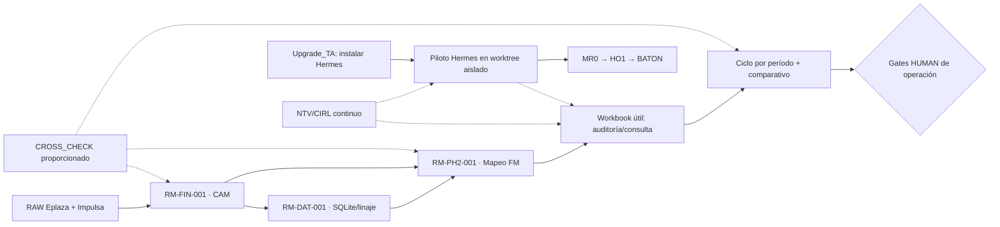

**Recursos y dependencias:** usar ejecutores/specialists solo cuando aporten. El desarrollo no se serializa por preferencias metodológicas; se serializa únicamente por precedencia `HARD`, `GATE` o exclusión de escrituras. `NTV/CIRL` protege el producto, no consume su propia wave.

## 07.00 — Milestones medibles, sin fechas inventadas

| ID de hito propuesto | Hito | Evidencia material | Condición de paso |
|---|---|---|---|
| `RM-MS-P01` | Workbook financiero con PH1 no degradado | Comparación real fuente/CAM/candidato y libro navegable | Aceptación funcional del alcance revisado |
| `RM-MS-P02` | Mapping y FM verificados por sociedad y coeficiente | Conciliación cuenta→FM, 36 filas clasificadas, 16 calculadas con alcance correcto | Ninguna suma errónea, UNKNOWN tratado explícitamente |
| `RM-MS-P03` | Consultas y auditoría operativas | Búsqueda funcional de cuenta, período, entidad, origen y destino | Usuario puede responder preguntas financieras sin inspeccionar SQLite |
| `RM-MS-P04` | Dos períodos reconciliados | CAM/FM correspondientes a fuentes y reglas vigentes de cada corte | Deltas atribuibles y reproducibles |
| `RM-MS-P05` | Hermes listo para KTMA | Prueba real de Upgrade_TA + segunda sesión recuperada | Capacidad comparada con DSH, adopción explícita |
| `RM-MS-P06` | Documentos de handoff actualizados | Roadmap aceptado → MR0 → HO1 → BATON | Canon y documentación sin pérdidas |

**Nota:** `RM-MS-Pxx` son etiquetas candidatas para control del plan, no reemplazan `RM-MS-001…007` históricos. Reconciliar antes de su promoción al canon.

## 08.00 — Dependencias tipadas y autonomía

| Relación | Tipo | Efecto operativo |
|---|---|---|
| Fuentes del período → CAM y SQLite | HARD | No procesar período sin identificación y hashes de fuentes reales |
| CAM y mapping v1.0.1 → FM | HARD | Sin inferir valores ni reclasificar cuentas |
| Evidencia financiera → gate de uso operativo | GATE | Aceptación HUMAN, no PASS automático |
| Upgrade_TA → piloto Hermes | HARD_EXTERNAL | No instala Hermes dentro del desarrollo MovemAcc sin validación |
| Piloto Hermes → cambio de ejecutor | GATE_DECISION | Requiere resultado de producto, continuidad y decisión HUMAN |
| MR0/HO1 → BATON | HARD_DOCUMENTAL | Handoff consume documentos coherentes, sin nuevo canon paralelo |
| SQLite/Excel en edición concurrente | RESOURCE_EXCLUSION | Un writer efectivo por artefacto protegido |
| Auditar TASK060 en paralelo con UX | INFORMATIONAL | No bloquear cambios independientes elegibles |

**Regla contra el ping-pong:** RORCH debe gestionar errores técnicos ordinarios con rework focalizado. Escalar únicamente decisiones financieras, autorización o bloqueos genuinos; ninguna respuesta retórica reemplaza artefactos.

## 09.00 — Gates y decisiones HUMAN

Conservar estados del documento integral, sin actualización unilateral:

| Gate | Estado reportado | Restricción |
|---|---|---|
| `RM-GATE-001` | OPEN | Adopción del Roadmap canónico bajo HUMAN |
| `RM-GATE-002` | CLOSED_INFRASTRUCTURE_ONLY | No implica aceptación contable |
| `RM-GATE-003` | OPEN | Revisión de excepciones/aceptación operacional |
| `RM-GATE-004` | OPEN | Uso productivo de mapping FM según contrato aplicable |
| `RM-GATE-005` | OPEN | Publicación/privacidad y actos específicos de Git |

**Permisos de revisión GitHub:** hay una autorización contextual para `review/KTMA-WORKBOOK-001`. No convertir esa autorización específica en permiso general de publicar la rama experimental, cambiar `main`, distribuir datos o cerrar RM-GATE-005. El contenido del gate efectivo prevalece.

## 10.00 — Riesgos, conflictos y contradicciones que permanecen visibles

| Conflicto / riesgo | Observación | Tratamiento propuesto |
|---|---|---|
| `RM-CONF-001` | Roadmap remoto `ROADMAP.md` corto vs local integral `03_DOCS/MANAGEMENT/ROADMAP_INTEGRAL.md` | Declarar local integral como referencia de revisión; no sobrescribir con el remoto |
| `RM-CONF-004` | Divergencias históricas MORCH/SKILLS y hashes | Mantener abiertas hasta conciliación real |
| FM 66 vs 72 vs 15/16 | Reglas, cuentas, celdas y destinos confundidos en reportes | Matriz por período y unidad contable, no usar cifras intercambiablemente |
| Query deduplicada por `account_code` | Potencial desaparición de ocurrencias o jerarquías | Demostrar equivalencia y presencia de resultados por identidad completa |
| Workbook vs PH1 | Versiones anteriores perdieron datos/auditoría | Proteger contrato semántico y probar nuevas funcionalidades |
| Windows/WSL/rutas | Descargas no realizadas y árboles `C` creados históricamente | Verificar ruta de destino real; no fabricar URLs o SHA |
| Validación Excel nativo | No se acreditó para cada nuevo candidato | Declarar UNVERIFIED por binario específico |
| Cambio de ejecutor | Pérdida de decisiones al migrar | Handoff desde Roadmap/MR0/HO1/BATON y Git, no memoria privada solamente |
| Automatización del propio QA | Riesgo de trabajo infinito sin mejora de producto | Reutilizar mínimos controles existentes; evitar nuevas capas |

## 11.00 — Métricas de producto, no de actividad de agentes

| Métrica | Baseline | Meta/criterio de aceptación |
|---|---|---|
| Integridad de cuentas fuente | RUN_008 253, período/dataset según fuente | 100 % de las filas/valores pertinentes conciliadas contra ese mismo período |
| Cobertura de asignación FM | RUN_008 66/253; 187 no asignadas | Sin doble destino; pendientes visibles, no forzar 253/253 |
| Cobertura de destinos FM | RUN_008 16/36 filas lógicas calculadas | 36/36 clasificadas; 16/16 correctas y demás solo cuando exista evidencia |
| Ceros y desconocidos | RUN_008 68 `ZERO_VERIFIED`, 0 UNKNOWN reportado | 0 falsos ceros; UNKNOWN preservado cuando corresponda |
| Conciliación E/F/D | Reportes técnicos anteriores | Todos los destinos procesados con coeficientes y tolerancias definidas |
| Utilidad consultas | Tabla filtrable publicada | Buscar cuenta por período/entidad, ver fuente y FM, sin falsos faltantes |
| Ciclo multi-período | RUN_009/010 reportados para 2026.08, comparativo 2026.09 | Dos períodos reproducibles desde sus propios RAW sin alterar reglas/antecedentes |
| Regresión de producto | Errores repetidos observados | 0 degradaciones materiales no autorizadas del PH1 |
| Costo de coordinación | Sin medición fiable | Menos re-trabajo, menos intervención HUMAN; medir por entregables utilizables |

No fijar SLA/fechas ni umbrales de rendimiento inventados. El progreso se verifica por **hitos de producto** y eventos financieros, no por frecuencia de reportes.

## 12.00 — Calidad mínima necesaria y reglas de no regresión

1. **Datos:** conciliación por período + entidad + código + tipo de fila + contexto jerárquico, no solo código aislado.
2. **Finanzas:** `Decimal`/tolerancias definidas y coeficientes correctos antes de calcular el resumen FM.
3. **Excel:** conservar jerarquías, subtotales, signos, unidades, filtros, auditoría y trazabilidad; consultas probadas con preguntas concretas de negocio.
4. **Rutas:** WSL/Windows sin traducción ficticia; output existente y recuperable donde se declaró.
5. **Evidencia:** commit, fuente, versión de reglas, candidato y pruebas asociados; no declarar PASS por hash o ausencia de errores de Python solamente.
6. **NTV/CIRL continuo:** seguridad, RAW inmutable, limpieza no destructiva, verificación proporcional a los cambios; **no nuevos bots ni SKILLS salvo necesidad técnica material**.
7. **Aceptación:** `TECHNICAL_VERIFICATION`, `PRODUCT_REVIEW` y `HUMAN_ACCEPTANCE` son estados diferentes.

## 13.00 — Plan de prueba para Hermes (fuera de KTMA, habilitado por Upgrade_TA)

**Hipótesis:** Hermes, correctamente instalado y provisto de modelos OpenRouter/DeepSeek/OmniRoute compatibles, puede conservar el contexto y entregar producto mejor que la actual ejecución DSH. **No está demostrado todavía.**

- `UTA-SETUP`: instalación verificable en WSL2/Windows y acceso a repositorio aislado; uso multimodelo demostrado con el proveedor realmente configurado.
- `KTMA-PILOT-1`: una corrección funcional o consulta financiera de valor visible, preservando PH1 y mapping; no desarrollar infraestructura auxiliar.
- `KTMA-PILOT-2`: reiniciar sesión, recuperar decisiones HUMAN, estado Git, prioridades y tarea pendiente sin explicación manual extensa.
- `KTMA-PILOT-3`: entregar artefacto/versionado real; comparar re-trabajo, regresiones y calidad con DSH.
- `KTMA-DECISION`: continuar con Hermes solo si supera esos hitos; DSH en respaldo, sin eliminación prematura.

**Responsabilidades:** Upgrade_TA configura Hermes. KT.MovemAcc mantiene Roadmap, contrato financiero, pruebas de producto y aceptación. La infraestructura no reordena la prioridad financiera.

## 14.00 — Revisión, procedencia y fuente de verdad

- **Fuente local recibida:** `KT_MovemAcc_ROADMAP_20261030(1).md` (30-10), copiada íntegra en Anexo H1.
- **Remoto inspeccionado:** el archivo `ROADMAP.md` de GitHub es un resumen histórico de ocho ítems y **no sustituye** al documento integral local.
- **Estado hasta RUN_008:** conservar todas las cifras, reportes y conflictos del documento del 30-10 sin convertirlos en aceptación productiva.
- **Reportes posteriores a RUN_008:** candidato integrado agosto, defectos de FM/consulta, rework, cambios de SHA y publicación GitHub; clasificados como `REPORTED` salvo inspección de código/manifest.
- **Última corrección RORCH (02-11):** SHA reportado `9fc6b91f...`, commit `caa2191...`; se observó código remoto con coeficientes y separación de entidades corregidos, pero no existe aceptación humana del libro.
- **No disponible para cotejo:** `03_DOCS/MANAGEMENT/ROADMAP_INTEGRAL.md` físico del worktree Windows, MR0/HO1/BATON actuales, últimos libros XLSB y FM para cálculo independiente completo.

**Regla de actualización:** cambios por evento material — nuevo período contable, nueva decisión financiera, nueva capacidad funcional, aprobación de gate, cambio de ejecutor o regresión material. No inventar cadencia de gobierno.

## 15.00 — Reglas de cambio y conservación

1. No reescribir el Roadmap completo cuando haya una modificación acotada. Actualizar solo secciones vigentes y **mantener baseline histórico literal**.
2. No crear dos Roadmaps canónicos: descargar `ROADMAP.md` es entrega de revisión, no migración efectiva desde `03_DOCS/MANAGEMENT/ROADMAP_INTEGRAL.md`.
3. No renumerar `RM-FIN-001`, `RM-PH2-001`, `RM-GATE-00x` ni su significado. Nuevos IDs requieren crosswalk y adopción.
4. Preservar `RAW.INPUT`, evidence y decisiones; nunca extrapolar una autorización técnica a una decisión contable.
5. Las reglas de mapping vigentes mantienen versión e historia; cambios HUMAN deben guardar emisor, vigencia, fecha de comunicación, fuente y anteriores.
6. Aprendizajes reutilizables propuestos exclusivamente en `IDEAS/` dentro del ROOT; corregir `ROOT/IDEAS/` cuando sea un subárbol literal incorrecto.
7. La transición Hermes no modifica las reglas del producto y no crea un nuevo conjunto de SKILLS como requisito de avance.

## 16.00 — Decisiones y autorizaciones pendientes

| DECISION / GATE | Responsable | Tratamiento |
|---|---|---|
| `RM-GATE-001` adopción Roadmap | HUMAN | Integrar contra canónico físico, con diff y sin pérdida |
| `RM-GATE-003` aceptaciones TASK060 | HUMAN cuando existan decisiones financieras | Previa ficha financiera; técnica independiente puede seguir |
| `RM-GATE-004` uso productivo FM | HUMAN | Sin aprobación automática por tests |
| `RM-GATE-005` publicación general | HUMAN | No confundir rama específica review autorizada con release |
| IVA `120971/120973` | Contador/HUMAN | Mantener pendiente, no aplicar 19 % por supuesto |
| Cuentas provisionales y cambios de mapping | HUMAN/Finanzas | Conservar decisiones actuales hasta nueva instrucción |
| Cambio de ejecutor DSH → Hermes | HUMAN | Decidir tras piloto funcional y recuperación de sesión |

## 17.00 — Próximas acciones y secuencia documental

**En KT.MovemAcc:** adoptar este Roadmap solo después del cotejo físico contra el canon; fijar un objetivo funcional de Excel/CAM/FM; continuar con ejecutor disponible sin esperar instalación de Hermes si existe tarea segura y elegible. Mantener abiertos solo los bloqueos financieros materiales.

**En Upgrade_TA:** instalar y validar Hermes independientemente, con worktree de prueba y modelos concretos, sin modificar el código productivo durante instalación.

**Documentos posteriores (no editados aquí):**

1. `MR0`: actualizar arquitectura/contratos rectores después de la adopción y sin perder baseline.
2. `HO1`: actualizar estado operativo, decisiones y límites de continuidad, sin reabrir 3/3.
3. `BATON`: transferir a Hermes el contexto mínimo suficiente, rutas reales, estado de Git, riesgos pendientes y siguiente GOAL de producto; no volcar transcripciones enteras.

### 17.10 — Quality gate de esta revisión

| Control | Resultado | Límite |
|---|---|---|
| `G_REQ` | PASS_CANDIDATE | Refleja objetivos recientes HUMAN y contratos del 30-10 |
| `G_SOURCE` | PASS_LOCAL_ATTACHED | El archivo 30-10 fue leído y preservado literalmente |
| `G_FUNCTION` | PASS_DOCUMENT | North Star, módulos, waves, hitos, dependencias, gates y aceptación definidos |
| `G_VISUAL` | STATIC_MERMAID_PRESENT | Diagramas no ejecutados en render externo |
| `G_REGRESSION` | PASS_TEXT_PRESERVATION | Anexo H1 contiene el documento 30-10 byte-equivalente en texto Unicode |
| `G_EVIDENCE` | PARTIAL_EXTERNAL | No se leyó el Roadmap real Windows ni se auditó el último workbook binario |
| `G_USER` | PENDING_HUMAN | No existe aprobación por el simple descargable |
| `G_AUTH` | PASS_CANDIDATE_SCOPE | No se hizo write al repositorio ni se modificaron gates |

**VEREDICTO DOCUMENTAL: CANDIDATE_READY_FOR_DIFF, NO CANONICAL_PASS.**

---

# ANEXO H1 — BASELINE LOCAL RECIBIDO, PRESERVADO ÍNTEGRO Y LITERAL

> **ARCHIVO HISTÓRICO PROTEGIDO.** El siguiente contenido reproduce íntegramente `KT_MovemAcc_ROADMAP_20261030(1).md` sin modificar sus líneas. Contiene, a su vez, su propio Anexo H con el baseline histórico del 29-10. En caso de contradicción de estado, la sección 2026-11-02 es la propuesta de actualización; las cifras históricas no se borran.

# KT.MovemAcc — ROADMAP.md | Producto financiero y mapeo contable → Funding Memo

**Versión:** `2026-10-30.REVIEW-RUN008`  
**Estado:** `ACTUALIZACIÓN PROPUESTA PARA RECONCILIACIÓN CANÓNICA / NO ADOPTADA EN EL ROOT`  
**Ubicación canónica declarada:** `C:\01. GitHub\Kumquat.TECH\KT.MovemAcc\03_DOCS\MANAGEMENT\ROADMAP_INTEGRAL.md`  
**Rama experimental informada:** `experiment/ktma-financial-convergence-087` · **HEAD informado RUN_008:** `bb9c19f9b36b74df3b4f4f00a1579a9aee5fa58e`  
**Horizonte:** PH1 → PH1.5 → PH2 mapeo → ciclo mensual → aceptación financiera/productiva.  
**Autoridad:** HUMAN → MORCH → RORCH → ejecutores autorizados.  
**Corte de hechos:** información aportada por HUMAN hasta RUN_008, 30-10-2026; ejecución del repositorio **no verificada directamente** en esta sesión.

> **Regla de conservación:** este documento agrega la revisión vigente y conserva **íntegra y literalmente** la versión integral anterior, identificada como *baseline histórico*, al final. Los estados históricos que contradigan RUN_008 **no son instrucciones actuales**. Antes de adoptar en el ROOT, Codex/RORCH deberá cotejar y fusionar sin pérdida con el `ROADMAP_INTEGRAL.md` real. No se declara aprobación de RM-GATE-001, 003, 004 ni 005.

## 00.00 — Resumen ejecutivo: DÓNDE ESTAMOS → QUÉ SIGUE

**Situación actual:** El proyecto ya dispone de un motor experimental de asignación contable a Funding Memo. RUN_008 reporta **253 cuentas, 66 asignadas, 187 sin asignar, 72 celdas de destino / 36 filas lógicas y 16 partidas mapeadas con total calculado 16/16**. Reporta además **42/42 pruebas de regresión, 19/19 QA de artefacto, comprobación independiente de ceros y recálculo Excel Desktop COM**. La regla de mapeo se mantiene en versión **1.0.1**, sin nueva decisión contable. Son evidencias **reportadas por Codex**, pendientes de verificación física independiente para aceptación formal.

**No confundir:** 16 partidas calculadas ≠ 36 filas completamente resueltas; 72 celdas E/F ≠ 72 conceptos; ausencia contable demostrada ≠ valor desconocido; QA de laboratorio ≠ aceptación productiva.

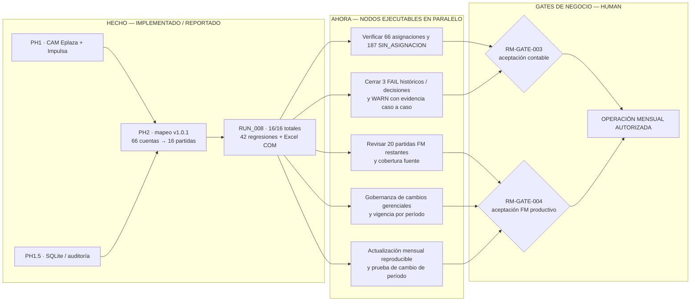

**Contrato NTV siempre activo, no limpieza final:**

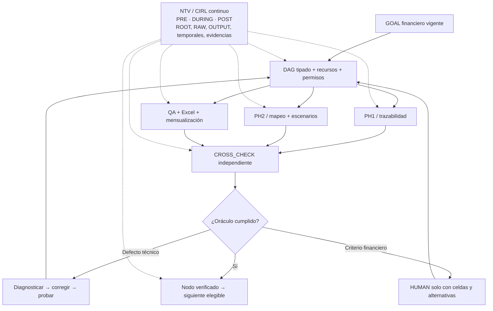

## 01.00 — North Star, contrato financiero y límites

**North Star:** Convertir los reportes contables acumulados de **Eplaza** e **Impulsa** en un CAM conciliado y un Funding Memo legible, trazable y actualizable todos los meses, sin reingresar a mano la lógica de asignación de cada cuenta ni alterar los originales RAW.

### 01.10 — Criterios HUMAN vigentes

1. **Origen numérico exclusivo para el mapeo:** `TOTAL.VALORES_UF` por ID contable, conservando signo original. No sustituirlo por Debe/Haber, saldos iniciales ni movimientos del mes.
2. **Dimensión de entidad:** FM columna **E = Eplaza**, columna **F = Impulsa**, columna **D = total horizontal E + F** para las partidas correspondientes; los encabezados de FM delimitan secciones y unidades, no equivalen a valores.
3. **Cardinalidad:** una cuenta/ID del consolidado puede asignarse a **máximo un ítem FM**; un ítem FM puede agrupar **N cuentas**, con operaciones `+1` o `−1`. Comprobar duplicación de aportes.
4. **Por período:** cambian los montos, **no necesariamente las reglas**. Las reglas son versionadas y pueden cambiar por decisión de gerencia/Directorio. El corte financiero es **acumulado desde inicio de proyecto hasta 23:59 del último día del período**, no únicamente movimiento mensual.
5. **Cero de entidad:** `ZERO_VERIFIED` solo con cobertura completa, identidad de RAW/período, ausencia exacta del ID para esa entidad, control de unicidad y valor CAM cero. `UNKNOWN` no puede convertirse en cero por comodidad. RUN_008 reporta 68 ceros verificados, de los cuales 62 son nuevos respecto RUN_007.
6. **Sin asignación:** cuenta que aún no tiene destino queda `SIN_ASIGNACION_FM`, visible, sin inventar equivalencias ni crear un ítem nuevo automáticamente.
7. **Governance:** una instrucción de HUMAN como «Mauricio indicó cambiar X por Y en fecha/hora» o «Directorio acordó…» se registra con emisor atribuido, texto, fecha, hora, fuente, vigencia, estado, versión anterior y nueva; **fecha de comunicación ≠ vigencia contable**. Historial append-only o garantía equivalente, sin reescribir decisiones antiguas.
8. **IVA construcción:** cuentas `120971`, `120973` requieren consulta al contador sobre IVA y cuenta origen; **no** multiplicar automáticamente por 1,19.
9. **Provisionales revisables:** Honorarios Especialistas, `121031` comercialización y `410457` Software en Postventa/Plan OK permanecen según mapeo HUMAN hasta mejor criterio; crédito especial IVA `120972` mantiene provisionalmente signo contable negativo sin doble inversión.
10. **Fuentes de venta y presupuesto externo:** quedan **fuera del objetivo actual** de alineación de reportes contables; no sustituir el producto con valorizaciones comerciales inventadas.

### 01.20 — Fórmula normativa (sin importes hardcoded)

Para un destino lógico `t` con conjunto de ID asignados `A(t)` y coeficiente `s(a)∈{+1,−1}`:

`FM!E(t) = Σ[a∈A(t)] s(a) × TOTAL.VALORES_UF(EPLAZA,a,período)`  
`FM!F(t) = Σ[a∈A(t)] s(a) × TOTAL.VALORES_UF(IMPULSA,a,período)`  
`FM!D(t) = FM!E(t) + FM!F(t)`

Las referencias efectivas `FM!E/F/D{fila}` se obtienen del **inventario real del libro FM**, no de IDs documentales `FM-Mxx`, que son **aliases conceptuales no oficiales**. Se impide doble destino por ID y doble suma cabecera/hijo. En la ausencia de dato, bloquear cálculo definitivo o representar explícitamente `UNKNOWN`.

## 02.00 — Baseline RUN_008 y evidencia de madurez

| Componente | Estado conocido al corte | Nivel de prueba | Restricción / próxima evidencia |
|---|---|---|---|
| Rama de desarrollo | `experiment/ktma-financial-convergence-087`; HEAD `bb9c19f...` | `REPORTED_ONLY` | Confirmar HEAD y cambios dirty; commits locales, sin push/merge autorizado. |
| PH1 / CAM | Consolidación Eplaza + Impulsa; Excel COM utilizado | `REPORTED_LAB` | Contrato de hojas y celdas reales; importes y jerarquía contra RAW. |
| PH1.5 | SQLite con linaje, modo consulta | `REPORTED_LAB` | Pruebas independientes; cambios DATA con transacciones, no libres. |
| TASK060 | Históricamente 32 FAIL semánticos; informes posteriores difieren entre «resueltos técnicamente» y «pendientes» | `CONFLICTED_REPORTED` | Oráculo original por CASE_ID y aceptación financiera separada. |
| TASK080–082 | 29 WARN físicos; 11 jerarquías técnicamente vinculadas; 18 restantes | `REPORTED_LAB` | Conservar WARN; no promover por existencia de código. |
| TASK083–086 | Investigaciones y escenarios Q1/Q2; reportes de QA y Excel | `REPORTED_LAB` | Diferencias numéricas reales y decisiones financieras; no confundir Q1/Q2 con trimestres. |
| TASK087 | Motor experimental, CAM y FM de negocio, puente Excel PowerShell/COM | `REPORTED_LAB` | Verificar contenido concreto, no solo apertura o copia de XLSX. |
| Mapping RUN_007 | 16 partidas; 1 total; 62 UNKNOWN; versión 1.0.1 | `REPORTED_LAB` | Evidencia comparativa RUN_008. |
| **Mapping RUN_008** | **16/16 totales; 64 VALUE; 68 ZERO_VERIFIED; 0 UNKNOWN** | `REPORTED_LAB` | 62 ceros nuevos solo bajo oráculo de cobertura exhaustiva. |
| QA RUN_008 | 42 PASS, 0 FAIL, 0 SKIP; artifact QA 19/19; zero QA independiente PASS | `REPORTED_LAB` | Conservar recibos, comando, coverage y separación de verificadores. |
| Excel RUN_008 | Excel 16.0 `CalculateFullRebuild` PASS reportado | `REPORTED_LAB` | Evidencia de celdas calculadas y sin fórmulas rotas. |
| Root/CIRL | `PARTIAL_PREEXISTING_DIRTY_TREE` | `REPORTED_ONLY` | Preservar tres archivos dirty ajenos, clasificar hallazgos sin borrar. |
| RM-GATE-003 / 004 | **OPEN** | `HUMAN_REQUIRED` | No inferir aprobación productiva desde QA. |

**Identidad RAW:** RUN_008 reporta Eplaza SHA-256 `c86ae98d2473921fda4ec70250226e8afd530b28b31450c5ff17fad566c549a8` e Impulsa SHA-256 `02003492b472173860e70b29d7837d10a931984a9ae0ae4e1784ca47a18601c6`, que **difieren** de los SHA históricos de XLSB **agosto 2026**. No calificarlos como corrupción: se refieren a un **período/dataset distinto**, a verificar mediante nombre de archivo, manifiesto y contenido. No mutar `RAW.INPUT`.

## 03.00 — Inventario canónico de destinos, cobertura y estado

| Métrica | Valor RUN_008 | Interpretación |
|---|---:|---|
| Cuentas consolidadas | 253 | Universo de ID del CAM usado por mapping septiembre. |
| Cuentas con destino definido | 66 | 66 relaciones de ID a 16 partidas FM; el nombre o fórmula de cada vínculo no debe cambiar sin registro. |
| Cuentas `SIN_ASIGNACION_FM` | 187 | No necesariamente errores; clasificación y materialidad pendientes. |
| Celdas destino FM E/F | 72 | **36 filas lógicas × 2 entidades**, no «72 partidas financieras». |
| Partidas FM con vínculo contable RUN_008 | 16 | 16 filas lógicas mapeadas con 16 totales D calculados. |
| Filas lógicas restantes | 20 | No todas equivalen a «fuentes externas»; conservar tipología verificada, reconciliar 72/74 histórico. |
| Modificaciones del template | 48 celdas | 16 totales D + 16 E + 16 F, según reporte. |
| Cambios RUN_007→RUN_008 | 15 F y 15 D recalculados | De UNKNOWN a ZERO_VERIFIED bajo condiciones. |
| Versión de mapping | `1.0.1` | No alterada por recálculo mensual. |

### 03.10 — Ejemplo de cadena de trazabilidad (no usar valores de un mes)

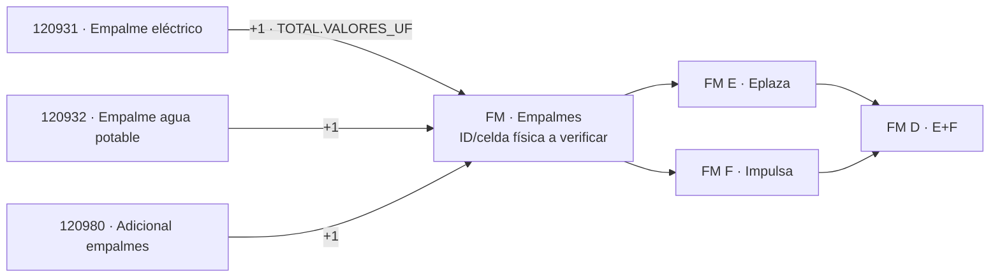

El mapa integral de **66 vínculos y 16 grupos conceptuales** está documentado en `KTMA_MAPEO_CONTABLE_A_FM_V02_CONCEPTUAL.md` según HUMAN y en `03_DOCS/HUMAN/KTMA_FUNDING_MEMO_MAPPING.md` según reportes Codex. La V02 fue localizada por HUMAN en `C:\Users\aazcl\Downloads`; la presencia y autoridad exacta dentro del ROOT deberán verificarse. **No es contrato de ID físico FM** hasta mapear sus aliases con `FM!celda` verificada.

## 04.00 — Estrategia, fases y módulos WBS (conservar IDs previos)

| WBS / módulo histórico | Alcance y resultado | Estado al corte | Siguiente oráculo |
|---|---|---|---|
| `RM-FIN-001` / PH1 | Ingesta y CAM, cruce entidades, jerarquía, celdas auditables | Baseline técnico | Reproducir corte mensual sin mutar RAW y sin doble cómputo. |
| `RM-DAT-001` / PH1.5 | SQLite fuente derivada, linaje por registro | Baseline técnico | Reconstrucción consistente con input y respaldo transaccional. |
| `RM-AUD-001` | AUDIT_ID, 29 WARN, criterios y evidencias | 11 vinculados, 18 abiertos según reporte | Oráculos financieros y estados independientes. |
| `RM-REC-001` | TASK060 32 FAIL y denominador original | CONFLICTED | 32 comparaciones caso a caso; separar identidad técnica vs autoridad financiera. |
| `RM-PH2-001` | 72 celdas/36 filas, mapeo N:1, 66 cuentas, 16 filas calculadas | **RUN_008 PASS técnico reportado** | Prueba de revisión financiera y ampliación solo con fuente suficiente. |
| `RM-CAT-001` | Catálogos y variantes jerárquicas Eplaza/Impulsa | Documental | Procedencia y vigencia por entidad, sin universalizar catálogo Eplaza. |
| `RM-QA-001` | Regresiones, Excel COM, oráculos y diffs | RUN_008 42/42, 19/19 reportados | Ejecución independiente y suites apropiadas tras cambios. |
| `RM-ROOT-001` | NTV/CIRL always-on, inventario e higiene | ACTIVO; dirty preexistente | Clasificación de deltas, no limpieza destructiva. |
| `RM-GOV-001` | Skills, MORCH y reconciliación documental | 2 SKILLS ROADMAP aprobadas por HUMAN; instalación local indicada | No crear proyecto de refactorización documental, comprobar identidad al adoptar. |
| `RM-TRUST-001` | Autorización productiva y publicación | `NOT_ENFORCED` histórico, verificar cambios | HUMAN + seguridad; sin publicar por defecto. |

**Conservación de numeración:** los IDs anteriores se mantienen; esta actualización **no renumera ni crea una taxonomía competidora**. La transición a MR0 y HO.1 será una reconciliación posterior, no se incorpora aquí como mutación documental.

### 04.10 — Vistas obligatorias complementarias (fases y módulos)

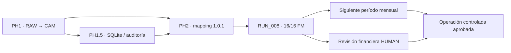

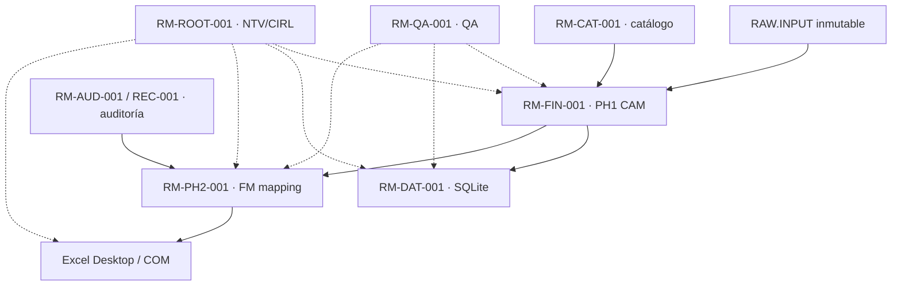

## 05.00 — ROADMAP de ejecución real: GOALS, TASKS y SPECIALIST (D5→D1)

**Prohibido volver al ping-pong:** cada tarea técnica debe implementar, validar, autocorregir y desbloquear sucesores del DAG; no regresar a HUMAN por problemas de runtime, diferencia de hojas, tests, conteos o formato. Tres intentos independientes razonados → escalar **solo ese nodo**, seguir trabajos paralelos. El operador mantiene permisos existentes: **no hay autorización automática para push, merge o cambios destructivos**.

| Prioridad/ID de cartera (no TASK_ID histórico) | Dificultad | Frente / entrega implementable | Paralelismo | Condición de aceptación |
|---|---|---|---|---|
| `RM-NEXT-FM-01` | **D5** | Motor mensual multi-período: regenerar CAM + FM con RAW del período nuevo, misma versión de mapping y reconciliación de celdas E/F/D | Paralelo con registro/QA | Dos períodos distintos producen diferencias atribuibles a RAW; sin hardnumbers ni cambios de reglas. |
| `RM-NEXT-REC-02` | **D5** | TASK060: ejecutar oráculos 32/32 y resolver contradicción «32 técnicos resueltos/32 FAIL formales» | Paralelo con FM | Matriz completa por CASE_ID con resultado técnico y estado financiero separados. |
| `RM-NEXT-FM-03` | **D5** | Inventariar **20 filas lógicas FM restantes**, localizar fuentes disponibles o entradas manuales válidas; no inventar ventas | Paralelo con gobernanza | Cobertura 36/36 clasificada, nunca confundir 20 con 20 fuentes externas. |
| `RM-NEXT-GOV-04` | **D4** | Cambios gerencia/Directorio: eventos append-only con atribución, fecha, zona horaria, aprobación, vigencia, versión, antes/después y reconstrucción histórica | Paralelo con FM | Demostrar «cambio futuro» preserva meses históricos y «retroactivo» requiere autorización explícita. |
| `RM-NEXT-QA-05` | **D4** | Oráculo independiente para `ZERO_VERIFIED`, signos, doble destino, 72 celdas E/F, 16 totales y compatibilidad Excel | Paralelo incremental; convergencia al integrar | 0 falsos ceros; 42/42 o suite pertinente tras delta y Excel COM donde corresponda. |
| `RM-NEXT-FIN-06` | **D4** | Resolver dudas financieras materialmente abiertas: IVA construcción, comercialización `121031`, software `410457`, Q1 220516/220517, Q2 subtotales | No bloquear otros frentes; HUMAN cuando exista ficha de celdas | Decisiones con archivo>hoja!celda, opciones, impacto y autoridad; ninguna aprobación tácita. |
| `RM-NEXT-ROOT-07` | **D3** | Root hygiene CIRL permanente y triage de dirty preexistentes/UNKNOWN_HOLD | Siempre activo | Inventario/delta, archivos RAW intactos, OUTPUT trazado, sin borrado/migración no autorizada. |
| `RM-NEXT-DOC-08` | **D2** | Generar diagramas Markdown de 66 conexiones y 16 partidas a partir del registro real | Paralelo con QA | Diagrama regenerable, sin importes mensuales, con ID cuenta/ID FM y fórmula. |
| `RM-NEXT-UX-09` | **D1** | Vista de negocio: partidas FM, aportes Eplaza/Impulsa, totales, pendientes; auditoría técnica en hoja separada | Después de dato funcional | Usuario puede operar Excel sin entender AUDIT_ID ni SQLite. |

### 05.10 — DAG tipado sin serialización artificial

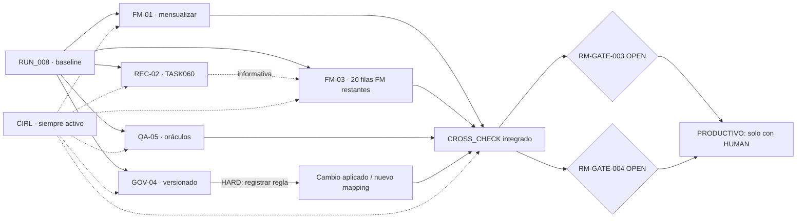

## 06.00 — Gates, autorización y decisiones financieras

| Gate | Estado al corte | Lo que **no** autoriza un PASS técnico |
|---|---|---|
| `RM-GATE-001` | OPEN salvo adopción explícita posterior | Sustituir `ROADMAP_INTEGRAL.md` en ROOT por este borrador. |
| `RM-GATE-002` | `CLOSED_INFRASTRUCTURE_ONLY` histórico | Tratar interoperabilidad Excel/DSH como aprobación financiera. |
| `RM-GATE-003` | OPEN | Certificar PH1/1.5 productivos o 32 excepciones sin acto HUMAN y matriz. |
| `RM-GATE-004` | OPEN | Declarar mapping/producto FM productivo; laboratorio y OUTPUT experimental están permitidos en su ámbito vigente. |
| `RM-GATE-005` | OPEN | Push/merge/publicación o distribución de datos sin autorización. |

**Cola HUMAN priorizada, exclusivamente financiera:**

- **FIN-01 — IVA construcción:** `120971` y `120973`. ¿Existe IVA construcción separado? ¿En qué cuenta/documento y con qué tratamiento? Pendiente del contador; no aplicar 19 % por defecto.
- **FIN-02 — Clasificaciones provisionales:** `121031` Comercialización y `410457` Software / Postventa; mantener vigentes sin reclasificar por defecto.
- **FIN-03 — Cuentas relacionadas:** `220516/220517`, sentido por entidad y consolidación; preservar separación hasta decisión documentada.
- **FIN-04 — Tres discrepancias de subtotales:** cabecera fuente vs suma hijos, por Debe/Haber/UF/CLP; presentar deltas verdaderos, no afirmaciones genéricas.
- **FIN-05 — Gobernanza del mapping:** cambios futuros instruidos por Mauricio/Directorio, con vigencia contable separada de fecha de instrucción. La regla de historial está definida, sus futuros eventos no.

Las 187 cuentas no asignadas se mantienen visibles; su falta de destino no es sinónimo de cero ni implica que todas deban alimentar el FM.

## 07.00 — Definición de DONE y pruebas necesarias

| Alcance | Oráculo de DONE | Estado |
|---|---|---|
| Mapeo técnico RUN_008 | 16/16 totales, 64 VALUE, 68 ZERO_VERIFIED, 0 UNKNOWN; Excel COM, 42/42 regresión | **PASS técnico reportado**, no aceptación productiva |
| Ingesta de mes posterior | RAW período nuevo → CAM → FM; misma mapping version; valores/celdas, hashes, fechas | **PENDIENTE DEMOSTRACIÓN** |
| 36 filas / 72 celdas FM | 16/36 calculadas + 20/36 clasificadas y operables con datos legítimos | **PARCIAL / no 100 % calculado** |
| Decisiones y reversibilidad | Cambio gerencial con fecha, autoridad, vigencia, versión y replay histórico | Parcial: historial 1.0.1 reportado; test extremo a extremo requerido |
| TASK060 | 32/32 casos con comparación original y resultado nuevo, regla aprobada si aplica | **Estado formal en conflicto** |
| Uso financiero de negocio | Salidas legibles, revisadas por responsables, sin cifras inventadas | **PENDIENTE HUMAN** |
| Publicación productiva | Aceptación financiera + seguridad + permisos vigentes | **BLOQUEADO GATES** |

**Checklist de rechazo:** No declarar `PASS` por copiar XLSX, conservar SHA, ejecutar 19 tests sin definir cobertura, guardar un Excel sin recalcular, catalogar `UNKNOWN` como cero, contar 72 celdas como 72 ítems, reclasificar 32 FAIL solo por renombrar nodos o modificar reglas sin registrar instrucción.

## 08.00 — Política de archivos, CI/NTV y residuos

- `RAW.INPUT/`: **INMUTABLE**. SHA original registrado por período y entidad, comparado antes y después, no borrar/renombrar.
- `OUTPUT/`: **MUTABLE_CONTROLLED**. Generar, recalcular y perfeccionar; mantener manifest de cambios, diferencia de celdas y linaje; **no usar hash histórico hardcoded como prohibición de OUTPUT nuevo**.
- `DATA/KTMA.sqlite`: escritura solo bajo contrato transaccional/reversión; no hay permiso general destructivo.
- `src/`, `06_TESTS/`, `07_TOOLS/`: mutables dentro de rama y permisos vigentes; commits locales acotados autorizados, sin push/merge.
- `08_EVIDENCE/`: conservar evidencia y provenance, evitar sustitución de registros históricos.
- `90_RUNTIME/`: aislar pruebas concurrentes, cuarentena/retención controlada; preservar `UNKNOWN_HOLD` (dos reportados históricamente) y dirty preexistente.
- **CIRL siempre activo:** PRE (root, allowlist, baseline) → DURING (escritores, artefactos, temporales) → POST (delta, hashes RAW, residuos, orphan, referencias), cruzado con **todos** los nodos del DAG.

## 09.00 — Seguimiento y siguientes actualizaciones MR0 / HO.1

**Este entregable es SOLO Roadmap.** Después de su revisión y reconciliación canónica, preparar **MR0** y luego **HO.1**, usando el Roadmap aprobado como entrada, sin borrar contenido útil de las versiones previas.

- **MR0 posterior:** comprobar arquitectura real de mapeo, integridad/linaje, gobierno de cambios y vigencias, reglas de cero, dependencias tipadas, escenarios financieros, pruebas independientes y gates.
- **HO.1 posterior:** continuidad humana/automática, handoff Codex ↔ RORCH/DSH, recuperación de worktree dirty, rutas/contratos reproducibles, evidencia, permisos y criterios de parada/continuación.
- **No adelantar aprobación:** este MD no afirma que se editó MR0, HO.1 o el canónico en `C:`.

## 10.00 — Registro de procedencia y límites de verificación

**Decisiones HUMAN directas en esta conversación:** definición de `FM!E/F/D`, suma horizontal, `TOTAL.VALORES_UF`, regla N:1 con coeficiente, ceros verificables, 187 sin asignación visibles, mapeo versionado por Gerencia/Directorio, ubicación de V02 en Downloads, política RAW inmutable y OUTPUT mutable, asignaciones provisionales/IVA.

**Resultados reportados por Codex / RORCH:** TASK060–087, RUN_007/008, SHA de septiembre, COM, QA, modelo v1.0.1, 66 códigos / 16 targets, 72 E/F cells. No se verificaron en el repositorio real en esta sesión.

**Material efectivamente disponible aquí:** `ROADMAP_KTMA_NTV_20261029.md`, `ROADMAP.md` anterior, SKILLS transversal e interna ROADMAP aprobadas por HUMAN, `KTMA_MAPEO_CONTABLE_A_FM_V02_CONCEPTUAL.md`, `mapeo1.xlsx` y fragmentos de continuidad MORCH. El `03_DOCS/MANAGEMENT/ROADMAP_INTEGRAL.md` *real y vigente* no fue adjuntado ni inspeccionado. Ningún hash real del repositorio fue recalculado aquí.

**Conflictos históricos explícitos que no se borran:** 72 vs 74 (reconciliar como 72 celdas E/F y 36 filas), 32 FAIL históricos vs resolución técnica, octubre 2026 vs estado de skills previo, manifiesto MORCH 7/13, `03_DOCS/MANAGEMENT` canónico vs nombre descargable `ROADMAP.md`, hashes diferentes según período, estado NTV/ROOT parcialmente dirty.

---

# ANEXO H — BASELINE HISTÓRICO ÍNTEGRO (2026-10-29.REVIEW-02)

> **ARCHIVAL / NO ES ESTADO VIGENTE.** Se conserva el documento integral anterior palabra por palabra para evitar pérdida de IDs, fases, gates, riesgos, oráculos, matrices de SPECIALIST y anexos, conforme a las SKILLS aprobadas. Las instrucciones históricas que niegan implementación de PH2 quedan supersedidas **solo como estado de ejecución de laboratorio autorizado**, no como aprobación productiva. Al adoptar una edición posterior, reconciliar formalmente con la versión canónica del ROOT sin desechar el material histórico.

# KT.MovemAcc — ROADMAP de producto y convergencia financiera

**Versión de trabajo:** `2026-10-29.REVIEW-02`  
**Estado:** `DRAFT_FOR_HUMAN_REVIEW / NOT_CANONICALLY_ADOPTED`  
**Ámbito:** `C:\01. GitHub\Kumquat.TECH\KT.MovemAcc`  
**Roadmap local declarado canónico:** `03_DOCS/MANAGEMENT/ROADMAP_INTEGRAL.md` (no sustituido ni contrastado íntegramente en esta sesión).  
**Rama / HEAD informados por Codex:** `experiment/ktma-qa-harness-004` / `e948336cd790d998e4af6243d00246989404897e`; no son una observación local del autor de este borrador.  
**Origen de información de producto:** reportes TASK060–TASK080 aportados por HUMAN en la conversación; nivel `REPORTED_ONLY` salvo fuente efectivamente inspeccionada aquí.  
**Autoridad:** HUMAN → MORCH → RORCH → SPECIALIST/ejecutores autorizados; un roadmap no concede permisos.

> **Alcance y límite de esta entrega.** Se examinaron los seis archivos SKILLS adjuntos y el informe de Codex TASK077/TASK079/TASK080. **No** se accedió al disco local Windows, al contenido completo del `ROADMAP_INTEGRAL.md` activo ni al catálogo íntegro de SKILLS del ROOT. Por ello este documento es una **propuesta integral basada en fuentes**, no una actualización canónica verificada, una certificación de instalación de SKILLS ni una sustitución autorizada.

## 0. Mapa ejecutivo: DÓNDE ESTAMOS → QUÉ SIGUE

**Punto actual (corte basado en reportes Codex TASK077–080; evidencia `REPORTED_ONLY`):** PH1 y PH1.5 cuentan con baselines históricos; TASK079 catalogó Eplaza; TASK080 implantó identificadores de auditoría en laboratorio. **Ahora comienza la adjudicación HUMAN de 29 WARN**. La aceptación operacional y PH2 no están autorizadas; la migración de carpetas está bloqueada. La higiene del ROOT no está bloqueada: continúa en **modo inventario, prevención y diseño de correcciones**, sin mover ni borrar.

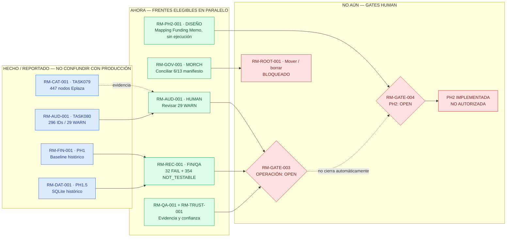

**Lectura:** azul = capacidades/reportes disponibles (no certificación productiva); verde = trabajo elegible, sujeto a recursos y alcance; rojo = efectos bloqueados por gate o dependencia. Las flechas continuas indican entradas necesarias para cierre o paso correspondiente; la flecha punteada desde el catálogo es informativa. **Diseño PH2 no depende de cerrar RM-GATE-003**; su implementación sí requiere RM-GATE-004 y las validaciones/autoridades adicionales que correspondan.

### Contrato NTV siempre activo (no etapa final)

Cada frente activo debe ejecutar el mismo mecanismo, con profundidad proporcional al riesgo: `GOAL → LOOP → TASKS → GRAPH/DAG tipado → asignación de recursos (SPECIALIST/AGENT/BOT solo si comprobados y útiles) → ejecución permitida → CROSS_CHECK → TERMINAL_CONVERGENCE`. Al mismo tiempo, **`CIRL / ROOT_HYGIENE` corre lógicamente en todos los loops**: inventario inicial, deltas, clasificación, prevención de nuevos residuos, propuesta de correcciones, prueba de referencias, retención y rollback. Una operación de limpieza que requiere mover/eliminar permanece bloqueada, **pero no suspende la detección ni paraliza el producto financiero**.

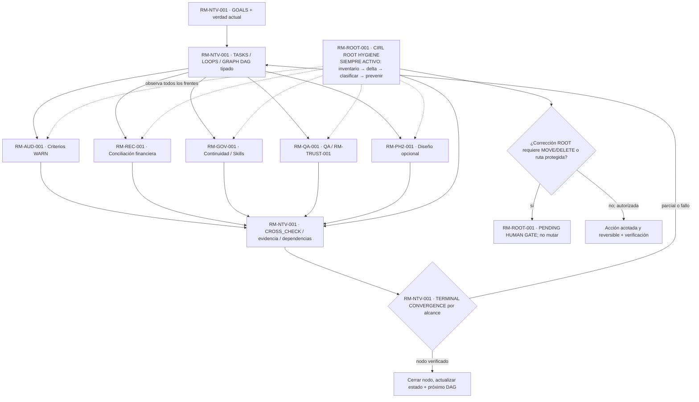

**Invariantes no negociables:** `NO_TUNNEL_VISION=true`, `MAX_SAFE_USEFUL_PARALLELISM=true`, `ROOT_HYGIENE_ALWAYS_ACTIVE=true`, `NO_ROOT_DISORDER=true`, `PROJECT_ROOT_WRITE_ONLY=true`, `PROTECTED_PATHS_DENY_WRITE=true`, `EVIDENCE_BEFORE_CLAIMS=true`, `UNKNOWN != PASS`. Los BOTS no son un requisito ritual ni se presumen instalados. Un único SPECIALIST puede intercalar frentes, pero eso **no** demuestra ejecución simultánea. Solo bloquean precedencias `HARD`, `GATE` y `RESOURCE_EXCLUSION`; las `INFORMATIONAL` no paralizan.

## 1. North Star — Resultado y beneficiarios

**North Star (propuesta de síntesis del trabajo observado):** disponer de una cadena financiera reproducible para MOVEM que transforme mayores originales de **Inmobiliaria Eplaza** y **Grupo Impulsa** en una consolidación Excel trazable (PH1), persistencia/consulta estructurada (PH1.5) y, solo tras autorización de diseño, alimentación del **Funding Memo** (PH2), con preservación de datos de origen, jerarquías y criterios acordados por HUMAN.

**Beneficiarios:** responsables del proyecto y de Administración/Finanzas, revisores financieros y HUMAN como dueño de las decisiones contables. El resultado no es acumular pruebas o carpetas, sino **hacer verificable, inteligible y útil la información financiera**.

**Métricas de resultado:** conciliación de cuentas/celdas, criterios pendientes resueltos con autoridad, ausencia de discrepancias financieras no justificadas, trazabilidad de importes y jerarquías desde fuente hasta destino, capacidad de ejecutar/recuperar sin modificar originales, aceptación de usuario por separado de tests.

**Dentro del alcance:** PH1, PH1.5, revisión de sus discrepancias, catálogo Eplaza, WARN con AUDIT_ID, contrato PH2 todavía gated, calidad, seguridad del ROOT, arquitectura documental/continuidad y cumplimiento de SKILLS. **Fuera del alcance actual:** declarar productivo el runtime; implementar PH2; sincronizar SkillsMachine; publicar material privado; borrar material histórico; promover Git; recalcular o sobrescribir un Excel aceptado.

## 2. Current State — Evidencia, madurez y deudas

| ID | Estado a fecha de corte | Evidencia disponible y limitación |
|---|---|---|
| RM-FIN-001 | `PH1_ACCEPTED` histórico local; salida original protegida | MORCH/antecedentes reportan aceptación; el actual `OUTPUT/2026.08/CAM2026.08_CONSOL.ALIGN.xlsx` SHA `5acba7...` corresponde a baseline física TASK069, **no equivale al binario originalmente aceptado** (`38a3ff...` citado por la SKILL interna QA). |
| RM-DAT-001 | PH1.5 SQLite histórico aceptado; control protegido | `DATA/KTMA.sqlite` SHA `b5f6b6...`, reportado 7/7 preservado tras TASK080. No implica aceptación de PH2. |
| RM-QA-001 | TASK076 `PASS_REPORTED_LAB`; TASK075 detectó falta de recibos en RUN_002 | RUN_003 reporta 52/52 tests, JUnit/exit 0 y hashes; revisión independiente de identidad `PENDING`. No confundir laboratorio con producción. |
| RM-AUD-001 | TASK080 `PASS_REPORTED_LAB` | Hoja `AUDIT.PH1` con 296 IDs (29 WARN, 267 INFO), RUN_002; 10/10 tests reportados, no recalculado en Excel Desktop. |
| RM-CAT-001 | TASK079 `PASS_REPORTED_DOCUMENTAL` | PDF Eplaza, 10 páginas, 447 nodos (4 TITLE, 144 SUBTITLE, 297 DETAIL, 2 unresolved); 179/214 cuentas del mayor coincidentes; 35 exclusivas del mayor. Vigencia del catálogo `UNKNOWN`. |
| RM-REC-001 | OPEN | TASK060: 11.325 comparaciones reportadas; 10.939 PASS, 32 FAIL, 354 NOT_TESTABLE. Reinterpretaciones posteriores **no cierran** los casos sin evidencia caso a caso. |
| RM-GOV-001 | CONFLICTED | TASK077: MORCH manifest 7/13 concordancias; seis divergencias; `main` declarado canónico frente a branch experimental en uso. |
| RM-ROOT-001 | ANALYSIS_COMPLETE / MIGRATION_BLOCKED | TASK077 inventarió colisiones en renumeración, ~19.242 archivos runtime, 41 sueltos ROOT; no se autorizó moverlos. |
| RM-TRUST-001 | NOT_ENFORCED | Autorizaciones de laboratorio ≠ emisor HUMAN independiente; `RM-GATE-003=OPEN`. |
| RM-PH2-001 | DESIGN_GATED | `RM-GATE-004=OPEN`; mapeo financiero Funding Memo no autorizado para implementación. |

**Criterio contable HUMAN documentado en Skill interna de preguntas/decisiones:** los reportes son **movimientos acumulados desde el origen del proyecto hasta las 23:59 del último día del período**; no son, por defecto, movimientos de un único mes. Se debe contrastar con la naturaleza saldo/flujo del Funding Memo antes de mapear.

**Advertencias de interpretación:** la SKILL QA interna distingue `ITEM`, `SUBTITLE_1`, `SUBTITLE_2`, `TITLE` y `ECONOMIC_PARAMETER` en **mayores fuente**. La taxonomía `TITLE/SUBTITLE/DETAIL/UNRESOLVED` proviene del **catálogo PDF**. No son equivalencias automáticas: se requiere crosswalk explícito y evidencia de estilo/valores.

## 3. Target State — Capacidad y madurez esperadas

| ID | Entregable observable | Madurez actual reportada | Meta / prueba de salida |
|---|---|---|---|
| RM-FIN-001 | CAM/CM/CONTROL/AUDIT.PH1 íntegros, legibles y trazables | L3 laboratorio / aceptación histórica PH1 | L4 operacional controlado si reconciliaciones y pruebas de Excel real/recuperación pasan; L5 solo con autorización. |
| RM-DAT-001 | SQLite con linaje y consultas consistentes | L3 histórico | Integridad y consultas no destructivas reproducibles con trazabilidad fuente; sin migración no autorizada. |
| RM-AUD-001 | WARN/INFO con IDs, feedback y versiones de decisión | L2/L3 laboratorio TASK080 | Los 29 WARN revisables, cada uno con estado y contexto; criterios HUMAN almacenados y aplicados solo cuando autorizados. |
| RM-CAT-001 | Catálogo Eplaza estructurado con procedencia y vigencia | L1/L2 documental TASK079 | 447 nodos reconciliados (2 sin padre resuelto o explícitamente pendientes), conflictos y 35 extensiones juzgados caso a caso. |
| RM-REC-001 | Matriz de aceptación financiera por caso | Evidencia histórica, open | Cada FAIL/NOT_TESTABLE con prueba fuente→celda→criterio; decisión técnica y HUMAN cuando proceda. |
| RM-PH2-001 | Contrato de mapping PH1/PH1.5 → Funding Memo | L0 propuesta | Contrato aprobado de cuentas/jerarquía, UF/CLP, signos, entidad, saldos/flujo, actual/presupuesto/proyección, asignación y excepciones, antes de implementación. |
| RM-TRUST-001 | Autoridad de uso productivo autenticada | L0/L2 local, NOT_ENFORCED | Emisor/trust anchor independiente, grants acotados/revocables y pruebas reales de enforcement; gate HUMAN. |
| RM-ROOT-001 | ROOT simple, sostenible y recuperable | Diagnóstico TASK077 | Estructura sin autoridades paralelas, dependencias íntegras y migración reversible con snapshot real de tracked/untracked/ignored. |

**Escalera de madurez:** L0 concepto → L1 visual/inspeccionable → L2 funcional acotado → L3 integrado en laboratorio → L4 operación controlada → L5 productivo autorizado → L6 evolutivo. Ningún resultado L3 implica L5.

## 4. Strategy — Prioridad a valor financiero y paralelismo seguro

1. **Frente producto A:** revisar los 29 WARN actuales (primero 15 conflictos descriptivos, luego 3 subtotales, 11 jerarquías), sin que la secuencia impida tratar casos independientes. Conservar todas las decisiones y sus evidencias en un registro único, sin re-preguntar decisiones HUMAN previas.
2. **Frente producto B:** reconciliar los 32 FAIL/354 NOT_TESTABLE históricos de TASK060 por caso (incluyendo casos disputados) y obtener oráculo financiero independiente. El catálogo Eplaza apoya solo su entidad; nunca determina Impulsa automáticamente.
3. **Frente habilitador C:** resolver divergencias MORCH, ownership SKILLS y paths; higiene CIRL siempre activa sin borrado no autorizado. Puede avanzar en paralelo con A/B mientras no compita por archivos protegidos.
4. **Frente habilitador D:** formalizar evidencia, runtime y confianza para RM-GATE-003. RUN_003 sirve como evidencia de laboratorio, no como firma de HUMAN.
5. **Frente futuro E:** diseñar PH2 de forma read-only/candidata y mantener implementación bloqueada por RM-GATE-004, sin inventar mapeos de Funding Memo.

**Regla de priorización:** primero beneficio económico/contable verificable, luego operaciones habilitadoras; preservar seguridad, trazabilidad y reversibilidad. No inventar tiempos ni fechas.

### 4.1 NTV operativo permanente: GOALS, LOOPS, TASKS, GRAPH, AGENTS/BOTS y CIRL

| GOAL / módulo propietario | LOOP / NEXT TASK | Recursos disponibles o propuestos | Estado de ejecución | Dependencia material | Higiene CIRL por loop | Oráculo de cierre |
|---|---|---|---|---|---|---|
| `RM-AUD-001` resolver WARN | `RM-NEXT-001`: extraer registros reales → agrupar → revisión HUMAN → registrar criterio → cross-check | HUMAN + MORCH; Codex SPECIALIST opcional | READY para leer; aprobación individual pendiente | Registro real TASK080; decisión HUMAN para criterios | Registrar nuevos archivos, no duplicar decisiones | 29/29 identidades revisadas y estados fieles; no exigir 29 aprobaciones |
| `RM-REC-001` reconciliar fuentes | `RM-NEXT-002`: caso → source/celda → signo/monto → oráculo → dictamen | Especialista financiero; QA con oráculo distinto | READY_READ_ONLY | 32 FAIL, 354 NOT_TESTABLE, inputs protegidos | No regenerar RAW/OUTPUT/DATA; registrar sidecars | Matriz completa de evidencias, sin PASS especulativos |
| `RM-GOV-001` continuidad | `RM-NEXT-003`: 6 drift → proveniencia → conflicto → propuesta → gate | Codex SPECIALIST o lectura directa | READY_READ_ONLY; mutación bloqueada | MORCH 7/13 y autoridad documental | Localizar duplicados, rutas obsoletas, referencias | 13/13 coherentes solo tras resolución autorizada |
| `RM-QA-001`/`RM-TRUST-001` | `RM-NEXT-005`: recibos → threat model → negativas → aceptación | SECURITY SPECIALIST; verificador distinto cuando posible | READY_DESIGN/QA; producción BLOQUEADA | Gate 003 + independencia suficiente | Sin caches ni evidencias fuera ROOT | Pruebas replicables y grants auténticos; no confundir fixture con producción |
| `RM-PH2-001` contrato FM | `RM-NEXT-006`: mapa candidatos → criterios → excepciones → revisión | Arquitecto financiero / SPECIALIST cuando aporte | READY_DESIGN_ONLY | Implementación bajo gate 004; finanzas por validar | Documentación derivada clasificada, sin canon paralelo | Mapping propuesto, no implementación |
| `RM-ROOT-001` orden | `RM-NEXT-004`: baseline → delta → dependencia → propuesta LEGACY → gate → lote ≤10 | Especialista de repositorio | **CIRL READY_ALWAYS**; MOVE/DELETE BLOQUEADOS | Owner/canon y permiso específico para cambio | Es el frente permanente; no solo cierre | Nuevos residuos 0 dentro del loop o deuda identificada, sin limpiezas ficticias |

**Política de recursos:** escoger bot/agente/subagente por capacidad **observada** y utilidad, con `RESOURCE_ID`, disponibilidad, frontera de confianza, coste, oráculo, permisos, exclusión de escritores, fallo/rollback. Si no hay bot verificablemente disponible: `BOT_NOT_ASSIGNED; NO_IMPACT_ON_GOAL`. Los frentes pueden avanzar en paralelo de manera lógica; ejecución simultánea solo con medios y aislamiento realmente demostrados.

**Ciclo mínimo CIRL:** `DISCOVER → CLASSIFY → EXPLAIN → PREVENT → PLAN → ACT_IF_AUTHORIZED → VERIFY → RECONCILE`. Capturar en cada cierre: `ROOT_HYGIENE_STATUS`, `FULL_TREE_COVERAGE_OR_DELTA`, `NEW_ARTIFACTS`, `DUPLICATES`, `UNKNOWN_HOLD`, `TEMPORARY_RESIDUES`, `CLEANUP_ALLOWLIST`, `CLEANUP_GATES`, `UNEXPECTED_MUTATIONS`, `NEXT_DAG`. TASK077 es inventario basal, **no un CIRL completo operando**; implementar el hábito sin fingir automatización.

## 5. Module Catalog — IDs y contratos

| Module ID | Nombre / tipo | Owner | Estado | Dependencia/gate real | Condición verificable de salida |
|---|---|---|---|---|---|
| RM-NTV-001 | Multipath, LOOPS y terminal convergence (control transversal) | MORCH/RORCH + ejecutores autorizados | REQUIRED_METHOD / ENFORCEMENT_UNVERIFIED | Todos los frentes, recursos y gates | DAG actualizado, cross-check por alcance, CIRL registrado; sin falsa automatización |
| RM-FIN-001 | PH1 consolidación (capability) | Equipo financiero/SPECIALIST | LAB / HISTORICAL_ACCEPTANCE | RAW protegidos; RM-REC-001 para aceptación operacional | Workbook, celdas, fórmulas, estilos, jerarquías y fuente verificadas |
| RM-DAT-001 | PH1.5 persistencia (capability) | Técnico/Finanzas | HISTORICAL_ACCEPTANCE | PH1/Sources; write guard | SQLite/linaje integridad y lectura controlada |
| RM-CAT-001 | Catálogo Eplaza (workstream) | SPECIALIST + HUMAN | PARTIAL_DECISION | PDF real TASK079 | Clasificación verificable, vigencia y excepciones explícitas |
| RM-AUD-001 | AUDIT_ID y decisiones (workstream) | SPECIALIST/HUMAN | PASS_REPORTED_LAB; 29 OPEN | TASK080; RM-CAT-001 informativa | 29 WARN adjudicados, aprobaciones auténticas, IDs estables |
| RM-REC-001 | Matriz financiera TASK060 (workstream) | Finanzas/QA | OPEN | PH1 fuente/celdas; criterios HUMAN | Cada caso FAIL/NOT_TESTABLE explicable y verificado |
| RM-QA-001 | QA/evidencia Windows (workstream) | SPECIALIST + verificador | PARTIAL_INDEPENDENCE | RUN_003; oracle separado | Recibos y QA de independencia suficiente al riesgo |
| RM-TRUST-001 | Trust productivo (workstream) | HUMAN + arquitectura | GATED | RM-GATE-003 | Issuer, grants, controles reales, prueba anti-bypass |
| RM-PH2-001 | Funding Memo mapping (capability futura) | HUMAN/Finanzas | DESIGN_ONLY/GATED | RM-REC-001, RM-GATE-004 | Mapping aprobado y pruebas de no doble conteo |
| RM-GOV-001 | MORCH/continuidad (workstream) | HUMAN/MORCH | CONFLICTED | Seis registros manifest | Autoridad y 13/13 reconciliación basada en procedencia |
| RM-SKL-001 | Skills locales (workstream) | HUMAN / owner local | CONFLICTED | RM-GOV-001; política ROOT | Oficiales vs candidatas y descubrimiento demostrados |
| RM-ROOT-001 | Higiene y arquitectura (workstream) | HUMAN/SPECIALIST | DESIGN_READY/MIGRATION_BLOCKED | RM-GOV-001; snapshots; permisos | Migraciones reversibles por lotes con pruebas, sin pérdidas |
| RM-GATE-001 | Adopción ROADMAP (gate) | HUMAN | OPEN | Revisión del ROADMAP_INTEGRAL real | Acto HUMAN con versión/hashes, sin crear doble canon |
| RM-GATE-003 | Aceptación financiera operacional (gate) | HUMAN | OPEN | RM-REC-001, RM-QA-001, RM-TRUST-001 según contrato efectivo | Aceptación HUMANA explícita respaldada |
| RM-GATE-004 | PH2 diseño/criterios (gate) | HUMAN | OPEN | Mapping y discrepancias relevantes | Aprobación explícita previa a implementación |
| RM-GATE-005 | Publicación/privacidad (gate) | HUMAN | OPEN | Política de release | Publicación expresamente autorizada |

*La nomenclatura de los RM-GATE existentes se conserva. Nuevos IDs `RM-*` de este borrador son propuestos; requieren reconciliación con el ROADMAP_INTEGRAL antes de adopción, sin reciclar semántica canónica previa.*

## 6. Diagrams — Cuatro vistas obligatorias

### 6.1 Progresión de fases (sin fechas inventadas)

### 6.2 Mapa de módulos/capacidades

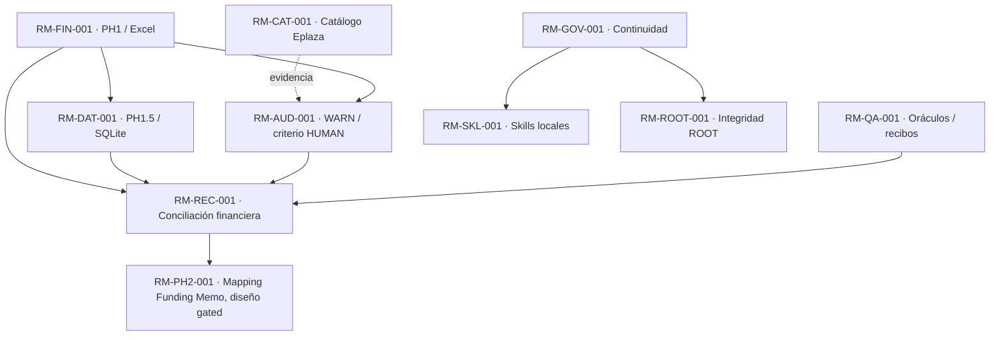

### 6.3 DAG de dependencias, frentes paralelos y bloqueos

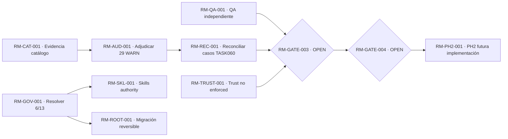

**Nota DAG:** los frentes catálogo/WARN, QA y gobernanza se pueden preparar en paralelo bajo recursos segregados; la flecha `AUD → REC` representa dependencia de decisiones para *cierre final* de casos vinculados, no prohíbe analizar otros casos TASK060 simultáneamente. El diseño conceptual PH2 puede evaluarse separadamente, sin alterar su gate de implementación.

### 6.4 Mapa de gates / autoridad

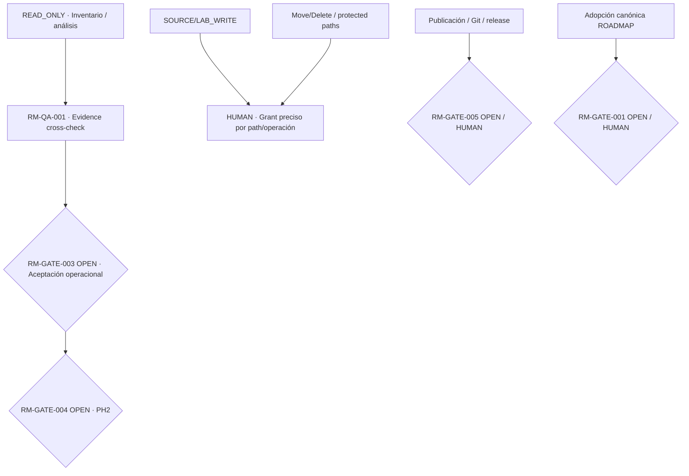

## 7. Phases — Entradas, salidas y permisos

| PHASE_ID | Propósito | Entrada | Salida / evidencia requerida | Frentes | Siguiente |
|---|---|---|---|---|---|
| RM-PH-00 | Preservar baseline aceptada y distinguir estados | Fuentes y objetos físicos | Hashes/origen, aceptación histórica separada de runtime | RM-FIN-001; RM-DAT-001 | RM-PH-01 |
| RM-PH-01 | Resolver criterio y discrepancias contables | TASK079/080 y TASK060 | WARN adjudicados, casos conciliados, oráculos reproducibles | RM-AUD-001, RM-CAT-001, RM-REC-001 | RM-PH-02 |
| RM-PH-02 | Validación operacional y seguridad | PH1/PH1.5 reconciliados; QA | Tests de runtime real, integridad, confianza y decisión HUMAN | RM-QA-001, RM-TRUST-001, RM-GATE-003 | RM-PH-03 solo tras gate |
| RM-PH-03 | Diseño PH2 | Criterios financieros y mapas posibles | Funding Memo line mapping aprobado y estados de cobertura | RM-PH2-001, RM-GATE-004 | RM-PH-04 gated |
| RM-PH-04 | Implementación/evolución futura | Autorización específica | Pruebas/aceptación de outputs, sin doble conteo | RM-PH2-001 | L6 evolutivo |

**Fases no completadas por narrativa:** en este borrador RM-PH-01/02/03/04 permanecen abiertas; RM-PH-00 se trata como baseline histórica, no ratificación de bytes aceptados.

## 8. Milestones — Hitos inspeccionables

| ID | Hito | Estado | Entregable visible/funcional | Evidencia de cierre |
|---|---|---|---|---|
| RM-MS-001 | TASK080 identificadores en AUDIT.PH1 | PASS_REPORTED_LAB | CAM laboratorio; 296 IDs | JUnit, workbook lab, comparación de celdas/estilos y protected 7/7 reportados |
| RM-MS-002 | Revisión 29 WARN | NOT_STARTED_HUMAN_REVIEW | Fichas de WARN, criterio/supersesión | 29 registros con decisión o bloqueo explícito |
| RM-MS-003 | Conciliación de TASK060 | OPEN | Matriz de casos | Oráculo y fuente exacta por caso |
| RM-MS-004 | MORCH 13/13 reconciliado | BLOCKED | Índice/read-plan único | Proveniencia y decisión sobre 6 divergencias |
| RM-MS-005 | Primera migración ROOT | NOT_AUTHORIZED | Lote ≤10 objetos | Snapshot, diff, regresión y rollback |
| RM-MS-006 | RM-GATE-003 | OPEN | Acta de aceptación operacional | Autorización HUMAN formal, no inferida |
| RM-MS-007 | RM-GATE-004 | OPEN | Contrato PH2 aprobado | Autorización HUMAN formal |

## 9. Dependencies — Hard, gate, recurso, informativa

| ID | De → A | Tipo | Consecuencia |
|---|---|---|---|
| RM-DEP-001 | RM-CAT-001 → RM-AUD-001 | INFORMATIONAL | El catálogo ayuda a explicar WARN, pero no impide revisar los demás |
| RM-DEP-002 | RM-AUD-001 → cierre RM-REC-001 | HARD por casos afectados | No cerrar disputas que necesitan criterio HUMAN |
| RM-DEP-003 | RM-REC-001 → RM-GATE-003 | GATE/aceptación | No declarar operación financiera aprobada con errores sin reconciliar |
| RM-DEP-004 | RM-QA-001 + RM-TRUST-001 → RM-GATE-003 | GATE | PASS de laboratorio insuficiente |
| RM-DEP-005 | RM-GATE-004 → implementación RM-PH2-001 | GATE | Diseño read-only puede prepararse antes; implementación prohibida |
| RM-DEP-006 | RM-GOV-001 → modificación MORCH/SKILLS/rutas | HARD + GATE | Manifest drift y ownership deben resolverse |
| RM-DEP-007 | Acceso Excel/SQLite writer compartido | RESOURCE_EXCLUSION | No lanzar escritores concurrentes de objetos protegidos |

## 10. Gates and Authorizations — estado y bloqueo

| Gate | Estado reportado | Autoridad | Prohibición/condición |
|---|---|---|---|
| RM-GATE-001 | OPEN | HUMAN | No reemplazar `ROADMAP_INTEGRAL.md` ni modificar canon por este borrador |
| RM-GATE-002 | CLOSED_INFRASTRUCTURE_ONLY histórico | HUMAN TASK058 | No extenderlo a aceptación financiera operacional |
| RM-GATE-003 | OPEN | HUMAN | No proclamar productive trust; sin grant/issuer confiable y aceptación financiera |
| RM-GATE-004 | OPEN | HUMAN | No implementar PH2 ni remapear finanzas productivas |
| RM-GATE-005 | OPEN | HUMAN | No publicar datos privados ni hacer release |
| ROOT-MUTATION | Por acción | HUMAN/guard efectivo | Deny external writes; no Git add/commit/push/reset/clean, move/delete sin permiso específico |

## 11. Risks and Assumptions

| ID | Riesgo/supuesto | Estado | Mitigación / trigger |
|---|---|---|---|
| RM-RSK-001 | Fuente PDF Eplaza sin fecha de vigencia; 35 códigos solo mayor | MATERIAL | No asumir obsolescencia ni errores; cotejar fecha y extensiones |
| RM-RSK-002 | Descripciones de bancos, ingresos y gastos discrepan | MATERIAL | HUMAN + fuente, clasificación no automática |
| RM-RSK-003 | 32 FAIL/354 NOT_TESTABLE históricos pueden ocultar casos reales | OPEN | Matriz por celda; ningún cierre genérico |
| RM-RSK-004 | Fuente Excel aceptada originalmente ≠ hash físico actual | OPEN_PROVENANCE | Separar integridad TASK069 de aceptación histórica |
| RM-RSK-005 | MORCH 6/13 hashes divergentes y branch/canon distintos | BLOCKED | Reconciliar semántica/autoridad, no actualizar hashes a ciegas |
| RM-RSK-006 | Skills candidatas confundidas con instaladas | OPEN | Registrar status documental vs carga efectiva |
| RM-RSK-007 | Archivos ignorados/untracked 90_RUNTIME no protegidos por Git | MATERIAL | Snapshot de contenido completo y retención, no `git clean` |
| RM-RSK-008 | Nombres de directorio destino colisionan | MATERIAL | Diseño de migración en dos fases con reversión; no mover antes de gate |
| RM-RSK-009 | Fuente QA/Excel no recalculada con Excel Desktop en TASK080 | PENDING_VALIDATION | Validar en fixture Windows y contrastar resultados si es gate exigido |
| RM-RSK-010 | `-.jpg` accidental en ROOT, preservado | INCIDENT_OPEN | Disposición exacta por hash/path bajo autorización |

## 12. Parallelization Plan / Next DAG

**Ejecución sugerida por frentes y dependencias, no calendario:**

| NODE_ID | Owner/recurso propuesto | Complejidad | Ready / dependencia | Acción siguiente segura | Oracle / entrega |
|---|---|---|---|---|---|
| RM-NEXT-001 | HUMAN + MORCH | D3 | READY | Obtener los 29 registros reales de `PH1_AUDIT_DECISIONS.json`/CAM lab y organizar revisión por AUDIT_ID, sin inventar aprobaciones | 29 identidades reconciliadas con texto y origen |
| RM-NEXT-002 | SPECIALIST contable, QA independiente | D5 | READY_READ_ONLY | Reconciliar TASK060 caso por caso, contrastar criterios fuente/Impulsa/Eplaza | 11.325 denominador verificado; 32 FAIL y 354 NOT_TESTABLE auditados |
| RM-NEXT-003 | SPECIALIST continuidad | D4 | READY_READ_ONLY | MORCH 6/13: comparación de versiones, procedencia, contratos y propuesta HUMAN | Matriz exacta con autoridad, hash, decisión por archivo |
| RM-NEXT-004 | SPECIALIST repo/QA | D4 | READY_READ_ONLY | Preparar snapshot integral y lote reversible ROOT, sin ejecutar migración | Allowlist/rollback; cero archivos movidos |
| RM-NEXT-005 | SPECIALIST seguridad | D5 | READY_DESIGN_ONLY | Arquitectura de grants y issuer externo a ejecutor | Threat model, pruebas anti-forgery y gate separado |
| RM-NEXT-006 | Arquitecto financiero | D5 | READY_DESIGN_ONLY | Borrador de contrato PH2 con mapeo trazable y excepciones explícitas | Documento de diseño sin writes financieros |
| RM-NEXT-007 | HUMAN | D3 | BLOCKED_HUMAN_GATE | Adjudicar formalmente vigencia catálogo, códigos nuevos y criterios contables | Decisions con source refs y alcance |

**Recursos:** Codex Desktop SPECIALIST tiene ejecución demostrada en reportes TASK079/080; DSH/RORCH históricamente usado, pero no presupone independencia. Bots externos/subagentes específicos no confirmados y por tanto `NOT_ASSIGNED`. Emplear oráculos determinísticos para sumas, conteos, hashes y referencias.

**Higiene CIRL concurrente:** cada loop compara delta de ROOT, clasificación (`CANONICAL`, `IMMUTABLE_EVIDENCE`, `DERIVED`, `DISPOSABLE`, `UNKNOWN_HOLD`), residuos y referencias; no crea ni destruye material sin gate. No constituye autorización de sincronizar Skills transversales.

## 13. Metrics and Evidence

| Métrica | Baseline reportada | Target / criterio | Fuente y límite |
|---|---|---|---|
| `AUDIT_ID_COVERAGE` | 296/296 LAB | 100 % del alcance real de WARN+INFO sin colisiones | TASK080 report, requiere inspección artefacto |
| `WARN_DECISIONS_REVIEWED` | 0/29 nuevas aprobaciones | 29 revisadas (pueden quedar OPEN con causa) | Registro HUMAN; no exigir aprobar falsamente todo |
| `TASK060_CASE_DISPOSITION` | 10.939 PASS / 32 FAIL / 354 NOT_TESTABLE | Cobertura caso a caso sin falsos PASS | TASK060 historic; reinterpretaciones reportadas requieren evidencia |
| `EPLAZA_SOURCE_MATCH` | 179/214 | Diferencias explicadas, no 214 forzado | TASK079; fecha catálogo desconocida |
| `ROOT_HYGIENE_STATUS` | ANALYSIS_COMPLETE; deuda OPEN | Retención/autoridad y migración segura documentadas | TASK077; 19.242 runtime referidos, no 100 % verificados aquí |
| `UNAUTHORIZED_MUTATIONS` | incidente `-.jpg` previo; TASK080 NONE reported | 0 en cada tarea acotada | Side-effect oracles, no afirmación universal |
| `QA_INDEPENDENCE_LEVEL` | TASK076 I1/I2 aprox. según evidencia, sign-off independiente PENDING | Nivel proporcional a aceptación | No describir como auditoría externa |
| `PRODUCTIVE_TRUST` | NOT_ENFORCED | Enforcement real sujeto a RM-GATE-003 | Diseño + prueba independiente + HUMAN |

## 14. Review Cadence

Revisión por **evento material**: nueva fuente/mes contable, respuesta HUMAN a WARN, modificación de reglas, cambio de branch/HEAD, adopción de Skill, cierre de evidencia, error de regresión, decisión de migración o cambio de gate. No inventar frecuencia semanal/mensual distinta del ciclo real de datos. MR.0 actualiza estado integrado; HO.1 entrega continuidad de sesión; Roadmap cambia estrategia/dependencias; backlog almacena tareas concretas.

## 15. Change Rules

1. Solo **un roadmap activo por ámbito**; este documento es candidato y no reemplaza `ROADMAP_INTEGRAL.md` sin diff, revisión de su contenido real y aceptación HUMAN explícita.
2. Para revisión canónica exigir `source_path`, `sha256_before/after`, autor, fecha, `DECISION_ID`, cambios semánticos por módulo, DAG/diagramas actualizados, dependencias y gate.
3. IDs preexistentes del roadmap real prevalecen; hacer crosswalk antes de promover IDs de este candidato y no reutilizar semántica histórica.
4. No declarar un PASS global si falla un MUST de la SKILL roadmap; los estados de tarea/scope se mantienen ortogonales.
5. No convertir buenas prácticas de Skills candidatas en autoridad de instalación. La aprobación del documento y su descubrimiento runtime son pruebas distintas.
6. No mover `src`, `RAW.INPUT`, `DATA`, `OUTPUT`, `90_RUNTIME` por uniformidad numérica. `AGENTS.md` de ROOT debe mantenerse por descubrimiento. No renumerar SKILLS/MORCH con manifest inconsistente.
7. Los criterios contables HUMAN se registran con alcance, historial de supersesión y relación a `AUDIT_ID`; cambios de fórmulas requieren autorización financiera independiente.

## 16. Next Actions — Inicio simultáneo seguro y secuencia de gates

1. **RM-NEXT-001:** obtener registro real de TASK080 y preparar fichas de los 29 WARN con dato fuente y diferencia exacta; revisar con HUMAN, sin alterar el archivo financiero.
2. **RM-NEXT-002:** auditar TASK060 32 FAIL y 354 NOT_TESTABLE con oráculos y casos realmente ejecutables, en paralelo con 1 cuando no comparten writers.
3. **RM-NEXT-003:** MORCH manifest 6/13, versiones de SKILLS, branch/canon; solucionar contradicciones antes de reubicaciones.
4. **RM-NEXT-004:** snapshot plan de ROOT total y candidatos de LEGACY por lotes ≤10. El primer movimiento `IDEAS → 11_IDEAS` sigue sin autorización ni necesidad inmediata.
5. **RM-NEXT-005:** estudiar issuer productivo independiente. **No abrir RM-GATE-003 por PASS 52/52 de fixtures**.
6. **RM-NEXT-006:** desarrollar contrato de diseño PH2 read-only; no implementación antes de RM-GATE-004.
7. **RM-GATE-001:** comparar este borrador con roadmap canónico local y adjudicar diferencias para eventual adopción.

**Do not do:** Git add/commit/push/reset/clean; delete/move archivos; mutar RAW/OUTPUT/DATA/SQLite; modificar externos; corregir warning sin criterio; inferir vigencia del PDF; declarar instalado candidato; regenerar aceptados; editar canon MORCH; cerrar gates por reporte de agente.

## 17. Decision Register — Hechos HUMAN vs propuesta

| DECISION_ID | Estado/autoridad | Decisión o cuestión | Consecuencia |
|---|---|---|---|
| RM-DEC-001 | HUMAN solicitado | Incorporar ID a cada INFO/WARN; revisar 29 WARN con HUMAN y registrar criterios | TASK080 reporta implementación laboratorio; ningún criterio nuevo aprobado |
| RM-DEC-002 | HUMAN solicitado | Reorganizar carpetas con `CONTINUITY, MEMORY, AI_HISTORY, AGENTS, SKILLS/INTERNAL, TRANSVERSAL` y correlativos | Arquitectura objetivo candidata, no renumeración inmediata |
| RM-DEC-003 | HUMAN / SKILL interna Q&A | Reportes contables acumulados hasta fin de período 23:59 | No interpretar agosto como movimiento exclusivo del mes |
| RM-DEC-004 | OPEN HUMAN | Vigencia/autoridad del catálogo Eplaza y clasificación de 35 source-only | Detalle en TASK079; no inventar aprobación |
| RM-DEC-005 | OPEN HUMAN | Resolver seis desajustes MORCH, branch y Skills candidatas | Bloquea mutación de esas rutas |
| RM-DEC-006 | OPEN HUMAN | Aprobación de RM-GATE-001, 003, 004, 005 | Ninguna se cierra con este documento |
| RM-DEC-007 | PROPUESTA MORCH | Priorizar criterio financiero y verificación antes de limpieza mayor | No es una autorización de trabajo externo/productivo |

## 18. Appendix — SKILLS, procedencia, conflictos, IDs

### A. Matriz de SKILLS efectivamente examinadas

Los archivos listados fueron **leídos de las seis adjunciones reales**. El `Status` procede de sus propios encabezados; el archivo adjunto **no prueba** carga/instalación en la máquina del usuario. Las aplicaciones de controles candidatas aquí son recomendaciones metodológicas, no promoción normativa.

| Archivo adjunto | ID / versión declarada | Estado del propio archivo | Aplicación sin falsear autoridad |
|---|---|---|---|
| `20261016_PSM_SKILLS.md` | PSM v2.0.0 propuesta | `CANDIDATE` | QUALITY>speed, evidencia, requisitos acumulados, G_REQ/G_SOURCE/.../G_AUTH, no falsa finalización |
| `20261017_Trans.ROADMAP_Skills.md` | ROADMAP transversal, versión propuesta 2026-10-17 | `CANDIDATA` no instalada | **Contrato estructural usado para este borrador:** 18 secciones, 4 diagramas, IDs, entregables, complejidad, next DAG, calidad |
| `20261018.1652_SKILLS_NTV.md` | NTV v1.2, header HUMAN_APPROVED_OFFICIAL | `INSTALLED_LOCAL_NIGHTSHIFT_ROOT` declarado; **KTMA no confirmado**. Adenda 1.2 contiene lenguaje de propuesta de promoción | Multipath, typed DAG, ROOT_ONLY, CIRL higiene, separaciones de autoridad; conflicto versionado explícito |
| `SKILLS.QA.TRANSVERSAL(1).md` | SKILL-TRANSVERSAL-QA v0.9 | `CANDIDATE / NOT OFFICIAL / NOT INSTALLED` | Matriz QA, niveles evidencia I0–I4, aceptar por oráculos independientes |
| `SKILLS.QA.KT.MovemAcc.md` | SKILL-INTERNAL-KTMA-QA v0.9 | `CANDIDATE / NOT OFFICIAL / NOT INSTALLED` | ITEM/SUBTITLE_1/SUBTITLE_2/TITLE, integridad de fuentes, 32 casos, PH2 gated |
| `QA_SKILLS.MovemACC_QA.md` | KTMA-QA-DECISION-RECORD v0.1 | `CANDIDATE / NOT OFFICIAL / NOT INSTALLED` | Q&A/QA_Resume; decisiones HUMAN, acumulados al cierre, no inventar respuestas |

**SKILLS referenciadas en bootstrap MORCH pero no disponibles completas en los seis adjuntos:** `MR0_Skiils.md`, `HO.1_Skiils.md`, `AI.DICTIONARY_Skiils.md`, `MORCH_CONTINUITY_TRANSVERSAL_SKILL_v2_READ_EFFICIENT.md`, y el README/política SKILLS local. No declaro haberlas auditado. El informe TASK077 dice que `02_SKILLS/INTERNAL/` tiene dos candidatas, pese a que un bootstrap antiguo la describió vacía: preferir inventario físico reportado reciente, sin adjudicar automáticamente oficialidad.

### B. Conflictos documentales materiales

| CONFLICT_ID | Descripción | Resolución segura hasta HUMAN |
|---|---|---|
| RM-CONF-001 | MORCH `03_DOCS/MANAGEMENT/ROADMAP_INTEGRAL.md` vs petición de `ROADMAP.md` nuevo | Candidato de descarga separado, no segunda fuente canónica |
| RM-CONF-002 | NTV v1.2 header `HUMAN_APPROVED_OFFICIAL` y `INSTALLED_LOCAL_NIGHTSHIFT_ROOT`, adenda marcada propuesta; versión/aprobación exacta no desambiguada para KTMA | Mantener autoridad por ámbito comprobado; no declarar instalación local |
| RM-CONF-003 | QA transversal e interna dicen `CANDIDATE` | No promover por cita ni uso práctico en borrador |
| RM-CONF-004 | 6/13 MORCH manifest y referencias antiguas `00_BOOTSTRAP` | No reescribir hashes/paths a ciegas |
| RM-CONF-005 | Catálogo visual PDF vs filas ITEM/SUBTITLE del mayor | Crosswalk, no reemplazo silencioso |
| RM-CONF-006 | PH1 workbook originalmente aceptado con SHA diferente al objeto protegido TASK069 | Diferenciar aceptación histórica, byte preservation y equivalencia financiera |
| RM-CONF-007 | Fuente Eplaza PDF sin fecha, 35 códigos en mayor ausentes | Reconocimiento de version drift posible, no error confirmado |
| RM-CONF-008 | `02_SKILLS` físico vs arquitectura futura `05_SKILLS` con colisión `05_SRC` | HOLD hasta reconciliación de referencias/manifest |

### C. Complejidad ordenada D5 → D1 y elección de recursos

| TASK_ID | MODULE_ID | Dificultad | Justificación | SPECIALIST / alternativa | Dependencia / gate |
|---|---|---|---|---|---|
| RM-NEXT-002 | RM-REC-001 | D5 | Error de consolidación y evidencia por celda, 32 FAIL y 354 NOT_TESTABLE | Especialista financiero + oráculo determinístico / análisis acotado | Inputs originales protegidos |
| RM-NEXT-005 | RM-TRUST-001 | D5 | Confianza de firma y bypass de ejecutor, riesgo productivo | Seguridad independiente / diseño read-only | RM-GATE-003 |
| RM-NEXT-006 | RM-PH2-001 | D5 | Mapeo financiero multi-entidad, UF, signos, saldos vs flujos | Especialista contable/arquitectura / diseño | RM-GATE-004 para implementación |
| RM-NEXT-003 | RM-GOV-001 | D4 | Canon, hashes divergentes, autoridad Skills/continuidad | Especialista governance / verificación de deltas | HUMAN para decisiones materiales |
| RM-NEXT-004 | RM-ROOT-001 | D4 | 19k artefactos runtime, colisiones y referencias dinámicas | Especialista repo / inventario sin mutar | HUMAN para mover/borrar |
| RM-NEXT-001 | RM-AUD-001 | D3 | Semántica de 29 WARN y registro de criterios | HUMAN + asistente contable / matriz estructurada | Decisiones HUMAN individuales |

### D. Versiones, hashes y límites de prueba

- **Documentos adjuntos:** seis SKILLS examinadas directamente. Sus contenidos no equivalen a políticas efectivamente cargadas en KTMA.
- **TASK079/TASK080:** datos transmitidos por HUMAN del informe Codex; no inspección directa del CAM RUN_002, decision JSON ni `JUnit` por este autor.
- **TASK077:** análisis Codex transmitido por HUMAN; sin acceso directo al inventario físico ni al directorio Windows actual.
- **Roadmap canónico real:** **NO ACCESIBLE íntegramente aquí**; no se realizó diff semántico antes/después con `ROADMAP_INTEGRAL.md`.
- **SHA del presente borrador:** calcular y registrar al momento de adopción; no insertar self-hash circular.

### E. IDs y registro deprecados

Este borrador propone `RM-FIN-001`, `RM-DAT-001`, etc. y reutiliza literalmente los **gates RM-GATE-001/003/004/005 conocidos**. No se ha comprobado si el Roadmap canónico contiene IDs equivalentes que exijan un crosswalk previo. Por lo tanto, *ningún nuevo ID se promueve a histórico oficial por este documento*. No se declara ningún ID canónico anterior depreciado sin leer el original.

### F. Quality gate del propio borrador

| Gate | Resultado | Motivo |
|---|---|---|
| G_REQ | PARTIAL | Se revisaron 6 adjuntos, no todas las SKILLS efectivamente existentes en el ROOT |
| G_SOURCE | PARTIAL | Informes de Codex aportados; roadmap canónico local no leído |
| G_FUNCTION | PASS_DOCUMENT_STRUCTURE | Módulos, fases, gates, siguiente DAG y salidas verificables incluidos |
| G_VISUAL | PARTIAL | Mermaid presente, renderizador externo no comprobado aquí |
| G_REGRESSION | NOT_RUN | No se modificó repositorio, tampoco hay diff contra canónico |
| G_EVIDENCE | PARTIAL | Distinción REPORTED_ONLY vs fuente inspeccionada |
| G_USER | PENDING_HUMAN | No se presume aceptación por descarga |
| G_AUTH | PASS_DOCUMENT_SCOPE | Solo archivo candidato separado, sin cambios en KTMA |

**Veredicto:** `DRAFT/PARTIAL`, **NO** `FINAL_PASS`, y **NO** reemplazo autorizado del roadmap canónico. Este resultado es deliberadamente distinto de la entrega anterior, que afirmó una revisión no realizada.
