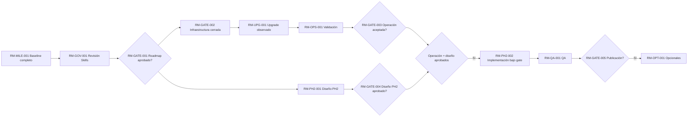
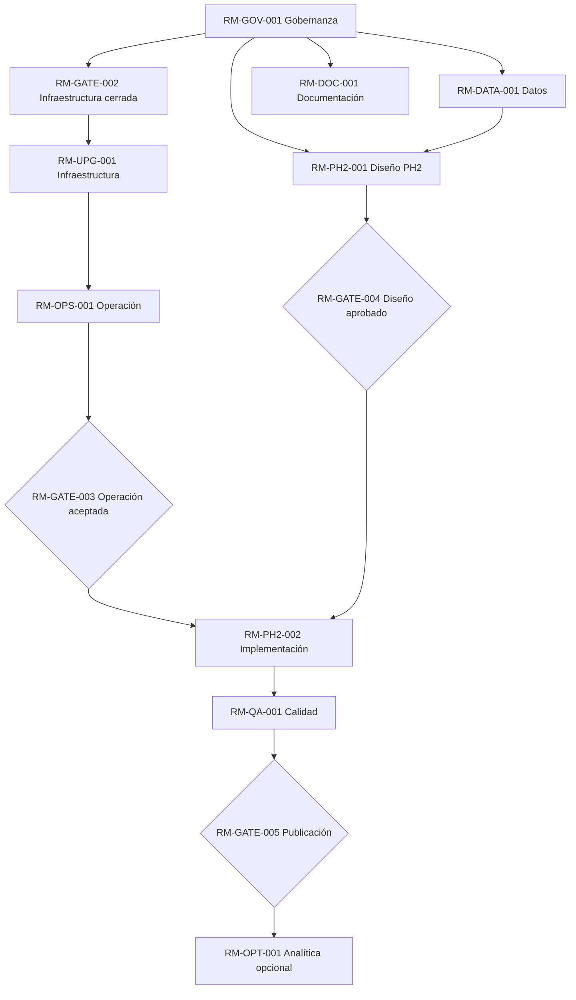
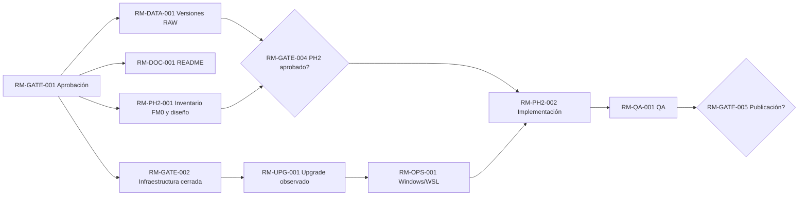
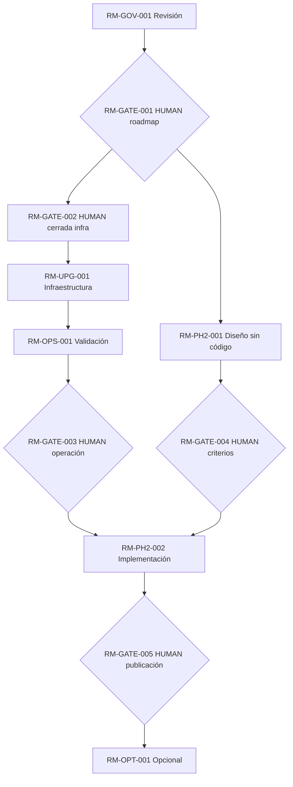

# ROADMAP — KT.MovemAcc | borrador formal corregido

**Versión:** RECONCILED-TASK060 · **Fecha:** 2026-10-19 · **Roadmap activo:** CANÓNICO LOCAL, APROBACIÓN FORMAL PENDIENTE · **Estado:** `RM-GATE-001=OPEN`; TASK054 preparó el candidato, TASK055 lo adoptó localmente sin publicación Git y TASK060 reconcilió la continuidad.
**Skills aplicadas:** `20261017_Trans.ROADMAP_Skills.md`, `20261016_PSM_SKILLS.md`, `AI.DICTIONARY_Skiils.md`.

## 1. North Star
Convertir dos mayores contables mensuales privados (Eplaza e Impulsa) en datos conciliados y auditables, con salida Excel aprobada, persistencia SQLite y posterior Funding Memo (FM), trazando cada cifra a fuente, criterio y aprobación humana, sin divulgación financiera.

## 2. Current State
PH1 y PH1.5 aceptadas y publicadas en `main`/`e948336cd790d998e4af6243d00246989404897e`. SQLite V1, período 2026.08. TASK056/TASK057 verificaron la arquitectura Windows financiera + WSL2 para DSH/OmniRoute; HUMAN cerró `RM-GATE-002` sólo para ese alcance de infraestructura en TASK058. `RM-GATE-003` sigue abierto; PH2 no está implementada y FM0/mapeos no están aprobados.

## 3. Target State
Flujo mensual repetible: RAW (XLSB) → ingesta → reglas versionadas y jerarquía → SQLite con linaje/conciliación → PH1 Excel → PH2 Funding Memo según criterios aprobados → auditoría y reportabilidad opcional. Ninguna fuente corregida reemplaza datos históricos sin política aprobada.

## 4. Strategy
Mantener la arquitectura aprobada Windows financiera + WSL2 para agentes sin instalaciones duplicadas; completar pruebas financieras aisladas; definir PH2 y versionado RAW sólo en frentes elegibles; implementar PH2 únicamente tras sus gates; mantener QA y publicación independientes. Evitar PostgreSQL/dbt/Airflow/Power BI sin justificación operativa específica.

## 5. Module Catalog (IDs estables antes de diagramas)
| Module ID | Name | Type | Owner | Status | Entry criteria | Exit criteria / evidence | Dependencies | Gates | Risks / Next |
|---|---|---|---|---|---|---|---|---|---|
| RM-GOV-001 | Gestión conforme a Skills | workstream | MORCH/HUMAN | DRAFT | Skills verificadas | MR.0/Roadmap/HO.1 aceptados | Ninguna | RM-GATE-001 | Incumplimiento; revisar |
| RM-GATE-001 | Aprobación roadmap | gate | HUMAN | OPEN | Borradores completos | Aprobación explícita | RM-GOV-001 | HUMAN | No inferir aprobación |
| RM-UPG-001 | Upgrade OmniRoute/DSH | phase | HUMAN/operador | COMPLETE_OBSERVED | Actualización ejecutada previamente por HUMAN | Versiones y health checks TASK056/TASK057; no instalación Windows requerida | RM-GATE-002 | RM-GATE-002 | No reinstalar |
| RM-GATE-002 | Compatibilidad/autoridad infraestructura | gate | HUMAN | CLOSED | TASK056/TASK057 + autorización TASK058 | `CLOSED_INFRASTRUCTURE_ONLY`; DSH/OmniRoute permanecen WSL2-only | RM-GOV-001 | HUMAN | No implica aceptación financiera |
| RM-OPS-001 | Validación Windows/WSL | workstream | RORCH/operador | NOT_READY | Infraestructura estable | Resolver o aceptar explícitamente 32 diferencias Excel↔SQLite identificadas por TASK060 | RM-UPG-001 | RM-GATE-003 | Separar evidencia de decisión HUMAN |
| RM-GATE-003 | Aceptación operativa | gate | HUMAN | OPEN | Pruebas reales | Evidencia revisada | RM-OPS-001 | HUMAN | No PASS por reporte antiguo |
| RM-DOC-001 | README y operación mensual | workstream | RORCH | PROPOSED | RM-GATE-001 | Runbook + README sin contradicción | RM-GATE-001 | Gate de modificación | Deuda documental |
| RM-DATA-001 | Política versiones RAW | workstream | Contabilidad/HUMAN | PROPOSED | MR.0 | Política REJECT/NEW_VERSION aprobada | RM-GATE-001 | HUMAN | Pérdida de historia |
| RM-PH2-001 | Diseño Funding Memo | workstream | HUMAN/contabilidad | PROPOSED | Inventario FM0 | Mapeos, reglas, diferencias y tolerancias aprobados | RM-GATE-001, RM-DATA-001 (si afecta versionado) | RM-GATE-004 | Falta de criterios |
| RM-GATE-004 | Aprobación diseño PH2 | gate | HUMAN | OPEN | FM0 y reglas | Matriz y UAT definidos/aceptados | RM-PH2-001 | HUMAN | Nunca inferir mapeos |
| RM-PH2-002 | Implementación PH2 | phase | RORCH | BLOCKED | Gate diseño + operación | Excel PH2 y trazabilidad aceptados | RM-GATE-003, RM-GATE-004 | RM-GATE-005 | Riesgo financiero |
| RM-QA-001 | QA/regresión end-to-end | workstream | Especialista QA | PROPOSED | Entorno de prueba | Pruebas/conciliación sin alterar baseline | RM-OPS-001, RM-PH2-002 | RM-GATE-005 | Deriva PH1 |
| RM-GATE-005 | Aceptación/publicación | gate | HUMAN | OPEN | QA, privacidad y diff | Autorización de publicación separada | RM-QA-001 | HUMAN | Fuga de datos |
| RM-OPT-001 | Reporting y automatización | phase | HUMAN | OPTIONAL | Producto estable | Caso de negocio y decisión | RM-GATE-005 | HUMAN | Complejidad no justificada |
| RM-MILE-001 | Baseline PH1/PH1.5 | milestone | HUMAN | COMPLETE | Aceptación | GitHub `e948336...` | Ninguna | Cerrado | No reabrir sin defecto |
| RM-MILE-002 | Desarrollo reanudable | milestone | HUMAN | BLOCKED | Gate operaciones y PH2 | Inicio autorizado | RM-GATE-003, RM-GATE-004 | HUMAN | Mantener pausa |
| RM-RISK-001 | Frontera público/privado | risk | HUMAN/RORCH | ACTIVE | Cualquier publicación | Allowlist exacta + revisión privacidad | Todas | RM-GATE-005 | RAW/SQLite/Excel privado |
| RM-DEC-001 | Estrategia RAW | decision | HUMAN | OPEN | Alternativas evaluadas | REJECT/NEW_VERSION decidido | RM-DATA-001 | HUMAN | Afecta PH2 |

## 6. Diagrams
### 6.1 Phase / timeline (orden lógico, no fechas inventadas)

### 6.2 Module map

### 6.3 Dependency DAG / paralelización

### 6.4 Gates / authorization map

**Lectura:** flechas representan dependencias, no autorizaciones implícitas. Todos los nodos en `OPEN`/`BLOCKED` requieren evidencia y gates expresos.

## 7. Phases
| ID | Fase | Estado | Trabajo | Salida |
|---|---|---|---|---|
| RM-GOV-001 | F0 Revisión | DRAFT | Skills, MR.0, roadmap, HO.1 | Aprobación HUMAN |
| RM-UPG-001 | F1 Infraestructura | COMPLETE_OBSERVED | Versiones y health checks TASK056/TASK057; WSL2-only | RM-GATE-002 cerrado sólo infraestructura |
| RM-OPS-001 | F2 Operación | NOT_READY | Matriz privada TASK060: 10.939 PASS, 32 FAIL y 354 NOT_TESTABLE | Resolver diferencias Excel↔SQLite antes de decisión HUMAN RM-GATE-003 |
| RM-DATA-001 | F3 Datos | PROPOSED | Diseño REJECT/NEW_VERSION | Política aprobada |
| RM-PH2-001 | F4 Diseño PH2 | PROPOSED | FM0, mapeos, criterios, auditoría | Diseño firmado |
| RM-PH2-002 | F5 Implementación PH2 | BLOCKED | SQLite read-only → FM Excel, QA | Aceptación |
| RM-OPT-001 | F6 Opcional | OPTIONAL | BI/automatización | Caso de negocio |

## 8. Milestones
| ID | Hito | Estado | Evidencia |
|---|---|---|---|
| RM-MILE-001 | Baseline PH1/PH1.5 | COMPLETE | Commit `e948336...` |
| RM-MILE-002 | Reanudación autorizada | BLOCKED | HUMAN + gates operaciones/diseño |

## 9. Dependencies
`RM-GATE-001 → RM-GATE-002 → RM-UPG-001 → RM-OPS-001 → RM-GATE-003` es la ruta de infraestructura; `RM-DATA-001 + RM-PH2-001 → RM-GATE-004` es la ruta contable. `RM-GATE-003` y `RM-GATE-004` deben estar cerrados antes de `RM-PH2-002`. README y diseño de QA pueden avanzar independientemente solo dentro de su autorización.

## 10. Gates and Authorizations
| ID | Quién autoriza | Entrada | Salida |
|---|---|---|---|
| RM-GATE-001 | HUMAN | Roadmap, MR.0 y HO.1 conformes | Plan aprobado |
| RM-GATE-002 | HUMAN | TASK056/TASK057 + aprobación TASK058 | `CLOSED_INFRASTRUCTURE_ONLY`; no aceptación financiera |
| RM-GATE-003 | HUMAN | Windows/WSL, fresh clone, checksum, integridad | Operación habilitada |
| RM-GATE-004 | HUMAN | FM0, mapping, fórmulas, tolerancias, auditoría | PH2 diseñada |
| RM-GATE-005 | HUMAN | QA + privacidad + allowlist | Publicación permitida |

## 11. Risks and Assumptions
`RM-RISK-001`: publicación accidental de información privada (P0). Otros riesgos: REJECT limita correcciones, PH1/PH1.5 comparten parser y la aceptación financiera completa sigue pendiente en `RM-GATE-003`. Supuestos no validados: capacidad del usuario para entregar FM0 actualizado y aceptación HUMAN de la reproducción financiera.

## 12. Parallelization Plan / DAG
Tras aprobación `RM-GATE-001`, pueden avanzar preparación documental `RM-DOC-001`, diseño de gobernanza `RM-DATA-001` y taller conceptual `RM-PH2-001`. `RM-GATE-002` ya está cerrado sólo para infraestructura; la aceptación financiera continúa por `RM-OPS-001 -> RM-GATE-003`. PH2 sigue bloqueada por `RM-GATE-003` y `RM-GATE-004`. No forzar secuencia entre análisis independientes.

## 13. Metrics and Evidence
| ID | Indicador de éxito | Evidencia requerida |
|---|---|---|
| RM-GOV-001 | 100% aceptación Skills | Checklist firmado/revisado |
| RM-UPG-001 | Rollback documentado + smoke tests PASS | Versiones, logs, hash y restauración |
| RM-OPS-001 | Windows/WSL reproducibles | Fresh clone y resultados, sin modificar aceptados |
| RM-DATA-001 | Política fuente aprobada | Registro HUMAN + tests definidos |
| RM-PH2-001 | 100% líneas FM mapeadas o excepción | Matriz de criterios con firmas |
| RM-QA-001 | 0 diferencias materiales inexplicadas | Auditoría trazable |
| RM-RISK-001 | 0 binarios financieros publicados | Allowlist y verificación del commit |

## 14. Review Cadence
Revisión en cada gate/hito y ante cambios de RAW, requisitos PH2, versiones de herramientas o incidentes; no se establece calendario fijo sin decisión HUMAN.

## 15. Change Rules
Una única versión activa tras aprobación; borradores no sustituyen fuentes. Todo cambio debe identificar ID afectado, motivación, evidencia, impacto DAG, riesgos, aprobador y nueva versión. IDs no se reutilizan; deprecados permanecen en apéndice. Commits requieren gate separado.

## 16. Next Actions
1. `RM-GOV-001`: HUMAN revisa y acepta/rechaza borradores de MR.0, Roadmap, HO.1.
2. `RM-GATE-001`: aprobar roadmap formal, con decisiones abiertas registradas.
3. `RM-OPS-001`: revisar y resolver las 32 diferencias Excel↔SQLite preservadas por TASK060; no recomendar cierre de `RM-GATE-003` mientras permanezcan.
4. Mantener PH2 bloqueada hasta cierre separado de `RM-GATE-003` y `RM-GATE-004`.

## 17. Decision Register
| ID | Decisión | Estado | Dueño |
|---|---|---|---|
| RM-DEC-001 | REJECT vs NEW_VERSION | OPEN | HUMAN |
| RM-GATE-001 | Aprobar roadmap | OPEN | HUMAN |
| RM-GATE-002 | Infraestructura Windows/WSL2 | CLOSED_INFRASTRUCTURE_ONLY | HUMAN TASK058 |
| RM-GATE-003 | Windows operacional | OPEN | HUMAN |
| RM-GATE-004 | FM0/mapping/tolerancias | OPEN | HUMAN |
| RM-GATE-005 | Publicación | OPEN | HUMAN |
Otras decisiones RD-001..RD-008 quedan documentadas en `ROADMAP_DECISIONS.md`; ninguna se aprueba implícitamente.

## 18. Appendix / Deprecated IDs
Los identificadores anteriores `R0`, `U1`, `C1` de `ROADMAP_DAG.md` son **aliases históricos no canónicos**, conservados para trazabilidad; no reutilizar. Este documento no modifica aquel archivo ni adopta sus gates por defecto. Referencias: `MR0_INTEGRATED_REVIEW.md`, `HO1_ROADMAP_INPUTS.md`, `ROADMAP_DAG.md`, `ROADMAP_DECISIONS.md`, Skills transversales.

### Acceptance checklist / QA
| ID | Requisito | Estado |
|---|---|---|
| RM-GOV-001 | Versión, North Star, estado actual, objetivo y estrategia | PASS_DOCUMENTAL |
| RM-GOV-001 | Catálogo con IDs y todas las tablas/diagramas identificados | PASS_DOCUMENTAL |
| RM-GOV-001 | Cuatro diagramas, DAG, gates y paralelización | PASS_DOCUMENTAL |
| RM-GOV-001 | Métricas, cambios, cadencia, registro, siguiente DAG | PASS_DOCUMENTAL |
| RM-GATE-001 | Aprobación HUMAN y publicación | PENDING |

**Prohibiciones:** no editar RAW, SQLite, Excel PH1 aceptado; no implementar PH2; no actualizar infra ni usar Git mutante sin autorización; no eliminar borradores rechazados ni crear BATON. Glosario: WSL = Windows Subsystem for Linux; DAG = grafo acíclico dirigido; FM0 = versión cero de Funding Memo; UAT = pruebas de aceptación de usuario; QA = aseguramiento de calidad.

